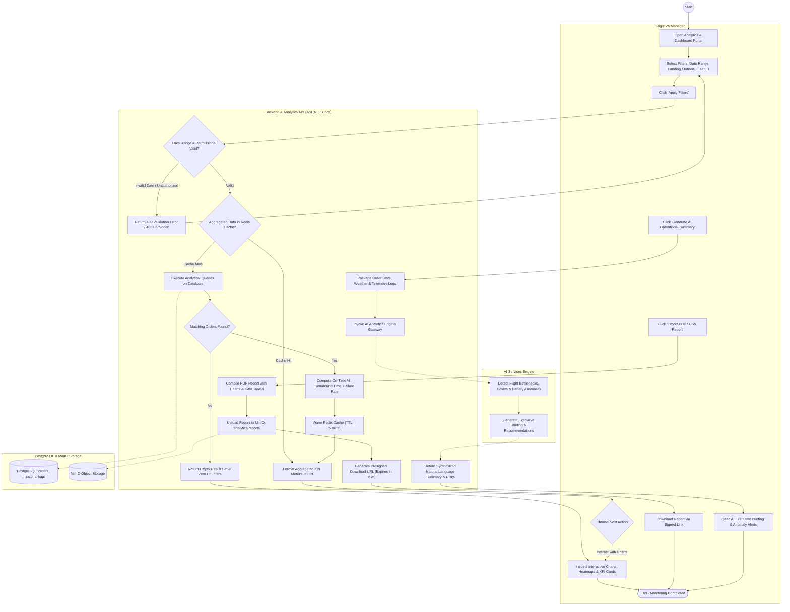
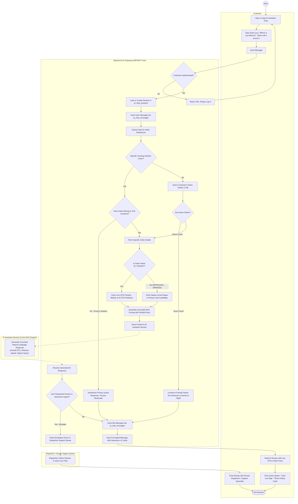

# Activity Diagrams - Analytics Dashboard & Customer AI Assistant
**Sprint:** Sprint 1-2  
**Parent Ticket:** [LA-194](https://hungndemail.atlassian.net/browse/LA-194)  
**Ticket:** [LA-215](https://hungndemail.atlassian.net/browse/LA-215) - Activity diagram for analytics and the AI assistant  
**Task Description:** Model how a manager views the dashboard and how a customer asks the AI assistant about an order.  
**Use Cases Covered:** [UC-09, UC-19, UC-20](../requirements/use-cases.md)  
**Entities Involved:** `ai_chat_sessions`, `ai_chat_messages`, `ai_eta_predictions`, `delivery_orders`, `flight_missions`, `flight_telemetry_logs`, `landing_stations`, `drones`  

---

## 1. Overview & Context

This specification models the two complementary intelligent workflows defined in **LA-215**:
1. **Workflow 1: Manager Views the Dashboard (UC-19, UC-20)**
   - Role-based operational monitoring by the Logistics Manager.
   - Dynamic metric filtering (date ranges, landing station hubs, drone models, delivery status).
   - Real-time caching, KPI calculation (success rate, average flight time, drone utilization, station turnaround), and report export to MinIO.
   - AI-driven operational synthesis and anomaly highlighting.
2. **Workflow 2: Customer Asks the AI Assistant About an Order (UC-09, UC-20)**
   - Conversational AI in-app experience for the Customer.
   - Strict data privacy: Customers can only query their own orders and packages.
   - Real-time context grounding: Augments prompt with live drone telemetry, flight status (`IN_TRANSIT`, `ARRIVED`), and AI ETA predictions.
   - Handling exceptions: No active orders, privacy denial on foreign tracking numbers, delayed flights due to weather, and seamless escalation to human dispatchers.

---

## 2. Actors & System Swimlanes

| Actor / Component | Type | Responsibility in Workflow |
|---|---|---|
| **Logistics Manager** | Human Actor | Applies filters, reviews operational KPIs, inspects charts, and requests exports / AI summaries. |
| **Customer** | Human Actor | Interacts with in-app AI chat, queries active orders, asks about ETAs, delays, or delivery policies. |
| **Client UI** | System Component | Web Portal (ReactJS) for Manager Dashboard / Mobile App (Flutter) for Customer AI Chat. |
| **Backend & Analytics API** | System Component | ASP.NET Core API (`/api/analytics`, `/api/ai/chat`), authentication, authorization, caching layer. |
| **Database & Object Storage** | System Component | PostgreSQL (orders, missions, telemetry, chat logs) and MinIO (exported PDF/CSV reports). |
| **AI Assistant & Analytics Engine** | System Component | LLM, RAG retriever, ETA prediction model, and telemetry anomaly analyzer. |
| **Dispatcher / Human Support** | Human Actor | Receives escalated chat sessions when customer requests a human or issue complexity exceeds AI threshold. |

---

## 3. Workflow 1: Logistics Manager Views the Dashboard (UC-19, UC-20)

### Specification
* **Actors:** Logistics Manager, Client Web Portal, Backend API, PostgreSQL / Redis, AI Engine, MinIO.
* **Preconditions:** Logistics Manager is logged in with `LOGISTICS_MANAGER` or `SYSTEM_ADMIN` role.
* **Postconditions:** Operational KPIs, charts, and maps are rendered; optional PDF/CSV report generated or AI executive summary generated.

### Detailed Flow & Decision Rules:
1. Manager accesses `/dashboard/analytics` and specifies filters:
   - Date range (today, last 7 days, custom month).
   - Target landing stations (all or specific hub).
   - Drone fleet selection and order status filters.
2. System checks date validity and user authorization.
3. System checks Redis cache for aggregated metrics of the selected filter key.
4. *Cache Miss:* System queries PostgreSQL read-replica:
   - Aggregates: Total Orders, On-Time Delivery Rate (`DELIVERED` within ETA / Total), Mean Flight Duration, Failure Breakdown (weather, battery abort, timeout).
   - Drone Fleet Metrics: Active vs Idle vs Charging vs Maintenance drones.
   - Station Metrics: Slot occupancy rate and pad turnaround time.
5. If result set is empty $\rightarrow$ Display "No data found for selected criteria" with filter reset button.
6. *Manager Action 1 - View Charts:* Interactive graphs (throughput by hour, heatmaps) rendered in UI.
7. *Manager Action 2 - Export Report:* System compiles PDF/CSV, persists in MinIO bucket `analytics-reports`, and returns presigned download URL.
8. *Manager Action 3 - Request AI Summary:* AI Engine synthesizes daily operational patterns, identifies bottlenecks, and highlights flight anomalies.

### UML Activity Diagram: Manager Views the Dashboard

---

## 4. Workflow 2: Customer Asks the AI Assistant About an Order (UC-09, UC-20)

### Specification
* **Actors:** Customer, Mobile App / Web Client, AI Gateway Backend, Telemetry & Order Service, AI Assistant (LLM/RAG), Human Dispatcher.
* **Preconditions:** Customer is logged in to their account.
* **Postconditions:** AI retrieves customer's order context, responds with grounded delivery information (status, ETA, live drone position, delay reasons), saves chat history, or escalates to human support.

### Detailed Flow & Decision Rules:
1. Customer opens in-app AI chat and submits a message (e.g. *"When will my order arrive?"*, *"Where is drone DR-02 right now?"*).
2. Backend validates authentication and loads active chat session from `ai_chat_sessions`.
3. System checks intent and extracts order reference if provided:
   - **Privacy Guard Check:** If customer mentions a specific tracking number, verify `delivery_orders.customer_id == authenticated_user_id`.
   - *Security Branch (Access Denied):* If tracking number belongs to another user, AI responds: *"For privacy reasons, you can only view status for orders placed by your account."*
4. **Context Grounding Retrieval:**
   - If no specific order mentioned, query active orders for this customer (`status IN ('APPROVED', 'READY_FOR_TAKEOFF', 'IN_TRANSIT', 'ARRIVED')`).
   - *Branch A (No Active Orders):* AI responds: *"You currently have no active deliveries in transit. Would you like to check past deliveries or help with creating an order?"*
   - *Branch B (Active Order Found):*
     - If `IN_TRANSIT`: Fetch current drone coordinates (`flight_telemetry_logs`), destination station, and latest AI ETA prediction (`ai_eta_predictions`).
     - If delayed: Retrieve flight incident flags (e.g. strong wind, holding pattern).
5. **Prompt Synthesis & LLM Generation:**
   - Prompt includes system instructions (role: Drone Logistics Assistant), verified order facts, ETA timestamp, and secure code instructions.
6. **Confidence & Sentiment Evaluation:**
   - If user expresses anger/frustration or explicitly asks *"I want to speak to a person"* $\rightarrow$ System triggers escalation: flags session, alerts human support / Dispatcher via SignalR, and hands over chat.
   - If normal $\rightarrow$ AI generates friendly, concise response with quick action cards (e.g. *"Track Live Drone on Map"*, *"View Pickup QR"*).
7. Persist user message and AI response into `ai_chat_messages` table.

### UML Activity Diagram: Customer Asks AI Assistant About Order

---

## 5. Traceability Matrix & Requirements Alignment

| Use Case | Process Name | Primary Actors | Key Decisions Modeled | Requirements |
|---|---|---|---|---|
| **UC-19** | View dashboard and reports | Logistics Manager | Date filter validation, Redis cache hit/miss, empty state, export PDF/CSV via MinIO | FR-28, FR-29 |
| **UC-20** | View ETA and delivery summary | Logistics Manager, Customer | AI operational pattern summarization, anomaly detection, live flight ETA calculation | FR-30, FR-31 |
| **UC-09** | Chat with AI assistant | Customer, Support | Privacy ownership verification, active flight telemetry grounding, escalation to human | FR-32, FR-33 |

---

## 6. Review Notes for Sprint 1-2 Delivery

1. **Strict Data Privacy Shield in AI Chat:** Prompt injection or user queries attempting to inspect another user's tracking number are blocked at the application query layer before reaching the LLM context.
2. **Telemetry Freshness:** The AI service queries the latest telemetry log from `flight_telemetry_logs` (recorded every 2 seconds during flight missions) to provide meter-accurate remaining distances.
3. **Dashboard Caching Strategy:** Aggregated statistics are cached in Redis with a 5-minute sliding window; mutations such as order completion (`DELIVERED`) or mission aborts (`FAILED`) trigger cache invalidation.
