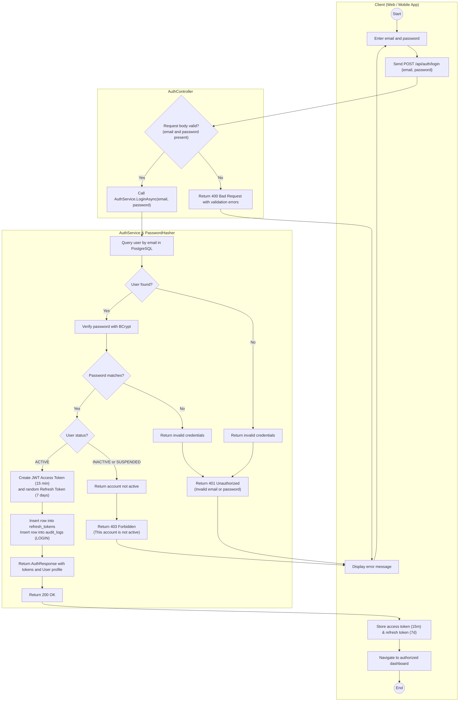
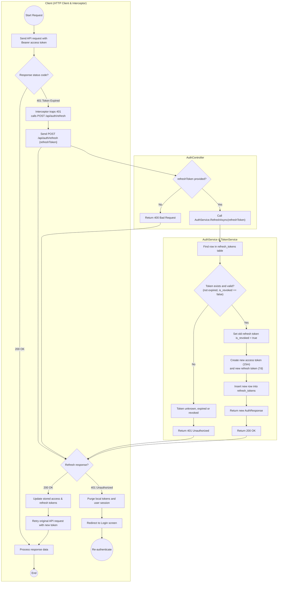
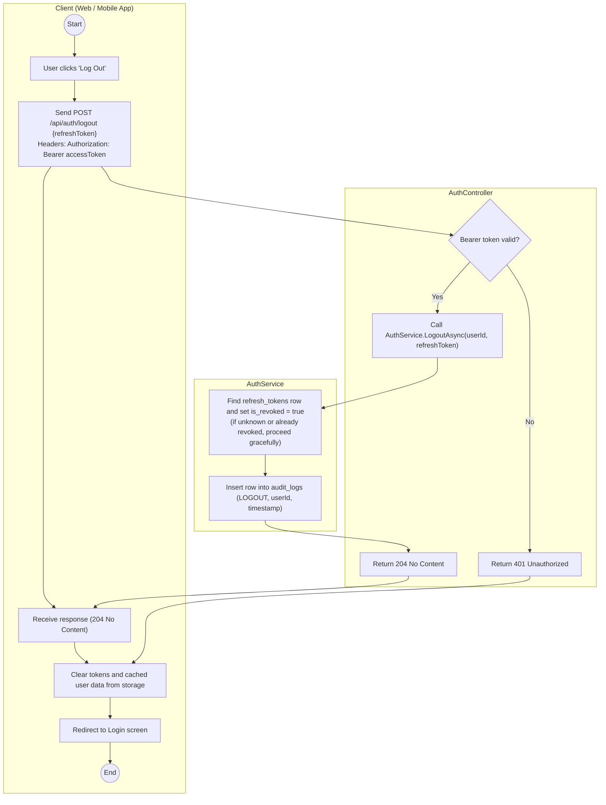
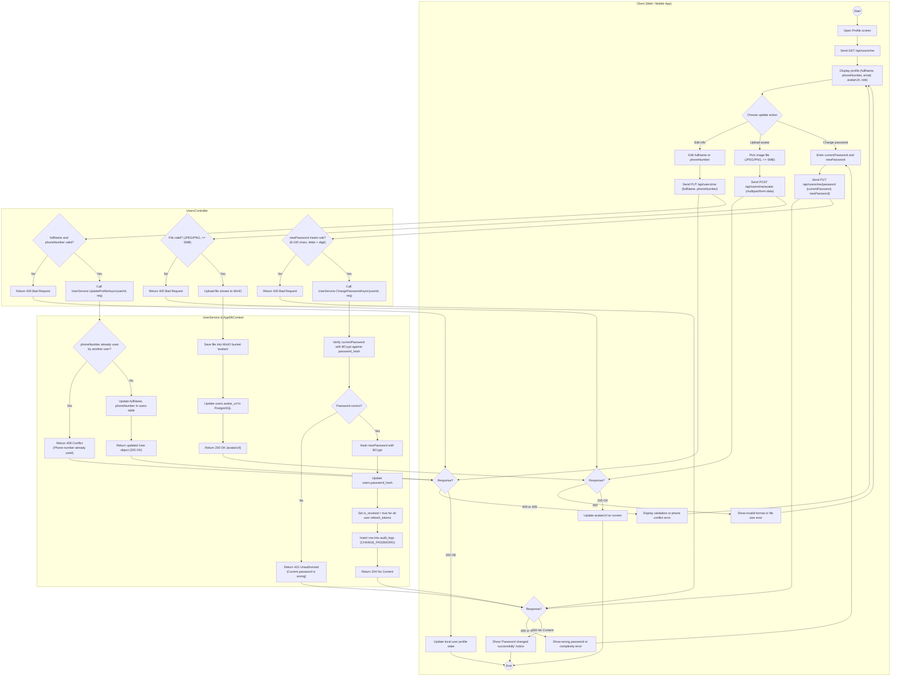

# LA-213: Activity Diagram for Authentication and Profile
**Sprint:** Sprint 1-2  
**Parent Ticket:** [LA-194](https://hungndemail.atlassian.net/browse/LA-194)  
**Ticket:** [LA-213](https://hungndemail.atlassian.net/browse/LA-213) - Activity diagram for authentication and profile  
**Task Description:** Model login, token refresh, logout and profile update with the decisions for invalid credentials and expired tokens.  
**Use Cases Covered:** [UC-01, UC-02](../requirements/use-cases.md)  
**API Contract:** [auth-api.md](../api/auth-api.md)  
**Sequence Diagram:** [sequence-auth.md](sequence-auth.md)  
**Entities:** `users`, `roles`, `refresh_tokens`, `audit_logs`  

---

## 1. Overview & Architectural Scope

This document specifies the UML Activity Diagrams with dedicated actor swimlanes for authentication and profile management in the **SmartDroneDelivery** platform.

The models strictly follow the merged API contract ([auth-api.md](../api/auth-api.md)), sequence diagrams ([sequence-auth.md](sequence-auth.md)), and PostgreSQL entity definitions ([erd.md](../architecture/erd.md)):
- Base path prefix is `/api`.
- Standard endpoints: `POST /api/auth/login`, `POST /api/auth/refresh`, `POST /api/auth/logout`, `GET /api/users/me`, `PUT /api/users/me`, `PUT /api/users/me/password`, `POST /api/users/me/avatar`.
- Error responses follow RFC 7807 problem details (400 validation, 401 unauthorized, 403 forbidden, 409 conflict).

---

## 2. Actors & System Swimlanes

| Swimlane | Component / Actor | Responsibilities |
|---|---|---|
| **Client Lane** | Web Portal (ReactJS) / Mobile App (Flutter) | Collects credentials, traps 401 expired tokens, manages local tokens, calls refresh endpoint, and updates UI state. |
| **AuthController / UserController** | ASP.NET Core Controllers (`/api/auth/*`, `/api/users/me/*`) | Request body validation, route handling, HTTP status mapping, RFC 7807 problem responses. |
| **AuthService / UserService** | Business Logic Services (`SmartDroneDelivery.Api`) | Password hashing/verification via BCrypt, JWT generation, token rotation, and profile updates. |
| **Database & Storage** | PostgreSQL (`AppDbContext`) & MinIO | Entity persistence in `users`, `roles`, `refresh_tokens`, `audit_logs`, and avatar object storage. |

---

## 3. Detailed UML Activity Diagrams

---

### Process 1: User Login (with Invalid Credentials Decision)

#### Specification
- **Endpoint:** `POST /api/auth/login`
- **Use Case:** `UC-01`
- **Preconditions:** User has a registered account.
- **Postconditions:** User authenticated, issued JWT Access Token (15-min lifetime) and Refresh Token (7-day lifetime), row inserted into `refresh_tokens` and `audit_logs`.

#### Decision Logic:
1. **Request Body Validation:** If email or password is missing $\rightarrow$ Returns `400 Bad Request`.
2. **User Lookup by Email:** Query `users` by email. If not found $\rightarrow$ Returns `401 Unauthorized` ("Invalid email or password.").
3. **Password Hash Verification:** Verify with BCrypt. If password does not match $\rightarrow$ Returns `401 Unauthorized` ("Invalid email or password.").
4. **Account Status Check:**
   - If `status` is `INACTIVE` or `SUSPENDED` $\rightarrow$ Returns `403 Forbidden` ("This account is not active.").
   - If `status` is `ACTIVE` $\rightarrow$ Proceeds to token generation.
5. **Token Generation & Logging:**
   - Generate access token (JWT, 15 minutes) with claims `sub`, `email`, `role`, `exp`.
   - Generate random cryptographically secure refresh token (7 days).
   - Insert row into `refresh_tokens` (`is_revoked = false`).
   - Insert row into `audit_logs` with action `LOGIN`.
   - Return `200 OK` with `AuthResponse`.

#### UML Activity Diagram: Login Process

---

### Process 2: Token Refresh (with Expired / Revoked Token Decision)

#### Specification
- **Endpoint:** `POST /api/auth/refresh`
- **Use Case:** `UC-01`
- **Preconditions:** Client has an expired access token and holds a refresh token.
- **Postconditions:** Old refresh token marked `is_revoked = true`, new refresh token inserted, new access token issued.

#### Decision Logic:
1. **Access Token Expiration:** Client API request receives `401 Unauthorized`. Client HTTP interceptor traps this and calls `POST /api/auth/refresh`.
2. **Request Body Validation:** If `refreshToken` is missing $\rightarrow$ Returns `400 Bad Request`.
3. **Token Lookup in Database:** Query `refresh_tokens` by token string.
   - If token not found $\rightarrow$ Returns `401 Unauthorized`.
   - If `is_revoked == true` $\rightarrow$ Returns `401 Unauthorized`.
   - If `expires_at < UtcNow` (expired) $\rightarrow$ Returns `401 Unauthorized`.
4. **Valid Token Rotation:**
   - Mark old refresh token `is_revoked = true`.
   - Generate new access token (15 min) and new refresh token (7 days).
   - Insert new row into `refresh_tokens`.
   - Return `200 OK` with new `AuthResponse`.
   - Client updates stored tokens and retries the original request.
5. **Refresh Failure:** If refresh returns `401`, client purges stored tokens and redirects user to login.

#### UML Activity Diagram: Token Refresh Process

---

### Process 3: User Logout Process

#### Specification
- **Endpoint:** `POST /api/auth/logout`
- **Use Case:** `UC-01`
- **Preconditions:** User is signed in (`Authorization: Bearer <accessToken>`).
- **Postconditions:** Refresh token marked `is_revoked = true` in database, audit log entry written with action `LOGOUT`, response `204 No Content`, client clears tokens and session state.

#### UML Activity Diagram: Logout Process

---

### Process 4: Profile Management & Password Change

#### Specification
- **Endpoints:**
  - `GET /api/users/me` (View current profile)
  - `PUT /api/users/me` (Update `fullName`, `phoneNumber`)
  - `PUT /api/users/me/password` (Change password with current password verification)
  - `POST /api/users/me/avatar` (Upload avatar image $\le 5\text{MB}$ via MinIO)
- **Use Case:** `UC-02`
- **Preconditions:** User is signed in with a valid access token.
- **Postconditions:** Profile updated; if password changed, all user refresh tokens revoked and audit log entry created.

#### Rules from Contract:
1. `PUT /api/users/me`: Only `fullName` and `phoneNumber` can be updated. Email and role cannot be changed. If phone number is already used by another account $\rightarrow$ `409 Conflict`.
2. `PUT /api/users/me/password`:
   - Checks `currentPassword` against stored hash: if wrong $\rightarrow$ `401 Unauthorized`.
   - Checks `newPassword` complexity (8–100 chars, letter + digit): if invalid $\rightarrow$ `400 Bad Request`.
   - Hashes new password with BCrypt and updates database.
   - **Revokes all refresh tokens** of the user (`is_revoked = true`) so other sessions must re-authenticate.
   - Writes row in `audit_logs` (action: `CHANGE_PASSWORD`).
   - Returns `204 No Content`.
3. `POST /api/users/me/avatar`: Accepts `multipart/form-data` with field `file` (JPEG/PNG, max 5 MB). Uploads to MinIO and returns `200 OK` with `avatarUrl`. If wrong type or $> 5\text{MB}$ $\rightarrow$ `400 Bad Request`.

#### UML Activity Diagram: Profile Update & Password Change

---

## 4. Contract Status & Error Mapping Matrix

| Endpoint | Condition | Status Code | Response / Detail |
|---|---|---|---|
| `POST /api/auth/login` | Missing email or password | `400 Bad Request` | Problem details with field errors |
| `POST /api/auth/login` | Email not found or wrong password | `401 Unauthorized` | `"Invalid email or password."` |
| `POST /api/auth/login` | Status is `INACTIVE` or `SUSPENDED` | `403 Forbidden` | `"This account is not active."` |
| `POST /api/auth/login` | Valid credentials, status `ACTIVE` | `200 OK` | `AuthResponse` (`accessToken`, `refreshToken`, `expiresIn`, `user`) |
| `POST /api/auth/refresh` | Missing refresh token | `400 Bad Request` | Missing token error |
| `POST /api/auth/refresh` | Unknown, expired, or revoked token | `401 Unauthorized` | Invalid refresh token |
| `POST /api/auth/refresh` | Valid refresh token | `200 OK` | New `AuthResponse` with rotated tokens |
| `POST /api/auth/logout` | Valid access token and refresh token | `204 No Content` | Refresh token revoked in DB, audit log written |
| `GET /api/users/me` | Valid access token | `200 OK` | `User` profile object |
| `PUT /api/users/me` | Validation failed | `400 Bad Request` | Field validation errors |
| `PUT /api/users/me` | Phone number already used | `409 Conflict` | `"Phone number is already registered."` |
| `PUT /api/users/me` | Valid update | `200 OK` | Updated `User` object |
| `PUT /api/users/me/password`| New password < 8 chars or no digit | `400 Bad Request` | Password complexity failure |
| `PUT /api/users/me/password`| Current password incorrect | `401 Unauthorized` | `"The current password is wrong."` |
| `PUT /api/users/me/password`| Successful change | `204 No Content` | All refresh tokens revoked, audit log written |
| `POST /api/users/me/avatar` | Invalid file type or size > 5 MB | `400 Bad Request` | Wrong file type or file too large |
| `POST /api/users/me/avatar` | Valid upload | `200 OK` | `{ "avatarUrl": "..." }` |
