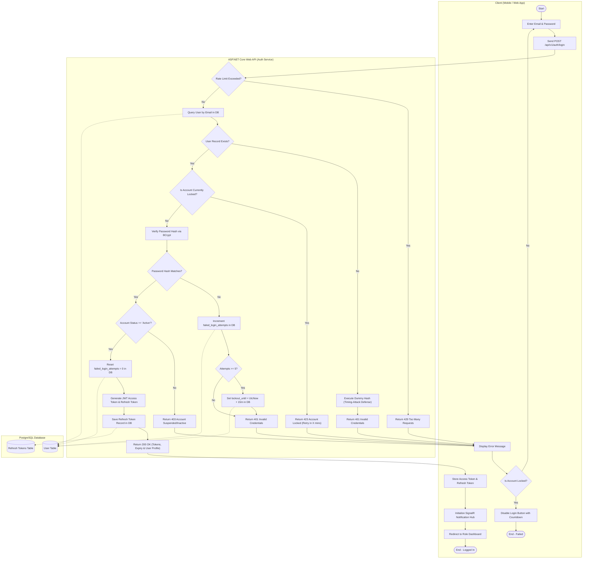
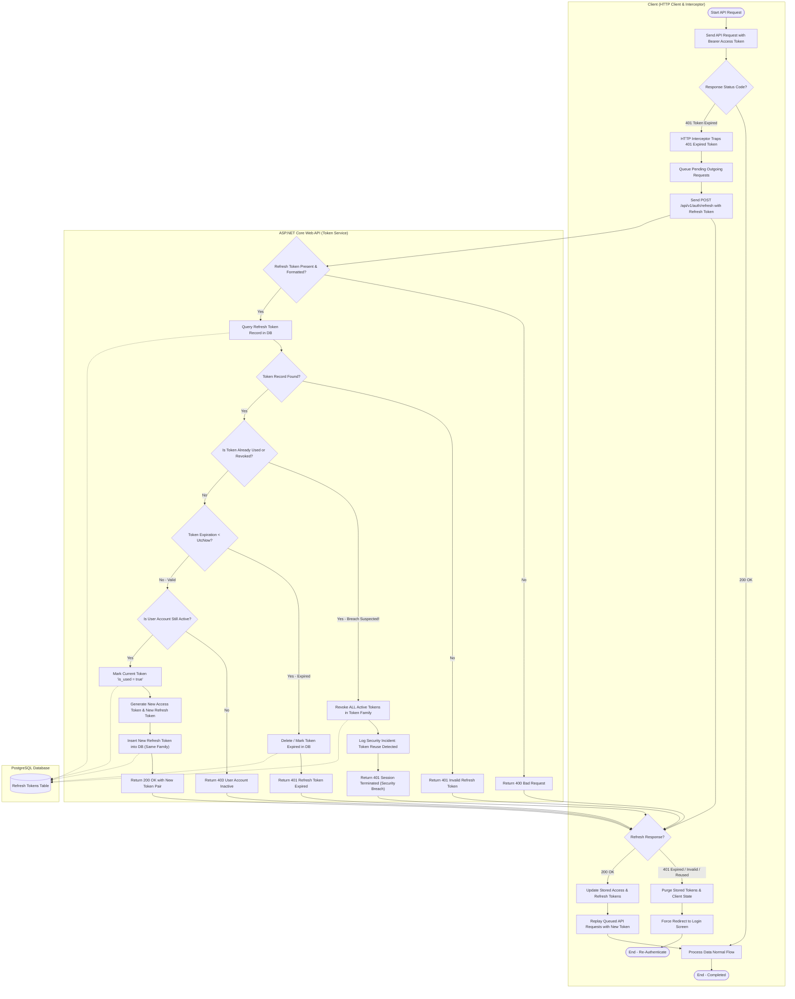
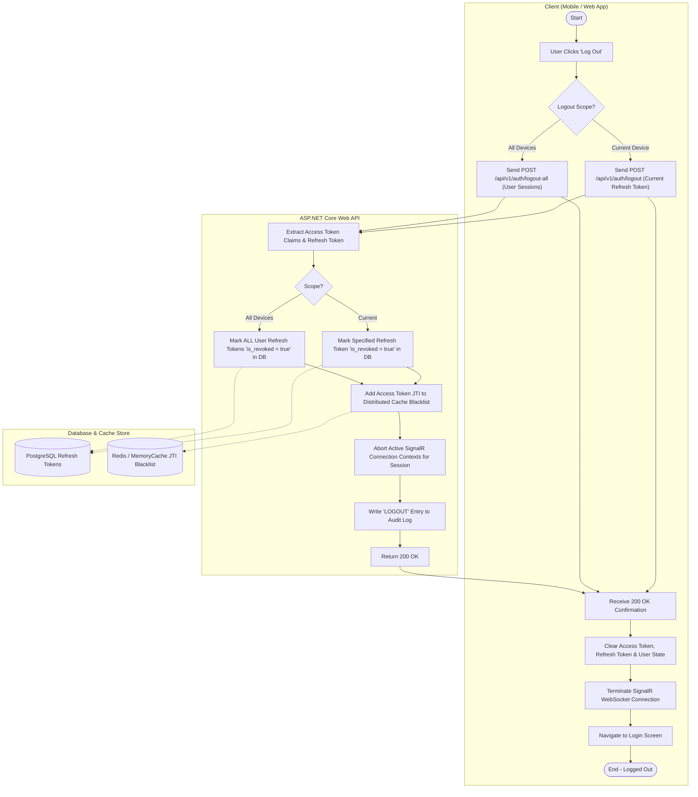
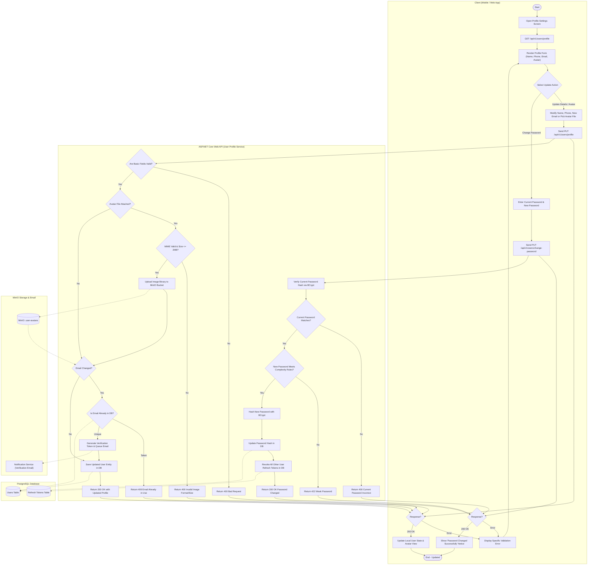

# LA-213: Activity Diagram for Authentication and Profile
**Sprint:** Sprint 1-2  
**Parent Ticket:** [LA-194](https://hungndemail.atlassian.net/browse/LA-194)  
**Ticket:** [LA-213](https://hungndemail.atlassian.net/browse/LA-213) - Activity diagram for authentication and profile  
**Task Description:** Model login, token refresh, logout and profile update with the decisions for invalid credentials and expired tokens.  
**Use Cases Covered:** [UC-01, UC-02](../requirements/use-cases.md)  
**Target Architecture:** ASP.NET Core Web API, PostgreSQL, SignalR, MinIO, ReactJS / Flutter Client  

---

## 1. Overview & Architectural Scope

This specification defines the complete identity lifecycle and profile management workflows for the **SmartDroneDelivery** platform. 

It explicitly models all conditional decision branches, edge cases, and security mitigations:
- **Login:** Rate-limiting, hash verification, account lockout policies, and role-based claim issuance.
- **Token Refresh:** Handling expired access tokens, expired refresh tokens, rotated token verification, and refresh token reuse detection (theft mitigation).
- **Logout:** Server-side refresh token revocation, access token blacklisting, SignalR disconnect, and client cache teardown.
- **Profile Update:** Avatar handling via MinIO, email uniqueness checks, current password re-verification, and multi-session revocation on credential modification.

---

## 2. Actors & System Swimlanes

| Swimlane | Component / Actor | Responsibilities |
| :--- | :--- | :--- |
| **Client Lane** | Mobile App (Flutter) / Web Portal (ReactJS) | Captures user inputs, intercepts 401 HTTP statuses, stores tokens, and renders UI state. |
| **API Gateway & Auth Controller** | ASP.NET Core Web API (`/api/v1/auth`, `/api/v1/users`) | Request validation, rate-limiting, JWT parsing, and business logic execution. |
| **Database & Token Store** | PostgreSQL & In-Memory / Distributed Cache | Credential persistence, token family tracking, lockout timestamps, and audit logging. |
| **Auxiliary Services** | MinIO Object Store / Notification Service | Avatar binary persistence and verification email dispatch. |

---

## 3. Detailed Specifications & UML Activity Diagrams

---

### Process 1: User Login (with Invalid Credentials & Lockout Decisions)

#### Specification
- **Endpoint:** `POST /api/v1/auth/login`
- **Primary Actors:** User (Client), Auth API, PostgreSQL Database
- **Preconditions:** User is registered in the system.
- **Postconditions:** User authenticated, issued JWT Access Token (15-min TTL) and Refresh Token (7-day TTL), redirect to role-specific dashboard.

#### Decision Logic & Edge Cases:
1. **Rate Limit Exceeded:** If IP/Client sends > 10 requests/minute $\rightarrow$ Returns `429 Too Many Requests`.
2. **Account Not Found:** Query returns null $\rightarrow$ Returns `401 Unauthorized` with generic error ("Invalid email or password" to prevent user enumeration).
3. **Account Locked:** If `lockout_until > UtcNow` $\rightarrow$ Returns `423 Locked` with remaining lockout minutes.
4. **Invalid Password:** BCrypt verification fails:
   - Increment `failed_login_attempts`.
   - If `failed_login_attempts >= 5` $\rightarrow$ Set `lockout_until = UtcNow + 15 minutes`.
   - Return `401 Unauthorized` ("Invalid email or password").
5. **Account Inactive / Suspended:** `status != Active` $\rightarrow$ Returns `403 Forbidden` ("Account suspended or pending approval").
6. **Success:** Reset `failed_login_attempts = 0`, issue signed JWT Access Token and persistent Refresh Token family.

#### UML Activity Diagram: Login Process

---

### Process 2: Token Refresh & Expired Token Decisions

#### Specification
- **Endpoint:** `POST /api/v1/auth/refresh`
- **Primary Actors:** Client HTTP Interceptor, Auth API, Database Token Store
- **Preconditions:** Client has an expired Access Token and holds an active Refresh Token.
- **Postconditions:** Old refresh token rotated/invalidated, new Access Token + new Refresh Token returned to client.

#### Decision Logic & Edge Cases:
1. **Access Token Expired During API Call:** Client HTTP client intercepts `401 Unauthorized` with `WWW-Authenticate: Bearer error="invalid_token", error_description="The token expired"`.
2. **Refresh Token Format Invalid:** Request body or cookie missing or malformed $\rightarrow$ Returns `400 Bad Request`.
3. **Refresh Token Not in Database:** Token string not recognized $\rightarrow$ Returns `401 Unauthorized` (Session terminated, redirect to login).
4. **Refresh Token Expired (`expires_at < UtcNow`):** 
   - Token is past its 7-day validity window.
   - Delete/mark expired in DB.
   - Return `401 Unauthorized` ("Refresh token expired. Please re-authenticate").
   - Client clears tokens and redirects to Login.
5. **Token Reuse Detected (Theft Detection):** 
   - A refresh token with `is_revoked == true` or `is_used == true` is presented.
   - **Critical Security Event:** Indicates the token was intercepted and already consumed by an attacker.
   - **Mitigation:** Revoke the **entire token family** (all active sessions of the user account).
   - Log security anomaly alarm in audit log.
   - Return `401 Unauthorized` ("Security Alert: Session revoked due to reuse detection").
6. **Valid Active Refresh Token:**
   - Mark current refresh token as `is_used = true`.
   - Issue new Access Token (15 min) and new Refresh Token (7 days, same family ID).
   - Persist new refresh token in DB.
   - Return `200 OK`.
   - Client replays the original queued request seamlessly.

#### UML Activity Diagram: Token Refresh & Expiration Process

---

### Process 3: User Logout Process

#### Specification
- **Endpoint:** `POST /api/v1/auth/logout`
- **Primary Actors:** User (Client), Auth API, Database / Cache Store, SignalR Hub
- **Preconditions:** User is authenticated.
- **Postconditions:** Active refresh token revoked, access token JTI blacklisted until expiration, SignalR connection closed, client tokens deleted.

#### Decision Logic & Edge Cases:
1. **Invalid or Already Expired Token:** If client presents an expired access token during logout, API extracts JTI without throwing authentication failure, ensuring the refresh token is still revoked from database.
2. **Scope of Logout:**
   - *Current Device Logout (Standard):* Revokes only the specific refresh token passed in request.
   - *All Devices Logout (Global):* Revokes all refresh tokens belonging to the user ID.
3. **SignalR Disconnect:** Disconnects real-time hub session to stop receiving flight/telemetry notifications.
4. **Client Teardown:** Client purges in-memory token store, secure storage, and local state cache before redirecting to login.

#### UML Activity Diagram: Logout Process

---

### Process 4: Profile Update (with Image Upload & Password Change Decisions)

#### Specification
- **Endpoints:** 
  - `GET /api/v1/users/profile` (Retrieve Current Profile)
  - `PUT /api/v1/users/profile` (Update Profile Details & Avatar)
  - `PUT /api/v1/users/change-password` (Update Password)
- **Primary Actors:** User, Users API Controller, PostgreSQL, MinIO Storage, Notification Service
- **Preconditions:** User is authenticated with a valid access token.
- **Postconditions:** User profile updated, avatar persisted in MinIO, password re-hashed if changed, other active sessions revoked upon password change.

#### Decision Logic & Edge Cases:
1. **Avatar Image Validation:**
   - Allowed formats: `image/jpeg`, `image/png`, `image/webp`. Max size: `2MB`.
   - If invalid format or size $> 2\text{MB}$ $\rightarrow$ Return `400 Bad Request`.
   - If valid $\rightarrow$ Upload stream to MinIO bucket `user-avatars`, generate permanent/presigned URL.
2. **Email Change & Uniqueness:**
   - If email is updated $\rightarrow$ Check if new email already exists in DB.
   - If already taken by another user $\rightarrow$ Return `409 Conflict` ("Email is already registered").
   - If unique $\rightarrow$ Set `email_verified = false`, dispatch email verification link via Notification Service.
3. **Password Change Verification:**
   - Verify `current_password` hash via BCrypt.
   - If incorrect $\rightarrow$ Return `400 Bad Request` ("Current password does not match").
   - Validate new password against complexity policy (minimum 8 chars, uppercase, lowercase, numeric, special char).
   - If weak $\rightarrow$ Return `422 Unprocessable Entity` ("Password complexity criteria not met").
   - If valid $\rightarrow$ Hash new password, update DB, and **revoke all active refresh tokens except the current one** to secure against compromised sessions.

#### UML Activity Diagram: Profile Update Process

---

## 4. Error Code & Decision Matrix

| Action | Condition / Decision | HTTP Status | Code / Response Message | System Action |
| :--- | :--- | :--- | :--- | :--- |
| **Login** | Rate limit threshold exceeded | `429 Too Many Requests` | `AUTH_RATE_LIMIT_EXCEEDED` | Client throttled for 60 seconds. |
| **Login** | Unknown user or incorrect password | `401 Unauthorized` | `INVALID_CREDENTIALS` | Generic message; increments failed counter. |
| **Login** | Failed attempts $\ge 5$ | `423 Locked` | `ACCOUNT_TEMPORARILY_LOCKED` | Account locked for 15 minutes; timer returned. |
| **Login** | Account marked inactive/suspended | `403 Forbidden` | `ACCOUNT_INACTIVE` | Login rejected; contact admin notice. |
| **Refresh** | Token missing or malformed | `400 Bad Request` | `INVALID_TOKEN_FORMAT` | Immediate client redirect to login. |
| **Refresh** | Refresh token not found in database | `401 Unauthorized` | `REFRESH_TOKEN_NOT_FOUND` | Session invalid; force re-login. |
| **Refresh** | Token expired (`expires_at < UtcNow`) | `401 Unauthorized` | `REFRESH_TOKEN_EXPIRED` | Expired record purged; force re-login. |
| **Refresh** | Token already revoked or reused | `401 Unauthorized` | `TOKEN_REUSE_DETECTED` | **All tokens in family revoked**; security alert logged. |
| **Logout** | Normal single session logout | `200 OK` | `LOGOUT_SUCCESSFUL` | Target token revoked; access JTI blacklisted. |
| **Logout** | All devices session revocation | `200 OK` | `GLOBAL_LOGOUT_SUCCESSFUL` | All active tokens for user revoked. |
| **Profile** | Avatar file $> 2\text{MB}$ or non-image MIME | `400 Bad Request` | `INVALID_AVATAR_FORMAT` | Upload aborted. |
| **Profile** | New email already registered by another | `409 Conflict` | `EMAIL_ALREADY_EXISTS` | Update aborted; current email retained. |
| **Profile** | Current password incorrect on change | `400 Bad Request` | `CURRENT_PASSWORD_INCORRECT` | Password change rejected. |
| **Profile** | New password fails complexity regex | `422 Unprocessable` | `PASSWORD_COMPLEXITY_FAILED` | Requires upper, lower, number, special char. |
| **Profile** | Password successfully changed | `200 OK` | `PASSWORD_CHANGED_SUCCESS` | New hash saved; **all other sessions revoked**. |

---

## 5. Implementation Notes for Sprint 1-2

1. **JWT & Refresh Token Architecture:**
   - Access token lifetime: **15 minutes** (`expires_in: 900`).
   - Refresh token lifetime: **7 days** with automatic token rotation.
   - Database table `refresh_tokens`: `id`, `user_id`, `token_hash`, `family_id`, `is_used`, `is_revoked`, `expires_at`, `created_at`, `replaced_by_token_id`.
2. **Timing-Attack Countermeasure:**
   - When an email address is not found in database, execute a dummy BCrypt verification before returning `401 Unauthorized` so that response duration is indistinguishable from an invalid password attempt.
3. **Blacklist for Revoked Access Tokens:**
   - For immediate logout effect prior to 15-minute access token expiration, store the revoked token's `jti` in a distributed Redis or in-memory sliding cache with TTL equal to the token's remaining lifespan.
