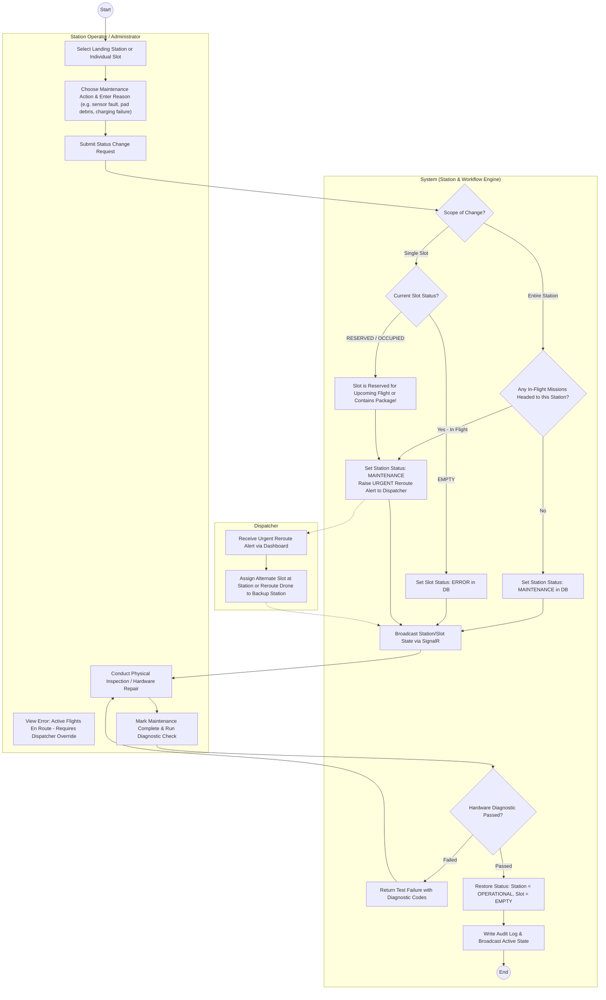
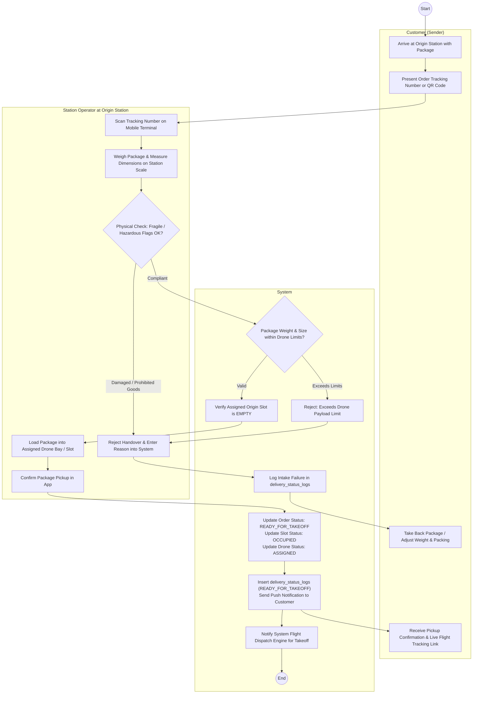
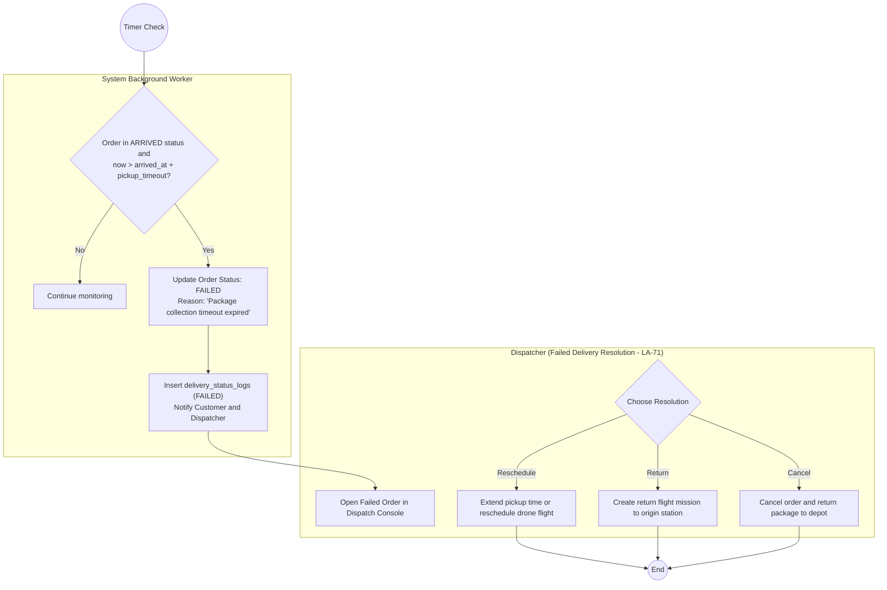

# LA-214: Activity Diagram for Station & Slot Maintenance and Package Pickup Confirmation
**Sprint:** Sprint 1-2  
**Parent Ticket:** [LA-194](https://hungndemail.atlassian.net/browse/LA-194)  
**Ticket Ref:** [LA-214](https://hungndemail.atlassian.net/browse/LA-214)  
**Task Description:** Model station and slot maintenance and the package pickup confirmation at the station.  
**Use Cases Covered:** [UC-16, UC-17, UC-18, UC-08](../requirements/use-cases.md)  
**Entities:** `landing_stations`, `station_slots`, `delivery_orders`, `drones`, `flight_missions`, `delivery_status_logs`, `audit_logs`  

---

## 1. Overview & Scope

This specification models the operational business processes at the landing stations for the **SmartDroneDelivery** platform using UML Activity Diagrams with dedicated actor swimlanes:
1. **Station and Slot Maintenance Management (UC-16, UC-17):**
   - Station-level maintenance toggle (`OPERATIONAL` $\rightarrow$ `MAINTENANCE` / `OFFLINE`).
   - Slot-level fault and maintenance isolation (`EMPTY` / `OCCUPIED` $\rightarrow$ `ERROR`).
   - Conflict resolution for scheduled dispatches, in-flight arrivals, and rerouting decisions.
2. **Origin Station Package Intake & Pickup Confirmation (UC-18):**
   - Customer drop-off verification (tracking number, physical weight/dimensions against drone limits).
   - Slot occupancy allocation and transition to `READY_FOR_TAKEOFF`.
3. **Destination Station Package Pickup & Secure Code Confirmation (UC-08, UC-18):**
   - Recipient pickup at station counter or smart locker kiosk.
   - Secure code verification with decisions for invalid attempts, lockout thresholds, and timeout exceptions.
   - Slot release to `EMPTY`, order completion to `DELIVERED`, and status logging.

---

## 2. Status Lifecycle & Transition Matrix

### Landing Station & Slot States (from ERD)
* **`landing_stations.status`:** `OPERATIONAL`, `MAINTENANCE`, `OFFLINE`
* **`station_slots.status`:** `EMPTY`, `OCCUPIED`, `RESERVED`, `ERROR`
* **`delivery_orders.status`:** `PENDING`, `APPROVED`, `READY_FOR_TAKEOFF`, `IN_TRANSIT`, `ARRIVED`, `DELIVERED`, `CANCELLED`, `FAILED`

| Entity | Initial State | Event / Trigger | Guard Condition | Target State | Side Effects |
|---|---|---|---|---|---|
| **Station** | `OPERATIONAL` | Operator/Admin triggers maintenance | No active in-flight missions headed to station | `MAINTENANCE` | Notify Dispatcher; stop assigning new missions |
| **Station** | `OPERATIONAL` | Operator/Admin emergency shutdown | In-flight missions exist | `MAINTENANCE` | **Urgent alert:** Dispatcher re-routes flights to fallback station |
| **Station** | `MAINTENANCE` | Maintenance completed & self-test pass | All pads inspected & online | `OPERATIONAL` | Re-enabled in flight scheduling pool |
| **Slot** | `EMPTY` | Hardware fault detected / Scheduled repair | None | `ERROR` | Exclude slot from dispatch & storage algorithms |
| **Slot** | `RESERVED` | Slot fault detected | Mission in transit | `ERROR` | Dispatcher assigns alternative slot or holds drone |
| **Slot** | `ERROR` | Repair completed | Sensor self-test OK | `EMPTY` | Slot available for allocation |
| **Order** | `APPROVED` | Customer hands over package at origin | Weight/dimensions valid | `READY_FOR_TAKEOFF` | Origin slot $\rightarrow$ `OCCUPIED`, drone assigned |
| **Order** | `ARRIVED` | Recipient enters correct secure code | `code == order.secure_code` | `DELIVERED` | Destination slot $\rightarrow$ `EMPTY`, notify customer |
| **Order** | `ARRIVED` | Pickup window expires (timeout) | `now > arrived_at + pickup_timeout` | `FAILED` | Go to failure flow (LA-71), notify dispatcher |

---

## 3. Station & Slot Maintenance Process (UC-16, UC-17)

### Specification
* **Actors:** Station Operator, System Administrator, Dispatcher, System Core
* **Preconditions:** Operator or Administrator is authenticated and assigned to the landing station.
* **Postconditions:** Target station or slot is set to `MAINTENANCE` or `ERROR`, any conflicting flight reservations are re-routed, and real-time updates are pushed via SignalR.



---

## 4. Origin Station: Package Intake & Pickup Confirmation (UC-18)

### Specification
* **Actors:** Customer (Sender), Station Operator, System
* **Preconditions:** Order status is `APPROVED` and scheduled; sender arrives at origin station with the package.
* **Postconditions:** Package verified against physical limits; origin slot set to `OCCUPIED`; order status set to `READY_FOR_TAKEOFF`.



---

## 5. Destination Station: Package Pickup & Secure Code Confirmation (UC-08, UC-18)

### Specification
* **Actors:** Recipient, Station Operator (or Smart Locker Kiosk), System
* **Preconditions:** Drone has landed safely at destination station; order status is `ARRIVED`; destination slot is `OCCUPIED`; recipient received notification with `secure_code`.
* **Postconditions:** Secure code validated; package handed over; order status set to `DELIVERED`; slot released to `EMPTY`.

```mermaid
flowchart TB
    Start((Start)) --> R_Arrive

    subgraph Recipient["Recipient (Customer)"]
        R_Arrive["Arrive at Destination Landing Station Hub"]
        R_EnterCode["Enter Pickup Secure Code on Kiosk or Present to Operator"]
        R_Arrive --> R_EnterCode
        R_Retry["Re-enter Code / Check Notification SMS"]
        R_ReceivePackage["Take Package from Locker / Operator"]
        R_RateService["Confirm Receipt & Rate Delivery Experience"]
        R_ReceivePackage --> R_RateService
    end

    R_EnterCode --> OP_Verify

    subgraph Interface["Station Operator / Kiosk Terminal"]
        OP_Verify["Capture Secure Code & Tracking Number"]
        OP_DisplayError["Display Error: 'Incorrect Secure Code' with Remaining Attempts"]
        OP_Lockout["Display Notice: 'Max Attempts Exceeded - Locked for 10 Mins'"]
        OP_OpenLocker["Unlock Station Slot / Locker Door"]
        OP_Handover["Hand Package to Recipient / Ensure Retrieval"]
        OP_OpenLocker --> OP_Handover
    end

    OP_Verify --> S_CheckOrder

    subgraph System["System (Delivery Workflow Engine)"]
        S_CheckOrder["Query delivery_orders by Tracking Number"]
        S_CheckState{"Order Status == ARRIVED?"}
        
        S_CheckState -->|No (e.g. FAILED / RETURNED)| S_StateErr["Return Error: Order Not Ready for Pickup or Expired"]
        S_StateErr --> OP_DisplayError

        S_CheckState -->|Yes| S_CheckLockout{"Is Code Verification Locked?"}
        S_CheckLockout -->|Yes| S_LockedResp["Return 423: Too Many Failed Verification Attempts"]
        S_LockedResp --> OP_Lockout

        S_CheckLockout -->|No| S_VerifyCode{"Entered Code == order.secure_code?"}
        
        %% Wrong Code Branch
        S_VerifyCode -->|No| S_IncAttempts["Increment failed_code_attempts"]
        S_IncAttempts --> S_MaxAttempts{"Attempts >= 3?"}
        S_MaxAttempts -->|Yes| S_LockCode["Set code_lockout_until = UtcNow + 10m<br/>Send Security Alert to Customer"]
        S_MaxAttempts -->|No| S_PromptRetry["Return 400: Invalid Secure Code"]
        S_LockCode --> OP_Lockout
        S_PromptRetry --> OP_DisplayError
        OP_DisplayError --> R_Retry
        R_Retry --> R_EnterCode

        %% Correct Code Branch
        S_VerifyCode -->|Yes| S_ResetAttempts["Reset failed_code_attempts = 0"]
        S_ResetAttempts --> S_SendUnlock["Send Signal to Kiosk / Operator: Validated"]
        S_SendUnlock --> OP_OpenLocker
        OP_Handover --> R_ReceivePackage

        R_ReceivePackage --> S_Finalize["Update Order Status: DELIVERED<br/>Set actual_delivery_time = UtcNow<br/>Update Destination Slot Status: EMPTY<br/>Update Drone Status: IDLE / CHARGING"]
        
        S_Finalize --> S_WriteStatusLog["Insert delivery_status_logs (DELIVERED)<br/>Write audit_logs entry<br/>Send Delivery Completed Notification to Sender"]
        S_WriteStatusLog --> End((End))
    end
```

---

## 6. Pickup Timeout & Expired Package Flow (Connecting to LA-71)

If the package is not collected by the recipient within the permitted pickup window (e.g. 24 hours after arrival):



---

## 7. Traceability Matrix

| Use Case | Description | Primary Actors | Key Decisions Modeled | Requirements |
|---|---|---|---|---|
| **UC-16** | Manage landing stations and slots | Station Operator, Administrator | Station/slot maintenance toggle, flight conflict check, self-test | FR-19, FR-20 |
| **UC-17** | Monitor station availability | Station Operator | Real-time pad state (EMPTY, OCCUPIED, ERROR), SignalR alerts | FR-21, FR-22 |
| **UC-18** | Confirm package pickup (Origin) | Station Operator, Sender | Physical weight/dimension verification against drone limits, slot allocation | FR-15, FR-23 |
| **UC-08** | Confirm delivery with secure code (Destination) | Recipient, Station Operator | Secure code validation, 3-attempt lockout defense, slot release | FR-11, FR-24 |
| **LA-71** | Pickup timeout exception | Background Worker, Dispatcher | Auto-transition to `FAILED`, dispatcher resolution (reschedule/return/cancel) | FR-18 |
