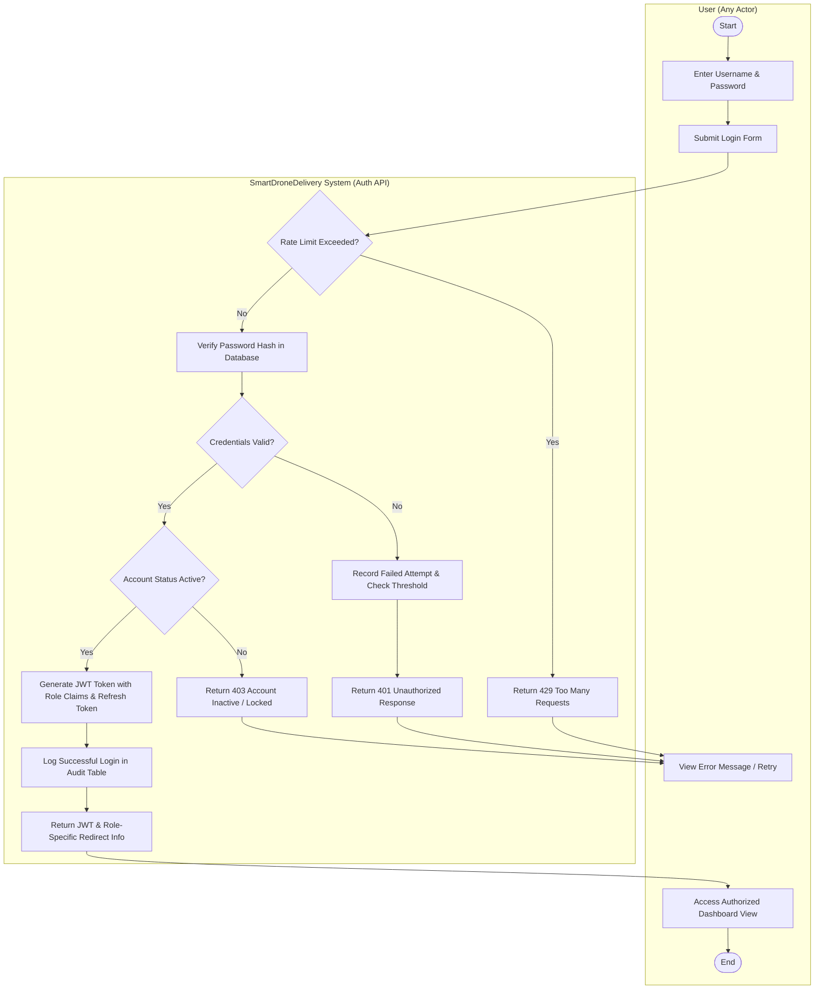
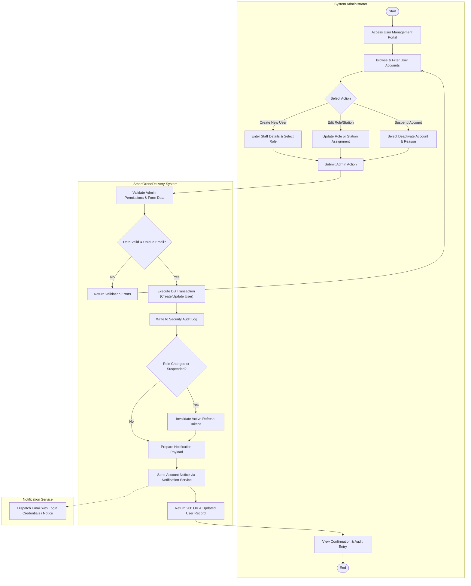
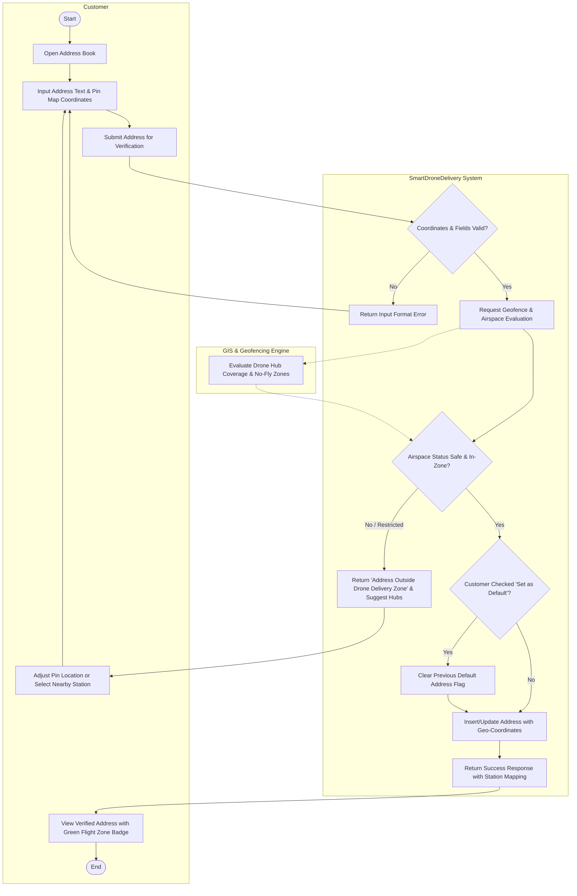
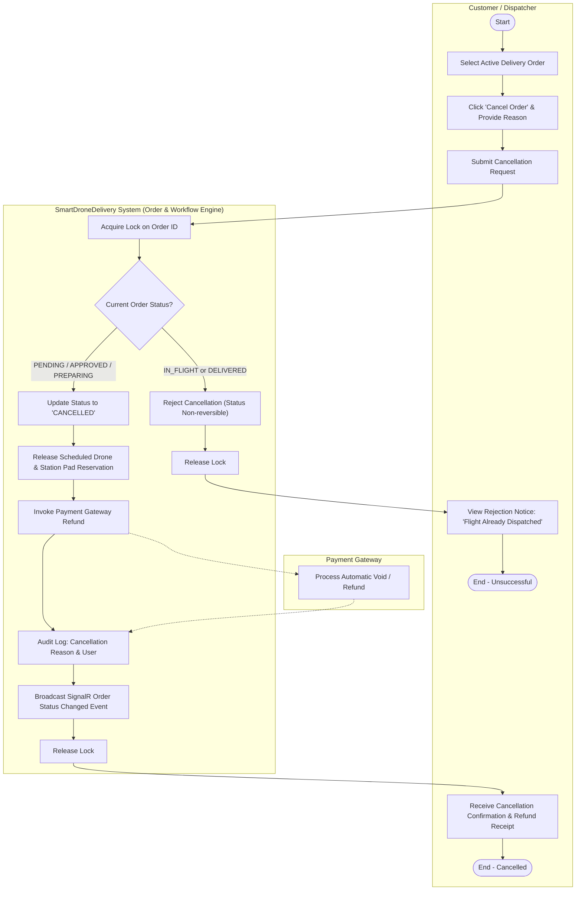
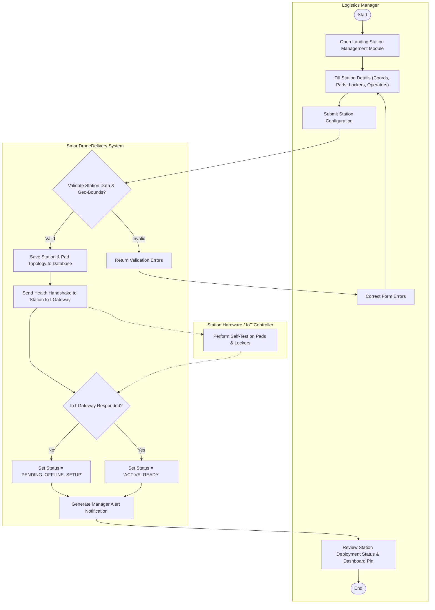
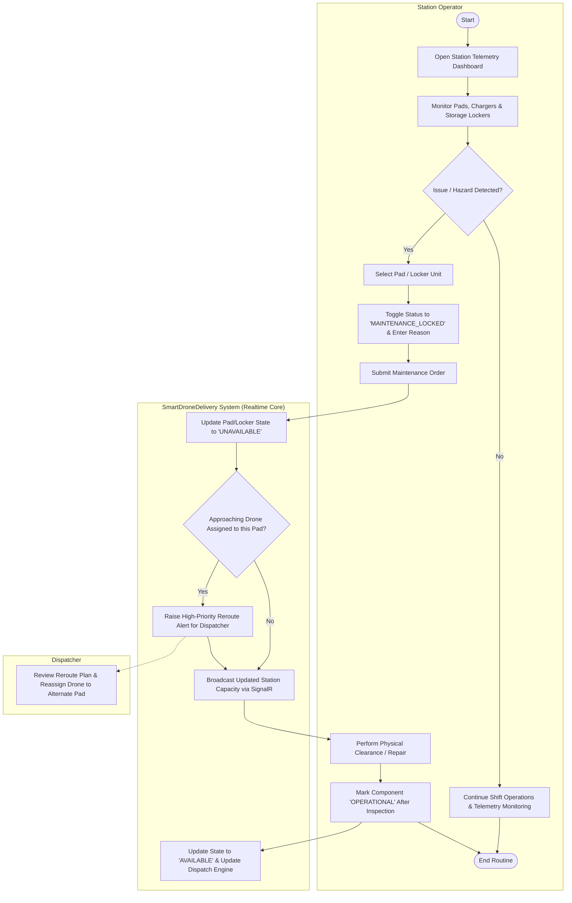
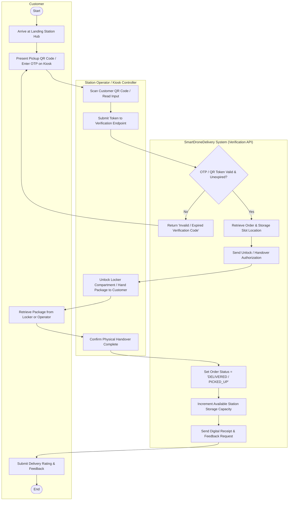
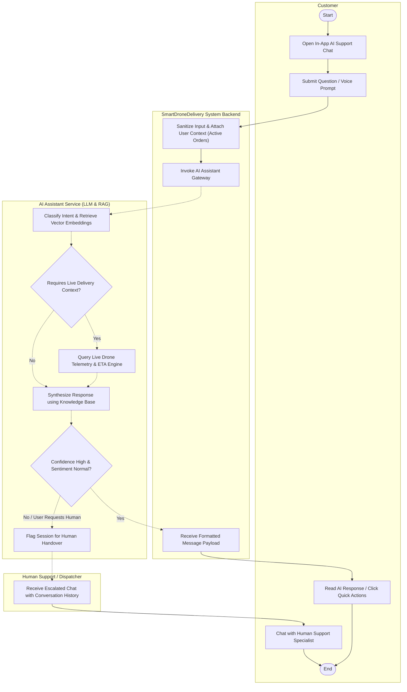
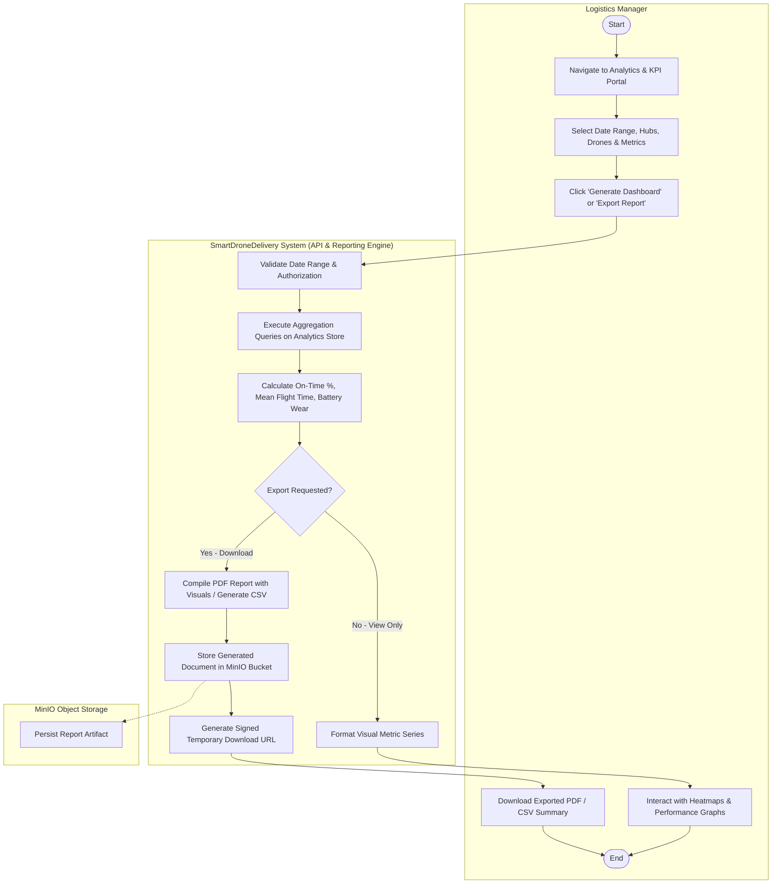
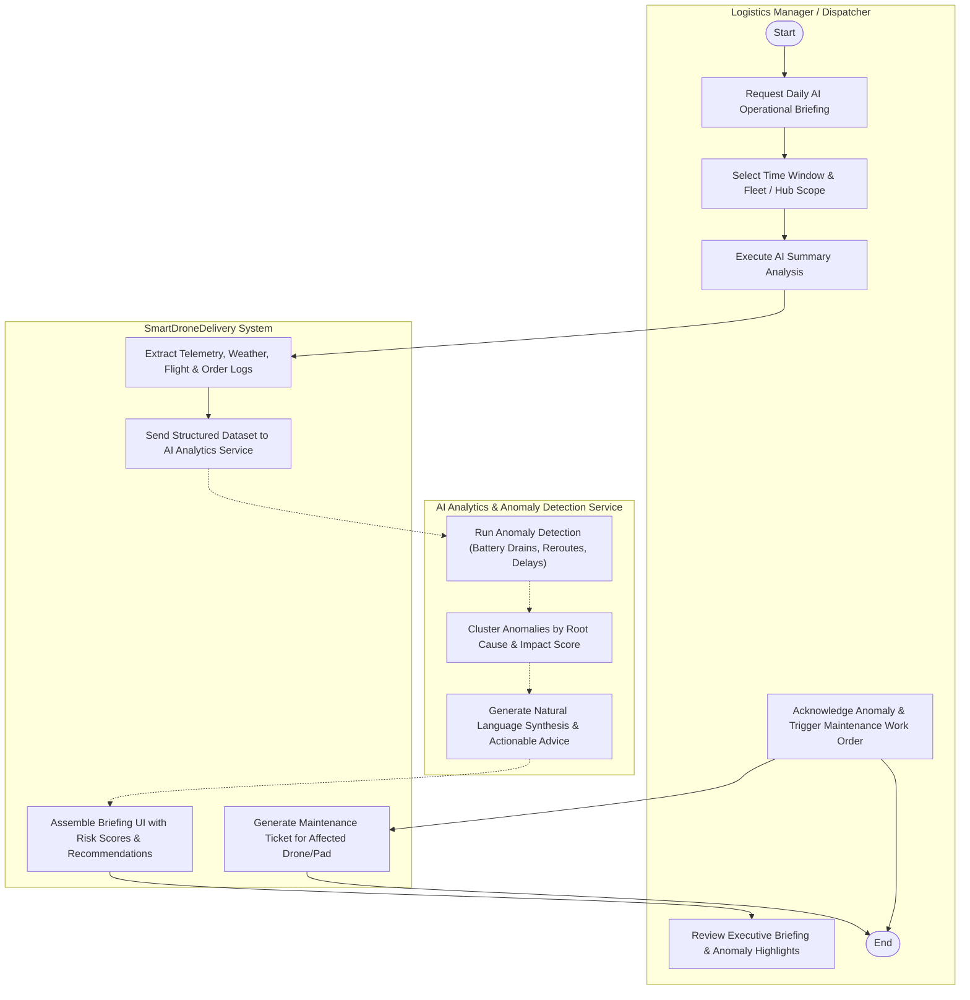

# SmartDroneDelivery - Activity Diagrams for Supplementary Use Cases
**Sprint:** Sprint 1-2  
**Ticket Ref:** Complement to [LA-12: Model the drone delivery business processes with BPMN](https://hungndemail.atlassian.net/browse/LA-12#icft=LA-12)  
**Suggested Owner:** Khai  
**Document Status:** Approved / Ready for Review  
**Project:** AI-powered Drone Delivery Management Platform (Nền tảng quản lý giao hàng bằng drone tích hợp AI)

---

## 1. Overview & Context

Ticket **LA-12** modeled the primary business processes of the **Drone Delivery Lifecycle** using BPMN:
1. Delivery Request Management
2. Package Management & Inspection
3. Delivery Execution (Scheduling, Route Planning & Dispatch)
4. Delivery Flight Tracking (Telemetry & Geofence Monitoring)
5. Delivery Confirmation & Failed Delivery Handling

To deliver a complete system specification for **Sprint 1-2**, this document defines the **supplementary business and operational use cases** outside the delivery flight lifecycle. Each use case includes:
- Formal specification (Actors, Preconditions, Postconditions, Triggers, Normal Flow, and Alternate/Exception Flows).
- Standard UML Activity Diagram with **explicit swimlanes per actor** (Customer, Dispatcher, Station Operator, Logistics Manager, System Administrator, and AI/System Services).

---

## 2. Actor Catalog

| Actor | Type | Description |
| :--- | :--- | :--- |
| **Customer** | Human | End user who places delivery orders, manages addresses, chats with AI Assistant, and picks up packages at landing stations. |
| **Dispatcher** | Human | Operational controller responsible for approving exceptions, reassigning drones, reviewing cancellations, and handling escalated inquiries. |
| **Station Operator** | Human | Field personnel stationed at drone landing hubs, managing station readiness, pad maintenance, physical loading/unloading, and package pickup verification. |
| **Logistics Manager** | Human | Management persona responsible for station configuration, service territory policies, KPI monitoring, and operational reporting. |
| **System Administrator** | Human | Technical administrator managing user accounts, role-based access control (RBAC), security audits, and system configuration. |
| **SmartDroneDelivery System** | Automated System | Core backend platform (ASP.NET Core Web API, PostgreSQL, SignalR, MinIO). |
| **AI Services Engine** | Automated System | Integrated AI modules for NLP Customer Assistance, ETA calculations, operational anomaly detection, and automated summarization. |

---

## 3. Supplementary Use Case Specifications & Activity Diagrams

---

### UC-OTH-01: User Authentication & Role-Based Access Control (RBAC)
- **Primary Actor:** Any User (Customer, Dispatcher, Station Operator, Logistics Manager, System Administrator)
- **Supporting Systems:** SmartDroneDelivery System (Auth Service), Identity/Token Service
- **Preconditions:** User has an existing active account in the system.
- **Postconditions:** User is authenticated, issued a signed JWT with role claims, and redirected to their role-specific dashboard.
- **Trigger:** User accesses the application and submits their login credentials.

#### Detailed Flow of Events:
1. **User** enters username/email and password on the login portal.
2. **System** receives credentials and performs rate-limiting & format validation.
3. **System** validates credentials against PostgreSQL database (BCrypt hash check).
4. *Alternative Flow A1 (Invalid Credentials):* If invalid, System logs the failed attempt, increments failure counter, and returns an error message. If attempts exceed threshold, account is temporarily locked.
5. **System** checks account status (Active, Suspended, or Pending Verification).
6. *Alternative Flow A2 (Inactive Account):* System notifies user of account restriction and terminates session.
7. **System** extracts user role claims (Customer, Dispatcher, Station Operator, Logistics Manager, System Admin) and generates a signed JWT Access Token and Refresh Token.
8. **System** sets up SignalR connection context for real-time notifications.
9. **User** receives token, browser/mobile app stores token securely, and user navigates to their authorized portal interface.

#### Activity Diagram: UC-OTH-01 (Authentication & RBAC)

---

### UC-OTH-02: Manage Users and Role Assignments
- **Primary Actor:** System Administrator
- **Supporting Systems:** SmartDroneDelivery System, Notification Service (Email/SMS)
- **Preconditions:** System Administrator is logged in with Admin privileges.
- **Postconditions:** New user is created, existing user profile/role is updated or deactivated, and audit logs are recorded.
- **Trigger:** System Administrator navigates to User Management console to onboard staff or adjust permissions.

#### Detailed Flow of Events:
1. **System Administrator** requests the user directory list with optional role/status filters.
2. **System** queries user accounts and renders directory with assigned roles and operational statuses.
3. **System Administrator** selects an action: Create New User, Modify Role, or Change Account Status (Activate/Suspend).
4. *Branch 1: Create New User:* Admin enters name, email, phone number, and selects role (Dispatcher, Station Operator, Logistics Manager, Admin).
5. *Branch 2: Modify Role / Permissions:* Admin updates role assignment and assigned stations/regions.
6. *Branch 3: Suspend/Deactivate User:* Admin marks account as suspended and provides a justification reason.
7. **System** validates inputs (email uniqueness, valid role enum, mandatory fields).
8. **System** executes transaction: updates database, revokes active refresh tokens if role changed or account suspended.
9. **System** dispatches invitation/notification email with temporary credentials or status notice.
10. **System Administrator** receives confirmation and views updated audit trail.

#### Activity Diagram: UC-OTH-02 (User & Role Management)

---

### UC-OTH-03: Manage Delivery Addresses & Coordinates
- **Primary Actor:** Customer
- **Supporting Systems:** SmartDroneDelivery System, Geocoding & Geofence Service
- **Preconditions:** Customer is logged in to the mobile or web application.
- **Postconditions:** Delivery address is validated, geocoded with coordinates (Latitude/Longitude), checked against allowed drone delivery zones, and stored in Customer's address book.
- **Trigger:** Customer wants to add, edit, or set a default landing address for future drone deliveries.

#### Detailed Flow of Events:
1. **Customer** navigates to "Saved Addresses" in the profile section.
2. **Customer** clicks "Add New Address" or selects an existing address to edit.
3. **Customer** inputs address line, building/campus details, and pins exact location on an interactive map.
4. **Customer** submits address details.
5. **System** forwards coordinates to Geofencing / GIS module to verify flight zone eligibility.
6. **System** evaluates eligibility:
   - Within operational radius of at least one drone hub.
   - Outside prohibited airspace (no-fly zones, high-voltage corridors, airport zones).
   - Safe landing clearance flag.
7. *Alternative Flow A1 (Outside Flight Zone):* If outside operational territory, System informs customer with a boundary warning, suggesting the nearest authorized Landing Station.
8. *Main Flow Success:* System saves address, sets default flag if chosen, and returns validated status.
9. **Customer** sees the verified landing pin with flight zone confirmation.

#### Activity Diagram: UC-OTH-03 (Manage Delivery Addresses)

---

### UC-OTH-04: Cancel Delivery Order (Pre-Dispatch Exception)
- **Primary Actor:** Customer (or Dispatcher on behalf of customer)
- **Supporting Systems:** SmartDroneDelivery System, Payment Gateway, Drone Dispatch Queue
- **Preconditions:** Order has been placed and is currently in `PENDING`, `APPROVED`, or `PREPARING` status (strictly before drone takeoff/flight initiation).
- **Postconditions:** Order status is transitioned to `CANCELLED`, scheduled drone flight slot is released back to inventory, refund is initiated, and parties are notified.
- **Trigger:** Customer requests order cancellation from the order tracking screen, or Dispatcher aborts pre-flight order due to operational constraints.

#### Detailed Flow of Events:
1. **Customer / Dispatcher** views the active order and clicks "Cancel Delivery".
2. **Customer / Dispatcher** selects a cancellation reason (e.g., changed mind, wrong address, weather/operational notice).
3. **System** acquires an optimistic concurrency lock on the order and checks the current order lifecycle state.
4. *Alternative Flow A1 (Drone Already Dispatched):* If state is `IN_FLIGHT`, cancellation is rejected with message: "Drone has already departed; in-flight cancellation is not permitted. Please initiate return upon arrival."
5. *Main Flow:* If state is eligible (`PENDING`, `APPROVED`, or `PREPARING`):
   - **System** changes status to `CANCELLED`.
   - **System** cancels drone reservation and frees assigned hub pad slot.
   - **System** calls Payment Gateway to void authorization or issue automated refund.
   - **System** logs cancellation reason and triggers push notification / email.
6. **Customer** receives cancellation confirmation and refund reference ID.
7. **Dispatcher** sees updated queue with freed drone capacity.

#### Activity Diagram: UC-OTH-04 (Cancel Delivery Order)

---

### UC-OTH-05: Configure & Manage Landing Stations
- **Primary Actor:** Logistics Manager
- **Supporting Systems:** SmartDroneDelivery System, Station Hardware Gateway
- **Preconditions:** Logistics Manager is authenticated with Manager privileges.
- **Postconditions:** Landing Station details, drone pads, charging docks, secure locker units, and operational geofences are created or updated in the platform.
- **Trigger:** Business expansion requires registering a new landing hub, or operational maintenance necessitates modifying station capacity.

#### Detailed Flow of Events:
1. **Logistics Manager** opens the "Landing Stations" management module.
2. **Logistics Manager** chooses to register a new station or edit an existing one.
3. **Logistics Manager** defines:
   - Station Name, Code, and Address.
   - GPS Boundary & Exact Pad Coordinates.
   - Number of Drone Landing Pads and Charger specifications.
   - Number of Storage Lockers and Station Operator assignment.
   - Operating Hours and Wind/Weather threshold rules.
4. **Logistics Manager** submits configuration.
5. **System** validates coordinate uniqueness, pad numbering, and operational rules.
6. **System** saves station entity and provisions station topic channels for telemetry.
7. **System** tests connectivity to the Station Hardware Gateway (ping test to station IoT controller).
8. *Alternative Flow A1 (Hardware Unreachable):* System marks station as `CREATED_OFFLINE`, notifying the manager to verify site network equipment.
9. *Main Flow Success:* System marks station as `ACTIVE_ONLINE`.
10. **Logistics Manager** sees the updated station list and operational map pin.

#### Activity Diagram: UC-OTH-05 (Manage Landing Stations)

---

### UC-OTH-06: Monitor Landing Station Availability & Maintenance
- **Primary Actor:** Station Operator (and Logistics Manager)
- **Supporting Systems:** SmartDroneDelivery System, Telemetry / SignalR Hub
- **Preconditions:** Station Operator is logged in and assigned to the local landing station.
- **Postconditions:** Pad occupancy, locker availability, and maintenance states (e.g., Pad Obstruction, Charger Malfunction) are tracked and updated in real-time.
- **Trigger:** Scheduled shift inspection, automated sensor alert from landing pad, or weather hazard requiring pad shutdown.

#### Detailed Flow of Events:
1. **Station Operator** opens the "Station Control Center" on their tablet or terminal.
2. **System** streams real-time status of all landing pads (Available, Reserved, Occupied, Faulted), battery chargers, and storage lockers via SignalR.
3. **Station Operator** observes a physical issue (e.g., debris on Pad 2 or malfunctioning charging contact) or receives automated sensor alarm.
4. **Station Operator** selects the affected component and toggles state to `MAINTENANCE_LOCKED`, specifying the reason code and estimated downtime.
5. **System** immediately updates component availability in the database.
6. **System** evaluates if active flight dispatches are scheduled for this pad:
   - *Alternative Flow A1 (Active Reservation Conflict):* System alerts Dispatcher to reroute approaching drone to an alternate available pad or fallback hub.
7. **System** broadcasts station capacity reduction to Dispatcher and routing engine.
8. Once repairs are completed, **Station Operator** conducts functional check and toggles status back to `OPERATIONAL`.
9. **System** re-enables pad in scheduling pool.

#### Activity Diagram: UC-OTH-06 (Monitor Station Availability & Maintenance)

---

### UC-OTH-07: Customer Package Pickup at Landing Station
- **Primary Actor:** Customer
- **Secondary Actor:** Station Operator (for attended stations) or Smart Locker Controller (for unattended hubs)
- **Supporting Systems:** SmartDroneDelivery System (Pickup Verification Service), Notification Service
- **Preconditions:** Drone has landed safely, unloaded the package into the station holding area/locker, and customer received a "Ready for Pickup" notification containing a 6-digit OTP and QR code.
- **Postconditions:** Customer identity is verified, package is physically handed over or locker door unlocked, order status changes to `DELIVERED`, and pickup confirmation is logged.
- **Trigger:** Customer arrives at the Landing Station to retrieve their package.

#### Detailed Flow of Events:
1. **Customer** arrives at the landing station and opens the mobile app showing pickup credentials (QR Code / OTP).
2. *Branch 1 (Unattended Smart Locker):*
   - Customer scans QR code or types OTP at the locker kiosk terminal.
   - Locker controller validates code with SmartDroneDelivery API.
   - System unlocks designated locker door.
   - Customer takes package and shuts door.
3. *Branch 2 (Attended Station Hub):*
   - Customer presents QR code to **Station Operator**.
   - Station Operator scans QR code via handheld mobile scanner.
   - System displays package ID, recipient name, and shelf location.
   - Station Operator retrieves package, cross-checks recipient, and clicks "Confirm Handover".
4. *Alternative Flow A1 (Invalid / Expired OTP):*
   - System rejects code and alerts customer. Customer can request an OTP resend via SMS/Email.
5. **System** updates order status to `COMPLETED_PICKUP`.
6. **System** timestamps pickup transaction, logs photo proof or digital signature, and releases station storage capacity.
7. **Customer** and **Station Operator** receive confirmation; customer is prompted for delivery rating.

#### Activity Diagram: UC-OTH-07 (Customer Package Pickup)

---

### UC-OTH-08: Customer AI Assistant Interaction
- **Primary Actor:** Customer
- **Secondary Actor:** Human Support / Dispatcher (Escalation)
- **Supporting Systems:** SmartDroneDelivery System, AI Assistant Service (RAG + LLM Engine)
- **Preconditions:** Customer is logged in to mobile or web application.
- **Postconditions:** Customer receives instant AI-assisted responses for inquiries (order status, ETA, delivery policies, dangerous goods restrictions), or session is escalated to human support.
- **Trigger:** Customer opens the "AI Support Chat" widget and submits a question.

#### Detailed Flow of Events:
1. **Customer** types a question in the in-app chat (e.g., "Where is my package?", "What items cannot be delivered by drone?").
2. **System** receives user query, enriches prompt with customer context (active order IDs, recent destinations).
3. **AI Assistant Service** executes intent classification and semantic retrieval (RAG) against platform knowledge base:
   - *Intent: Order Status / Tracking:* AI retrieves live telemetry, current drone state, and calculated ETA.
   - *Intent: Operational / FAQs:* AI retrieves guidelines on package dimensions (< 5kg), weather policies, and operating hours.
4. **AI Assistant Service** evaluates response confidence and sentiment.
5. *Alternative Flow A1 (Low Confidence / Customer Frustration / Complex Request):*
   - If user asks for refund, reports damaged goods, or expresses high frustration, AI initiates handover.
   - **System** alerts human support / **Dispatcher** with full conversation context.
   - Dispatcher takes over chat session.
6. *Main Flow Success:* AI generates concise, helpful answer with actionable UI buttons (e.g., "Track Live Drone").
7. **Customer** views response and continues conversation or closes widget.

#### Activity Diagram: UC-OTH-08 (Customer AI Assistant)

---

### UC-OTH-09: Generate Operational Analytics & Delivery KPI Reports
- **Primary Actor:** Logistics Manager
- **Supporting Systems:** SmartDroneDelivery System, Analytics Engine / Data Warehouse
- **Preconditions:** Logistics Manager is authenticated and possesses Manager or Executive permissions.
- **Postconditions:** Analytics dashboards are filtered, aggregated metrics (on-time delivery rate, drone battery cycle health, station turnaround, incident count) are rendered, and exportable reports (PDF/CSV) are generated.
- **Trigger:** Weekly/monthly operational review, performance audit, or fleet optimization requirement.

#### Detailed Flow of Events:
1. **Logistics Manager** navigates to "Analytics & Reporting" module.
2. **Logistics Manager** selects date range, target region, landing station hubs, and drone fleet IDs.
3. **Logistics Manager** specifies desired KPI metric views (e.g., On-Time Delivery Rate, Turnaround Time, Energy Consumption per KM, Aborted Missions).
4. **Logistics Manager** clicks "Generate Report" or "Export Data".
5. **System** aggregates raw telemetry, flight logs, and order completion tables from PostgreSQL / read-replicas.
6. **Analytics Engine** computes statistical aggregations, trend lines, and outlier benchmarks.
7. *Main Flow View:* System renders interactive charts, heatmaps, and summary KPI cards.
8. *Export Flow:* If manager requested export, System compiles data into structured PDF or CSV format and generates a secure download link.
9. **Logistics Manager** downloads report and reviews operational insights.

#### Activity Diagram: UC-OTH-09 (Operational Analytics & KPI Reporting)

---

### UC-OTH-10: AI Delivery Summarization & Anomaly Detection
- **Primary Actor:** Logistics Manager / Dispatcher
- **Supporting Systems:** SmartDroneDelivery System, AI Analytics Service
- **Preconditions:** Sufficient operational flight and order logs exist for the specified operational window.
- **Postconditions:** AI synthesizes complex multi-dimensional telemetry, detects anomalous flight events (unexpected battery drops, geofence micro-deviations, excessive pad turnaround delays), and provides natural language executive summaries with recommendations.
- **Trigger:** Automated end-of-day summary trigger or on-demand dispatch audit.

#### Detailed Flow of Events:
1. **Dispatcher / Logistics Manager** triggers "AI Operational Summary" for a specific hub or time frame.
2. **System** collects raw logs: telemetry streams, weather conditions, aborted flights, and maintenance records.
3. **AI Analytics Service** processes logs through anomaly detection algorithms:
   - Identifies pattern outliers (e.g., Drone DR-04 had 35% higher battery drain on North route due to headwind).
   - Identifies bottleneck stations where package loading exceeded target window (> 4 minutes).
4. **AI Analytics Service** constructs an executive natural language briefing summarizing key highlights, failures, and proactive operational recommendations.
5. **System** displays the AI summary card alongside severity-ranked incident lists.
6. **Dispatcher / Manager** reviews findings, acknowledges high-priority anomalies, and can assign maintenance tickets directly from recommendations.

#### Activity Diagram: UC-OTH-10 (AI Summarization & Anomaly Detection)

---

## 4. Traceability & Acceptance Matrix

| Use Case ID | Use Case Name | Primary Actors | Diagram Type | Swimlanes Included | Acceptance Status |
| :--- | :--- | :--- | :--- | :--- | :--- |
| **UC-OTH-01** | User Authentication & RBAC | Any User, System | UML Activity | User, SmartDroneDelivery System | Verified |
| **UC-OTH-02** | Manage Users & Role Assignments | System Administrator | UML Activity | System Administrator, SmartDroneDelivery System, Notification Service | Verified |
| **UC-OTH-03** | Manage Delivery Addresses | Customer | UML Activity | Customer, SmartDroneDelivery System, GIS Engine | Verified |
| **UC-OTH-04** | Cancel Delivery Order (Pre-Dispatch) | Customer, Dispatcher | UML Activity | Customer/Dispatcher, SmartDroneDelivery System, Payment Gateway | Verified |
| **UC-OTH-05** | Configure & Manage Landing Stations | Logistics Manager | UML Activity | Logistics Manager, SmartDroneDelivery System, IoT Hardware Gateway | Verified |
| **UC-OTH-06** | Monitor Station Availability & Maintenance | Station Operator, Dispatcher | UML Activity | Station Operator, SmartDroneDelivery System, Dispatcher | Verified |
| **UC-OTH-07** | Customer Package Pickup at Station | Customer, Station Operator | UML Activity | Customer, Station Operator/Kiosk, SmartDroneDelivery System | Verified |
| **UC-OTH-08** | Customer AI Assistant Interaction | Customer, Support Staff | UML Activity | Customer, SmartDroneDelivery System, AI Assistant (LLM/RAG), Human Support | Verified |
| **UC-OTH-09** | Operational Analytics & KPI Reporting | Logistics Manager | UML Activity | Logistics Manager, SmartDroneDelivery System, MinIO Storage | Verified |
| **UC-OTH-10** | AI Summarization & Anomaly Detection | Logistics Manager, Dispatcher | UML Activity | Manager/Dispatcher, SmartDroneDelivery System, AI Analytics Service | Verified |

---

## 5. Summary for Sprint 1-2 & Implementation Roadmap

- **Owner:** Khai
- **Sprint Alignment:** Sprint 1-2 (Work Package 1: Requirement Analysis & Process Modeling)
- **Downstream Artifacts:**
  1. RESTful API route mapping (`/api/v1/auth`, `/api/v1/users`, `/api/v1/addresses`, `/api/v1/stations`, `/api/v1/ai`, `/api/v1/analytics`).
  2. Database schema design (PostgreSQL tables for Users, Roles, Stations, Pads, Lockers, Addresses, AuditLogs).
  3. UI Wireframes for Customer Mobile App (Pickup QR, Address Pinning, AI Chat) and Management Web Portal (User Admin, Station Setup, Analytics).
