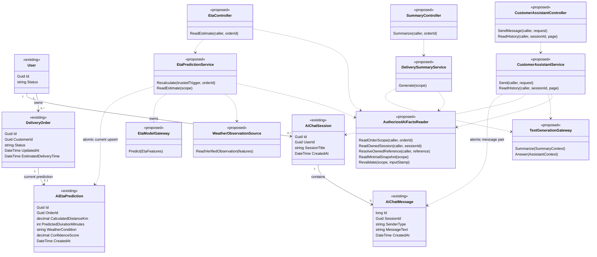

# Class Diagram - AI-assisted services

**Parent:** [LA-201](https://hungndemail.atlassian.net/browse/LA-201). **Task:** [LA-244](https://hungndemail.atlassian.net/browse/LA-244).

Existing persistence entities are marked `existing`. All controllers, service/gateway classes and transfer objects are proposed responsibilities for LA-158/162/165, not implemented classes or fixed HTTP DTOs. Only relevant existing entity fields are shown; omitted sensitive fields must not be added to AI context by loading complete entities.

Nullable fields and storage constraints are specified in [class-specification-ai-services.md](class-specification-ai-services.md); Mermaid's simplified property types above do not remove nullability. No summary entity, prediction-history relationship, model tool with operational write authority, or session-to-order FK is implied.

Sequences: [ETA / LA-241](sequence-ai-eta-estimation.md), [summary / LA-242](sequence-ai-delivery-summarization.md), [customer assistant / LA-243](sequence-ai-customer-assistant.md).
