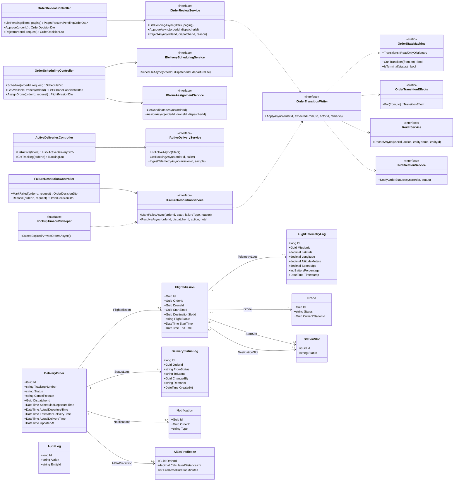
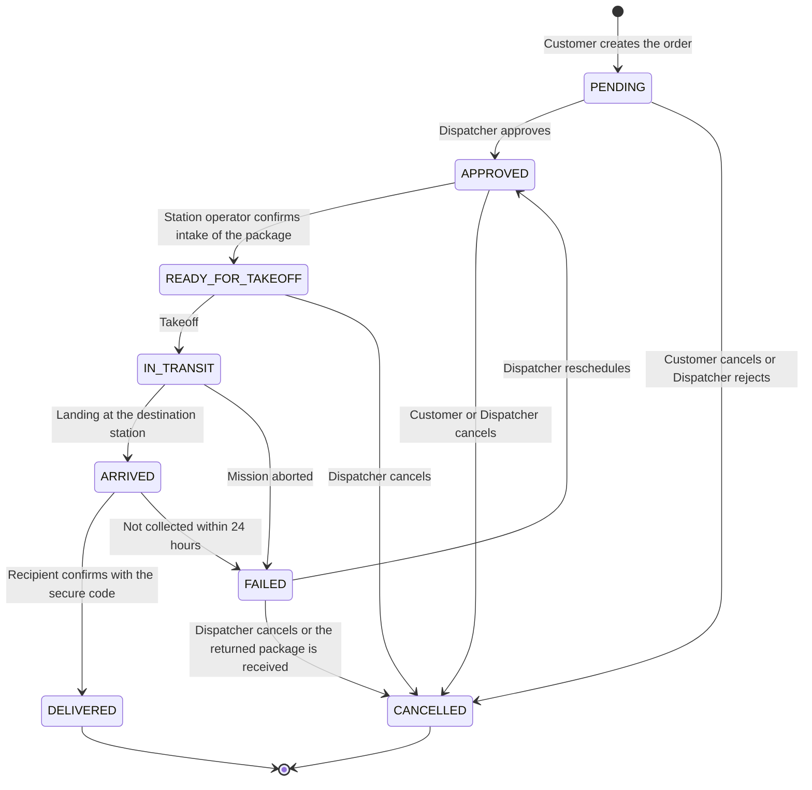
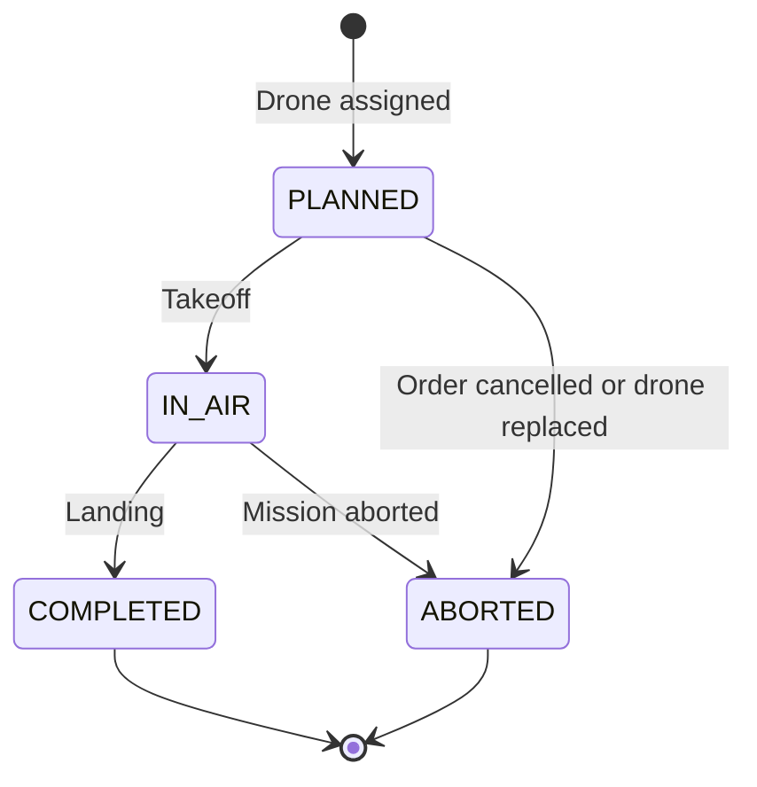

# Delivery Workflow — Class Diagram

**Parent:** LA-199 - Design documents: Delivery workflow

**Subtask:** LA-234 - Class diagram and specification for the workflow module

**Status:** Proposed for review

The class specification (fields, constraints, transition table, services and DTOs) is in [class-specification-delivery-workflow.md](class-specification-delivery-workflow.md).

---

## 1. Scope and architecture

This document gives the class diagram of the **Delivery Workflow** module of the SmartDroneDelivery ASP.NET Core 8 Web API: the order state machine, the flight mission, the status log, and the services that review, schedule, assign, track and resolve a delivery after the customer has created it (SRS FR-13 to FR-19, FR-24, FR-25, with FR-12, FR-14 and FR-32; use cases UC-11 to UC-14).

The entities are the ones already in `backend/SmartDroneDelivery.Api/Entities/`. Controllers, services and DTOs in this document are **proposed**: they do not exist yet. Only `DeliveryOrder`, `DeliveryStatusLog`, `Notification` and `AuditLog` are used by merged code today (customer create, update, cancel and list).

| Layer | Responsibility | Key components |
|---|---|---|
| **Presentation** | Authenticated endpoints, role checks (`DISPATCHER`, `ADMIN`, `STATION_OPERATOR`, `CUSTOMER`), translation of exceptions to RFC 7807 responses | `OrderReviewController`, `OrderSchedulingController`, `ActiveDeliveriesController`, `FailureResolutionController` |
| **Application** | One use case per method, one transaction per decision, validation of the state again inside the transaction | `IOrderReviewService`, `IDeliverySchedulingService`, `IDroneAssignmentService`, `IActiveDeliveryService`, `IFailureResolutionService`, `IPickupTimeoutSweeper` |
| **Domain** | The 8 order statuses, the allowed transitions and what each transition changes | `OrderStatus`, `OrderStateMachine`, `OrderTransitionEffects` |
| **Cross-cutting** | Append-only status log, audit entry, customer notification written together with the change | `IOrderTransitionWriter`, `IAuditService`, `INotificationService` |
| **Data access** | EF Core, PostgreSQL 16, conditional updates | `AppDbContext` |

---

## 2. Class diagram

Notes on the diagram:

- Only the properties that the workflow reads or writes are drawn. The full field list is in the specification.
- `IOrderTransitionWriter` is the single place that changes `delivery_orders.status`. Every service in the diagram goes through it, so the state machine, the status log, the audit entry and the notification cannot be skipped (FR-14, FR-32, FR-12).
- `IPickupTimeoutSweeper` is the scheduled job already described in [sequence-package-pickup-confirmation.md](sequence-package-pickup-confirmation.md) section 4. It marks the failure through `IFailureResolutionService`, so a timeout and a manual failure share one code path.
- The `1` to `0..1` link between `DeliveryOrder` and `FlightMission` is how the schema is today (`flight_missions.order_id` is unique). Section 4 of the specification explains the consequence for rescheduling.

---

## 3. Order state machine

The 8 statuses and the transitions are the ones of [business-processes.md](business-processes.md) section 1. The guard on each arrow says who may trigger it. The side effects of each arrow are in the specification (section 3).

Scheduling a departure and assigning a drone do **not** change the order status: the order stays `APPROVED` while a `PLANNED` mission exists. The status becomes `READY_FOR_TAKEOFF` only when the origin station operator confirms the package ([sequence-package-pickup-confirmation.md](sequence-package-pickup-confirmation.md) section 2). This keeps the status list at the 8 values of the ERD (BR-DW-01).

---

## 4. Mission and drone states that move with the order

| Order event | Order status | Mission `flight_status` | Drone status | Destination slot |
|---|---|---|---|---|
| Drone assigned | `APPROVED` | `PLANNED` | `ASSIGNED` | `RESERVED` |
| Intake confirmed | `READY_FOR_TAKEOFF` | `PLANNED` | `ASSIGNED` | `RESERVED` (origin slot `OCCUPIED`) |
| Takeoff | `IN_TRANSIT` | `IN_AIR` | `FLYING` | `RESERVED` (origin slot `EMPTY`) |
| Landing | `ARRIVED` | `COMPLETED` | `CHARGING` or `IDLE` | `OCCUPIED` |
| Delivery confirmed | `DELIVERED` | `COMPLETED` | `IDLE` | `EMPTY` |
| Mission aborted | `FAILED` | `ABORTED` | `FLYING` until it lands, then `CHARGING` or `IDLE` | stays `RESERVED` until the dispatcher resolves |
| Cancelled while `APPROVED` or `READY_FOR_TAKEOFF` | `CANCELLED` | `ABORTED` | `IDLE` | `EMPTY` |
