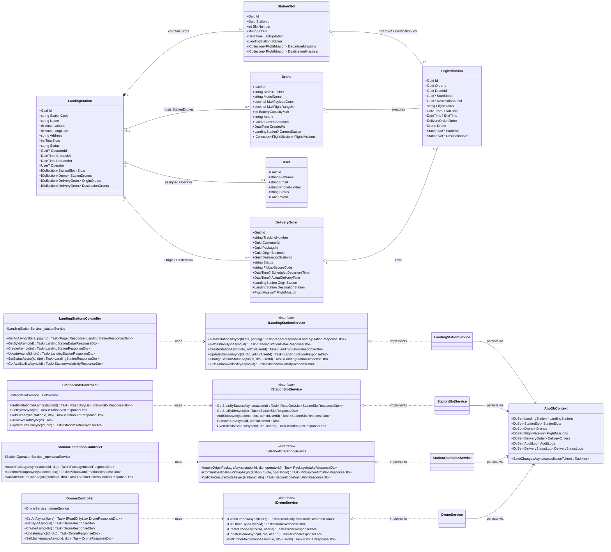

# Landing Stations, Slots and Drones — Class Diagram

**Parent:** LA-198 - Design documents: Landing stations, slots and drones

**Subtask:** LA-230 - Class diagram and specification for stations, slots and drones

**Status:** Proposed for review

---

## 1. Scope and architecture

This document provides the architectural class diagram and structural design for the **Landing Stations, Slots and Drones** module of the SmartDroneDelivery ASP.NET Core 8 Web API. It models the core physical infrastructure, fleet assets, operational slots, and their application service orchestration.

In accordance with the project architecture ([architecture.md](../architecture/architecture.md)), the module is structured into distinct layers:

| Layer | Responsibility | Key Components |
|---|---|---|
| **Presentation** | Authenticated HTTP endpoints, routing, role-based authorization (`ADMIN`, `STATION_OPERATOR`, `DISPATCHER`), model binding, and HTTP status code translation | `LandingStationsController`, `StationSlotsController`, `StationOperationsController`, `DronesController` |
| **Application** | Use-case orchestration, domain validation, physical safety rules, status transitions, atomic transaction boundaries, and event notifications | `ILandingStationService` / `LandingStationService`, `IStationSlotService` / `StationSlotService`, `IStationOperationService` / `StationOperationService`, `IDroneService` / `DroneService` |
| **Domain** | Physical and aeronautical entities, core status enumerations, validation rules, and relational navigations | `LandingStation`, `StationSlot`, `Drone`, `FlightMission`, `DeliveryOrder`, `StationStatus`, `SlotStatus`, `DroneStatus`, `FlightMissionStatus`, `OrderStatus` |
| **Data Access** | Entity Framework Core persistence, PostgreSQL relational mapping, transaction execution, and concurrency control | `AppDbContext`, EF Core configuration, PostgreSQL 16 |
| **DTO Boundary** | Strongly-typed request/response data transfer contracts at the API boundary; entities are never directly exposed to HTTP clients | Station request/response DTOs, Slot request/response DTOs, Intake/Pickup DTOs, Drone DTOs |

---

## 2. Class diagram

---

## 3. Structural mapping and domain rules

### 3.1 Status domain vocabularies

| Entity | Allowed statuses (`varchar(30)`) | Initial / Default | State semantics |
|---|---|---|---|
| `LandingStation` | `OPERATIONAL`, `MAINTENANCE`, `OFFLINE` | `OPERATIONAL` | `OPERATIONAL`: Available for flight departures, arrivals, and storage.  `MAINTENANCE`: Hub isolated for repairs; no new missions scheduled.  `OFFLINE`: Hub decommissioned or shut down. |
| `StationSlot` | `EMPTY`, `OCCUPIED`, `RESERVED`, `ERROR` | `EMPTY` | `EMPTY`: Free for landing, charging, or parcel placement.  `OCCUPIED`: Contains a drone or stored parcel.  `RESERVED`: Booked by an in-flight mission en route.  `ERROR`: Hardware fault, debris, or maintenance isolation. |
| `Drone` | `IDLE`, `ASSIGNED`, `FLYING`, `CHARGING`, `MAINTENANCE` | `IDLE` | Aligned with ERD and `LA-233`. Only `IDLE` drones are offered for assignment. `CHARGING` drones are not offered until a trusted battery source exists (the `drones` table has no charge column; see class-specification-delivery-workflow.md, open point 3). |
| `FlightMission` | `PLANNED`, `IN_AIR`, `COMPLETED`, `ABORTED` | `PLANNED` | Aligned with ERD. Created when drone is assigned to an approved delivery order. |
| `DeliveryOrder` | `PENDING`, `APPROVED`, `READY_FOR_TAKEOFF`, `IN_TRANSIT`, `ARRIVED`, `DELIVERED`, `CANCELLED`, `FAILED` | `PENDING` | Approved delivery order transitions to `READY_FOR_TAKEOFF` upon origin intake, and `ARRIVED` to `DELIVERED` upon pickup confirmation. |

### 3.2 Relational integrity rules

1. **Station — Slot Composition:** Every `StationSlot` belongs strictly to exactly one `LandingStation`. When a station is deleted, cascade delete applies to its slots (`OnDelete(DeleteBehavior.Cascade)`), provided no active mission references exist.
2. **Unique Slot Index:** `(station_id, slot_number)` forms a unique composite index in PostgreSQL. Slot numbers are consecutive integers ($1 \le \text{slotNumber} \le \text{totalSlots}$).
3. **Station Coordinates:** `Latitude` ($-90.000000$ to $90.000000$) and `Longitude` ($-180.000000$ to $180.000000$) use `numeric(9,6)` precision for sub-meter geographic resolution.
4. **Drone Fleet Hosting:** `Drone.CurrentStationId` is a nullable foreign key (`OnDelete(DeleteBehavior.SetNull)`). A drone in flight (`status = 'FLYING'`) has `CurrentStationId = null`.
5. **Slot Reservation Consistency:** A destination slot transition to `RESERVED` occurs upon flight mission scheduling. Upon drone touchdown, it transitions to `OCCUPIED`. Upon customer pickup, it transitions to `EMPTY`.
