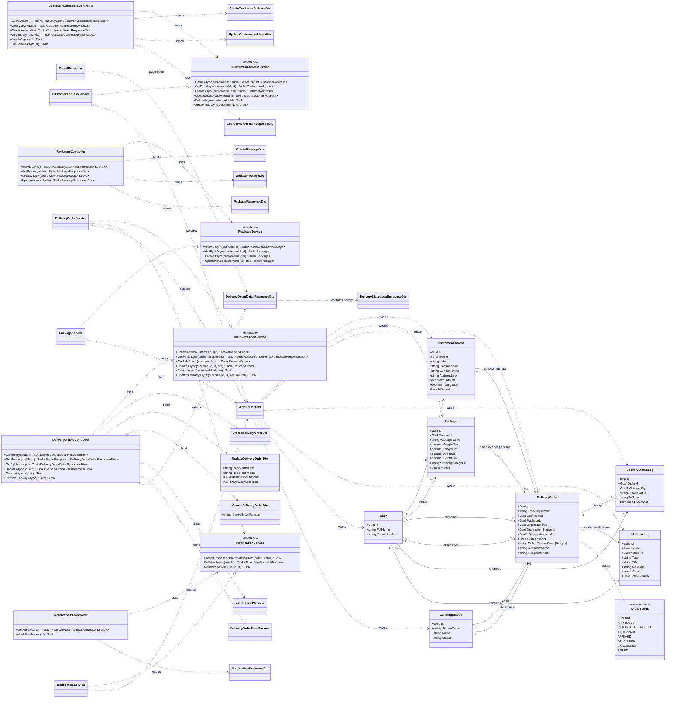

# Customer, Address, Package and Order Management — Class Diagram

## Scope and architecture

This is a design specification for the SmartDroneDelivery ASP.NET Core 8 Web API. It is not an implementation or a claim that these controllers, services, and DTOs already exist.

The module follows these layers:

| Layer | Responsibility | Main types |
|---|---|---|
| Presentation | Authenticated HTTP endpoints, request binding, authorization, and HTTP response mapping | `CustomerAddressesController`, `PackagesController`, `DeliveryOrdersController`, `NotificationsController` |
| Application | Use-case orchestration, ownership checks, validation, status rules, and transaction boundaries | `ICustomerAddressService`, `IPackageService`, `IDeliveryOrderService`, `INotificationService` and their service implementations |
| Domain | Customer delivery concepts, relationships, and allowed order statuses | `CustomerAddress`, `Package`, `DeliveryOrder`, `DeliveryStatusLog`, `Notification`, `User`, `LandingStation`, `OrderStatus` |
| Data Access | EF Core persistence and database transactions | `AppDbContext`, PostgreSQL |
| DTO | Input/output contracts at the API boundary; entities are not returned directly | Create/update/cancel/filter request DTOs and order/notification response DTOs |

DTOs are shown as a boundary layer rather than a separate runtime dependency of the domain. Controllers bind DTOs and delegate to application services; services persist domain entities through `AppDbContext`.

## Class diagram

The diagram uses `0..1` for optional relationships and `0..*` for collections. A package can be unassigned or linked to one order; `DeliveryOrder.PackageId` is unique in the ERD. Origin and destination are separate required references to `LandingStation`.

Package measurements are constrained to `0 < WeightGram <= 5000`, `0 < LengthCm <= 40`, `0 < WidthCm <= 30`, and `0 < HeightCm <= 30`.

`NotificationsController` is included to provide the read/mark-as-read operations in UC-10. The three core controllers requested for address, package, and order management remain the primary module endpoints.

## Main processing flows

### Create delivery order

1. Require an authenticated `CUSTOMER`; take the customer ID from the authenticated principal, never from a client-supplied owner field.
2. Validate the request and confirm the selected package belongs to that customer and is not already assigned to an order. Confirm origin and destination are distinct, valid stations; validate an optional delivery address belongs to the same customer.
3. Check that package weight is at most `5000` grams and dimensions are at most `40 x 30 x 30` cm.
4. Generate a unique `TrackingNumber`. Enforce uniqueness with the database unique constraint and handle a collision by generating another value. Generate a random six-digit pickup secure code using a cryptographically secure random source.
5. In one database transaction, create the order with `PENDING`, add its initial `DeliveryStatusLog` (`FromStatus = null`, `ToStatus = PENDING`), and create the customer's order notification.
6. Commit and return `201 Created` with the order detail/location. Do not expose the secure code in an ordinary order-detail response; use an explicitly authorized delivery channel/view.

### Update and cancel an order

- Update only `RecipientName`, `RecipientPhone`, `DestinationStationId`, and `DeliveryAddressId` on an order owned by the signed-in customer and still before approval (`PENDING`). `PackageId`, `OriginStationId`, and `Status` are not updateable through this DTO. Reject edits after approval or another disallowed transition with `409 Conflict`; validate ownership of a replacement address and the destination station.
- Cancellation requires a non-empty `CancellationReason` and an order in a cancellable state. Within a transaction, set `CANCELLED`, map `CancellationReason` to the `cancel_reason` column, append a status log, and notify the customer. The exact cancellable statuses are not specified by the SRS and must be agreed before implementation.
- A failure after database commit but before an external push is sent must not silently lose the notification; use a durable notification/outbox strategy if delivery is asynchronous.

### Manage addresses and packages

- Address list/read/update/delete/default operations are always scoped to the authenticated customer. Setting a default must make the default unique for that customer in a transaction.
- An address referenced by an existing order must not cause historical order data to be deleted or changed. The optional order-to-address FK and delete behavior should be preserved (for example, detach the FK or reject deletion); choose and test the final policy before implementation.
- Package create/update is customer-scoped. Enforce `0 < WeightGram <= 5000`, `0 < LengthCm <= 40`, `0 < WidthCm <= 30`, and `0 < HeightCm <= 30`, along with optional image metadata validation. Do not allow reassignment or deletion to bypass the one-package/one-order invariant. Package capacity is checked when creating an order and again at physical intake where appropriate.
