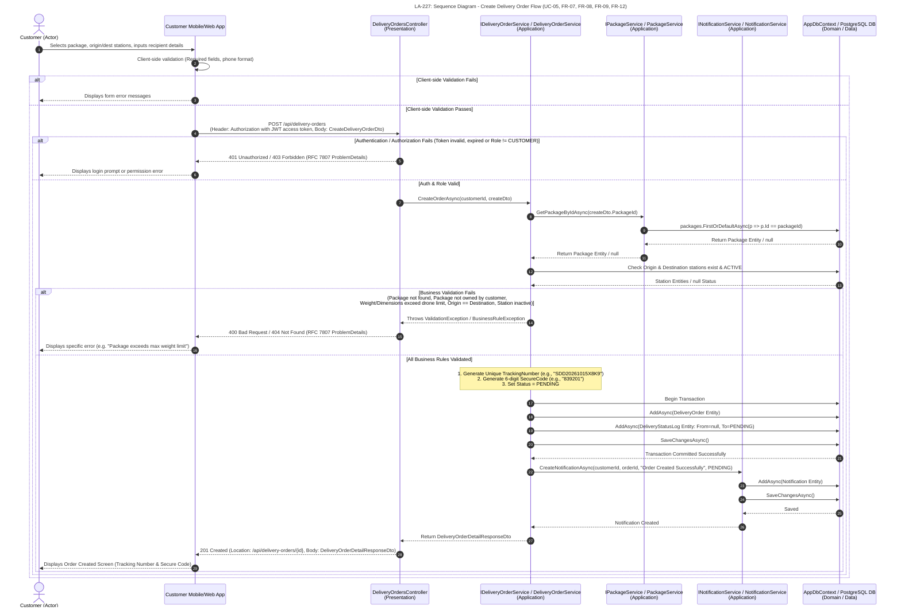

# LA-227: Sequence Diagram - Create Delivery Order

## 1. Tổng quan và phạm vi (Introduction & Scope)

Tài liệu đặc tả luồng tương tác giữa các lớp trong hệ thống khi khách hàng tạo đơn giao hàng (UC-05). Luồng bao quát việc nhập thông tin đơn hàng, xác thực và kiểm tra quy tắc nghiệp vụ, lưu đơn hàng cùng lịch sử trạng thái, tạo thông báo và trả kết quả cho ứng dụng khách hàng. Phạm vi liên quan đến FR-07, FR-08, FR-09 và FR-12.

### Participants

| Participant | Vai trò / tầng |
|---|---|
| Customer | Actor — khách hàng khởi tạo yêu cầu |
| Client | Customer Mobile/Web App — giao diện khách hàng |
| Controller | `DeliveryOrdersController` — Presentation |
| OrderSvc | `IDeliveryOrderService` / `DeliveryOrderService` — Application |
| PkgSvc | `IPackageService` / `PackageService` — Application |
| NotifSvc | `INotificationService` / `NotificationService` — Application |
| DbContext | `AppDbContext` / PostgreSQL DB — Domain / Data Access |

## 2. Sơ đồ tuần tự Mermaid (Mermaid Sequence Diagram)

## 3. Diễn giải luồng (Interaction Flow)

1. Khách hàng chọn kiện hàng, ga gửi và ga nhận, rồi nhập thông tin người nhận. Ứng dụng kiểm tra các trường bắt buộc và định dạng số điện thoại trước khi gửi yêu cầu.
2. Khi dữ liệu hợp lệ, ứng dụng gửi `POST /api/delivery-orders` kèm JWT trong header `Authorization` và `CreateDeliveryOrderDto`. Controller xác thực danh tính và quyền `CUSTOMER`, sau đó chuyển tiếp yêu cầu cùng `customerId` tới dịch vụ đơn hàng.
3. Dịch vụ đơn hàng lấy kiện hàng qua `IPackageService` và kiểm tra các ga. Các quy tắc nghiệp vụ gồm sự tồn tại và quyền sở hữu kiện hàng, giới hạn trọng lượng/kích thước, hai ga khác nhau và trạng thái hoạt động của ga.
4. Nếu hợp lệ, dịch vụ tạo mã theo dõi duy nhất, mã bảo mật 6 chữ số, đặt trạng thái ban đầu là `PENDING`, rồi lưu đơn hàng và bản ghi lịch sử trạng thái trong transaction.
5. Sau khi lưu đơn hàng, dịch vụ tạo thông báo cho khách hàng qua `INotificationService`. Cuối cùng, phản hồi thành công chứa `DeliveryOrderDetailResponseDto` được trả về với mã HTTP `201 Created` và URI của đơn hàng mới.

## 4. Kết quả và nhánh ngoại lệ (Responses & Exception Paths)

| Tình huống | Kết quả trong luồng |
|---|---|
| Kiểm tra phía client không đạt | Ứng dụng hiển thị lỗi biểu mẫu; không gửi yêu cầu tới API. |
| JWT không hợp lệ/hết hạn hoặc vai trò không phải `CUSTOMER` | API trả `401 Unauthorized` hoặc `403 Forbidden` với `ProblemDetails`; ứng dụng yêu cầu đăng nhập hoặc thông báo lỗi quyền. |
| Dữ liệu nghiệp vụ không hợp lệ | API trả `400 Bad Request` hoặc `404 Not Found` với `ProblemDetails`; ứng dụng hiển thị lỗi cụ thể. |
| Tạo đơn hàng thành công | API trả `201 Created`, `Location` và `DeliveryOrderDetailResponseDto`; màn hình kết quả hiển thị mã theo dõi và mã bảo mật. |
