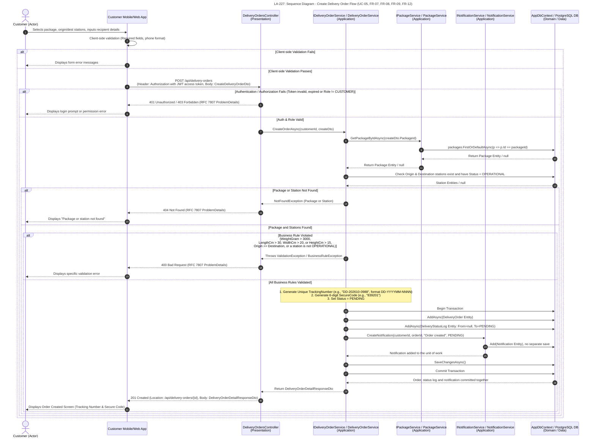

# LA-227: Sequence Diagram - Create Delivery Order

## 1. Overview and Scope

This document specifies the interactions between system components when a customer creates a delivery order (UC-05). The flow covers order entry, authentication and business-rule validation, saving the order and its status history, creating a notification, and returning the result to the customer application. It relates to FR-07, FR-08, FR-09, and FR-12.

### Participants

| Participant | Role / layer |
|---|---|
| Customer | Actor — customer initiating the request |
| Client | Customer Mobile/Web App — customer interface |
| Controller | `DeliveryOrdersController` — Presentation |
| OrderSvc | `IDeliveryOrderService` / `DeliveryOrderService` — Application |
| PkgSvc | `IPackageService` / `PackageService` — Application |
| NotifSvc | `INotificationService` / `NotificationService` — Application |
| DbContext | `AppDbContext` / PostgreSQL DB — Domain / Data Access |

## 2. Mermaid Sequence Diagram

## 3. Interaction Flow

1. The customer selects a package and origin and destination stations, then enters the recipient's details. Before sending the request, the application validates required fields and the phone number format.
2. Once the data is valid, the application sends `POST /api/delivery-orders` with the JWT in the `Authorization` header and a `CreateDeliveryOrderDto` body. The controller authenticates the customer and checks the `CUSTOMER` role, then forwards the request and `customerId` to the order service.
3. The order service retrieves the package through `IPackageService` and checks that the stations exist and have `OPERATIONAL` status. A missing package or station, or a package that belongs to another customer, results in `404 Not Found` (BR-CO-36). If the entities exist but a business rule is violated (the package does not belong to the customer, `WeightGram > 3000` g (3.0 kg), `LengthCm > 30` cm, `WidthCm > 20` cm, `HeightCm > 15` cm, the origin and destination are the same, or a station is not `OPERATIONAL`), the request results in `400 Bad Request`. The corresponding accepted limits are `WeightGram <= 3000`, `LengthCm <= 30`, `WidthCm <= 20`, and `HeightCm <= 15`.
4. If validation succeeds, the service generates a unique tracking number and a six-digit secure code, sets the initial status to `PENDING`, and begins a database transaction. It adds the `DeliveryOrder`, the initial `DeliveryStatusLog` (`From=null`, `To=PENDING`) and the customer `Notification` in the same transaction and commits once; if any step fails, nothing is saved.
5. The notification (FR-12) is created inside that transaction, not after it, so an order never exists without its notification. The service then returns a successful response containing a `DeliveryOrderDetailResponseDto`, with HTTP status `201 Created` and the new order's URI.

## 4. Responses and Exception Paths

| Scenario | Flow result |
|---|---|
| Client-side validation fails | The application displays form errors and does not send a request to the API. |
| JWT is invalid or expired, or the role is not `CUSTOMER` | The API returns `401 Unauthorized` or `403 Forbidden` with `ProblemDetails`; the application prompts the customer to sign in or displays a permission error. |
| A business rule is violated (the package does not belong to the customer, `WeightGram > 3000`, `LengthCm > 30`, `WidthCm > 20`, `HeightCm > 15`, the origin and destination are the same, or a station is not `OPERATIONAL`) | The API returns `400 Bad Request` with `ProblemDetails`; the application displays a specific validation error. |
| The package or station cannot be found | The API returns `404 Not Found` with `ProblemDetails`; the application reports that the requested resource could not be found. |
| Order creation succeeds | The API returns `201 Created`, a `Location` header, and a `DeliveryOrderDetailResponseDto`; the result screen displays the tracking number and secure code. |
