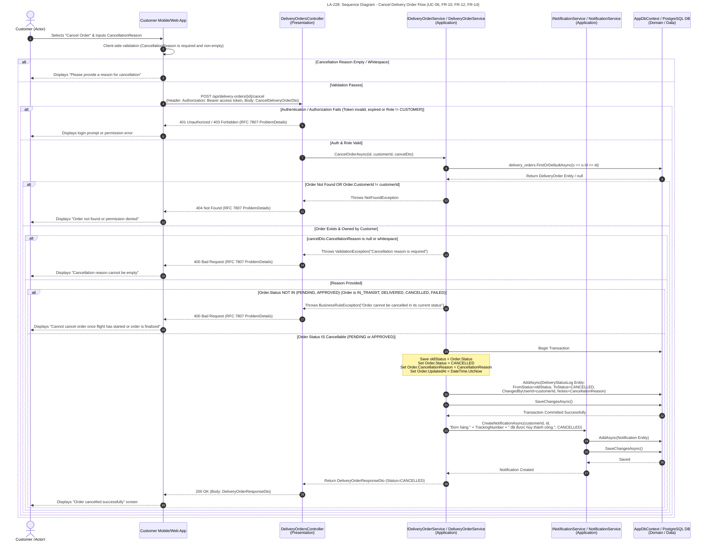

# LA-228: Sequence Diagram - Update/Cancel Delivery Order

## 1. Tổng quan và phạm vi (Introduction & Scope)

Tài liệu đặc tả hai luồng tương tác của khách hàng khi cập nhật thông tin đơn hàng (UC-06, FR-10) và khi hủy đơn hàng kèm lý do (UC-06, FR-10, FR-12, FR-14). Luồng cập nhật mô tả việc kiểm tra quyền sở hữu, trạng thái đơn hàng và dữ liệu thay đổi trước khi lưu. Luồng hủy mô tả việc xác thực lý do, kiểm tra trạng thái có thể hủy, ghi lịch sử trạng thái và tạo thông báo cho khách hàng.

### Participants

| Participant | Vai trò / tầng |
|---|---|
| Customer | Actor — khách hàng khởi tạo yêu cầu |
| Client | Customer Mobile/Web App — giao diện khách hàng |
| Controller | `DeliveryOrdersController` — Presentation |
| OrderSvc | `IDeliveryOrderService` / `DeliveryOrderService` — Application |
| NotifSvc | `INotificationService` / `NotificationService` — Application |
| DbContext | `AppDbContext` / PostgreSQL DB — Domain / Data Access |

## 2. Sơ đồ tuần tự Mermaid (Mermaid Sequence Diagrams)

### 2.1. Cập nhật đơn hàng (Update Order Flow)

```mermaid
sequenceDiagram
    autonumber
    title LA-228: Sequence Diagram - Update Delivery Order Flow (UC-06, FR-10)

    actor Customer as Customer (Actor)
    participant Client as Customer Mobile/Web App
    participant Controller as DeliveryOrdersController<br/>(Presentation)
    participant OrderSvc as IDeliveryOrderService / DeliveryOrderService<br/>(Application)
    participant DbContext as AppDbContext / PostgreSQL DB<br/>(Domain / Data)

    %% Step 1: Customer UI Interaction
    Customer ->> Client: Edits order details (RecipientName, RecipientPhone, DestinationStationId, DeliveryAddressId)
    Client ->> Client: Client-side validation (Required fields, phone format)
    Note over Client: UpdateDeliveryOrderDto contains exactly RecipientName, RecipientPhone, DestinationStationId, and DeliveryAddressId.<br/>PackageId and Status are not editable through this request.
    Note over OrderSvc: Package limits are validated at order creation, not updated here: WeightGram <= 5000 (5.0 kg), LengthCm <= 40 cm, WidthCm <= 30 cm, HeightCm <= 30 cm.

    alt Client-side Validation Fails
        Client -->> Customer: Displays form error messages
    else Client-side Validation Passes
        %% Step 2: HTTP PUT Request
        Client ->> Controller: PUT /api/delivery-orders/{id}<br/>(Header: Authorization: Bearer access token, Body: UpdateDeliveryOrderDto)

        alt Request attempts to include PackageId or Status
            Controller -->> Client: 400 Bad Request (RFC 7807 ProblemDetails; field is not allowed)
            Client -->> Customer: Displays "Package and order status cannot be changed"
        else Request contains only the four allowed fields
        %% Step 3: Auth & Role Validation
        alt Authentication / Authorization Fails (Token invalid, expired or Role != CUSTOMER)
            Controller -->> Client: 401 Unauthorized / 403 Forbidden (RFC 7807 ProblemDetails)
            Client -->> Customer: Displays login prompt or permission error
        else Auth & Role Valid
            Controller ->> OrderSvc: UpdateOrderAsync(id, customerId, updateDto)

            %% Step 4: Fetch Order & Ownership Check
            OrderSvc ->> DbContext: delivery_orders.FirstOrDefaultAsync(o => o.Id == id)
            DbContext -->> OrderSvc: Return DeliveryOrder Entity / null

            alt Order Not Found OR Order.CustomerId != customerId
                OrderSvc -->> Controller: Throws NotFoundException
                Controller -->> Client: 404 Not Found (RFC 7807 ProblemDetails)
                Client -->> Customer: Displays "Order not found or permission denied"
            else Order Exists & Owned by Customer
                %% Step 5: Business Rule Validation (FR-10)
                alt Order.Status != PENDING (Order is APPROVED, IN_TRANSIT, DELIVERED, CANCELLED, etc.)
                    OrderSvc -->> Controller: Throws BusinessRuleException("Order cannot be modified after approval")
                    Controller -->> Client: 400 Bad Request (RFC 7807 ProblemDetails)
                    Client -->> Customer: Displays "Cannot update order that is already approved or processed"
                else Order Status == PENDING
                    %% Step 6: Validate New Destination Station / Address (if changed)
                    alt DestinationStationId changed & Invalid (Station not found, not OPERATIONAL, or Same as Origin)
                        OrderSvc -->> Controller: Throws ValidationException
                        Controller -->> Client: 400 Bad Request (RFC 7807 ProblemDetails)
                        Client -->> Customer: Displays specific error (e.g. "Destination station is invalid or not operational")
                    else New Data Valid
                        %% Step 7: Apply Updates & Persistence
                        OrderSvc ->> OrderSvc: Update properties (RecipientName, RecipientPhone, DestinationStationId, DeliveryAddressId, UpdatedAt)
                        OrderSvc ->> DbContext: SaveChangesAsync()
                        DbContext -->> OrderSvc: Changes Saved

                        %% Step 8: Return Response DTO
                        OrderSvc -->> Controller: Return DeliveryOrderDetailResponseDto
                        Controller -->> Client: 200 OK (Body: DeliveryOrderDetailResponseDto)
                        Client -->> Customer: Displays "Order updated successfully" notification & updated order details
                    end
                end
                end
        end
                        end
    end
```

### 2.2. Hủy đơn hàng (Cancel Order Flow)



## 3. Diễn giải luồng (Interaction Flow)

1. **Cập nhật:** Khách hàng chỉnh sửa thông tin người nhận, ga đích hoặc địa chỉ giao hàng. Request chỉ chứa bốn trường `RecipientName`, `RecipientPhone`, `DestinationStationId` và `DeliveryAddressId` trong `UpdateDeliveryOrderDto`; `PackageId` và `Status` không được phép cập nhật. Các giới hạn package (`WeightGram <= 5000` g/5.0 kg, `LengthCm <= 40` cm, `WidthCm <= 30` cm, `HeightCm <= 30` cm) được kiểm tra khi tạo đơn, không phải trong luồng cập nhật này. Request có một trong hai trường bị cấm sẽ bị từ chối với `400 Bad Request`.
2. Controller xác thực danh tính và quyền `CUSTOMER`, sau đó chuyển `id`, `customerId` và dữ liệu cập nhật tới dịch vụ đơn hàng. Dịch vụ xác nhận đơn hàng tồn tại, thuộc sở hữu khách hàng và vẫn ở trạng thái `PENDING`.
3. Dịch vụ kiểm tra ga đích mới ở trạng thái `OPERATIONAL` và khác ga gửi (cùng địa chỉ giao hàng nếu có thay đổi). Nếu hợp lệ, dịch vụ cập nhật các thuộc tính đơn hàng và lưu thay đổi; API trả `200 OK` cùng `DeliveryOrderDetailResponseDto`.
4. **Hủy:** Khách hàng nhập lý do hủy không rỗng. Ứng dụng gửi `POST /api/delivery-orders/{id}/cancel` cùng JWT và `CancelDeliveryOrderDto`; dịch vụ tiếp tục kiểm tra quyền sở hữu, lý do và trạng thái đơn hàng.
5. Chỉ đơn hàng `PENDING` hoặc `APPROVED` mới được hủy. Dịch vụ cập nhật trạng thái thành `CANCELLED`, lưu `CancellationReason` và bản ghi `DeliveryStatusLog` (`FromStatus` → `CANCELLED`, `ChangedByUserId = customerId`, `Notes = CancellationReason`) trong transaction. Sau đó, `INotificationService` tạo thông báo cho khách hàng; API trả `200 OK` cùng `DeliveryOrderResponseDto`.

## 4. Kết quả và nhánh ngoại lệ (Responses & Exception Paths)

| Tình huống | Kết quả trong luồng |
|---|---|
| Kiểm tra phía client không đạt | Ứng dụng hiển thị lỗi biểu mẫu; không gửi yêu cầu tới API. |
| JWT không hợp lệ/hết hạn hoặc vai trò không phải `CUSTOMER` | API trả `401 Unauthorized` hoặc `403 Forbidden` với `ProblemDetails`; ứng dụng yêu cầu đăng nhập hoặc thông báo lỗi quyền. |
| Không tìm thấy đơn hàng hoặc đơn hàng không thuộc khách hàng | API trả `404 Not Found` với `ProblemDetails`; ứng dụng thông báo không tìm thấy đơn hàng hoặc không có quyền truy cập. |
| Đơn hàng không ở trạng thái phù hợp để cập nhật/hủy, hoặc dữ liệu/lý do không hợp lệ | API trả `400 Bad Request` với `ProblemDetails`; ứng dụng hiển thị lỗi tương ứng. |
| Request cập nhật cố truyền `PackageId` hoặc `Status` | API từ chối trường không được phép với `400 Bad Request`; hai trường này không thuộc `UpdateDeliveryOrderDto`. |
| Cập nhật đơn hàng thành công | API trả `200 OK` cùng `DeliveryOrderDetailResponseDto`; ứng dụng hiển thị thông tin đã cập nhật. |
| Hủy đơn hàng thành công | API trả `200 OK` cùng `DeliveryOrderResponseDto`; trạng thái và lịch sử hủy được lưu, đồng thời khách hàng nhận thông báo. |
