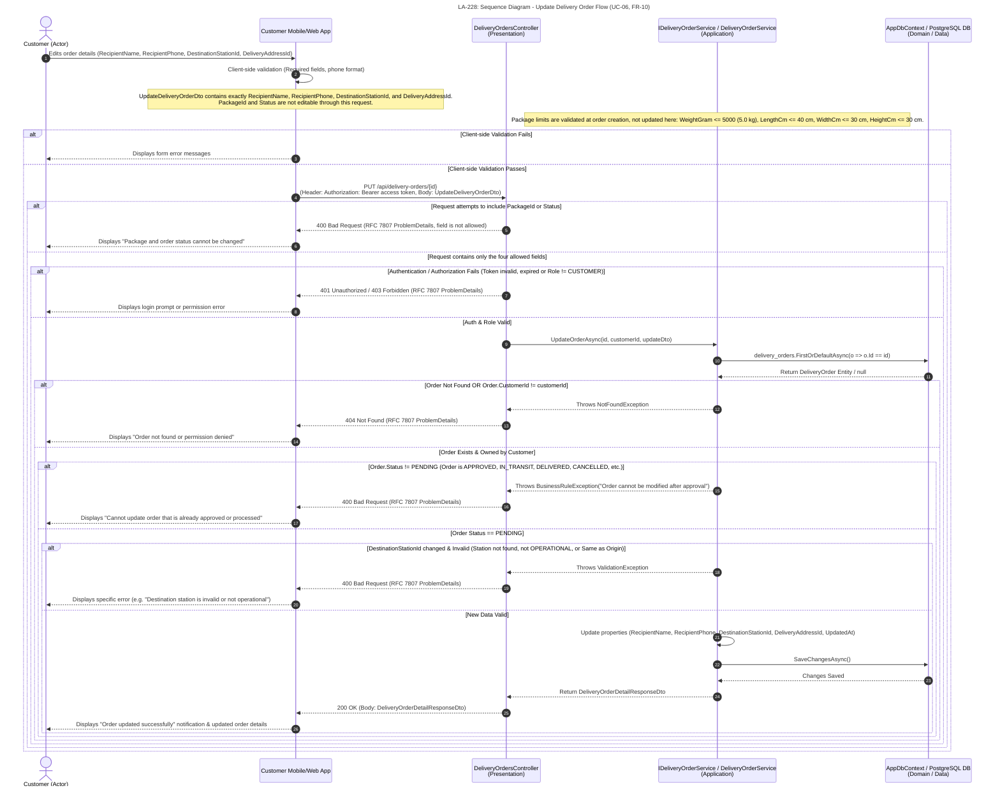
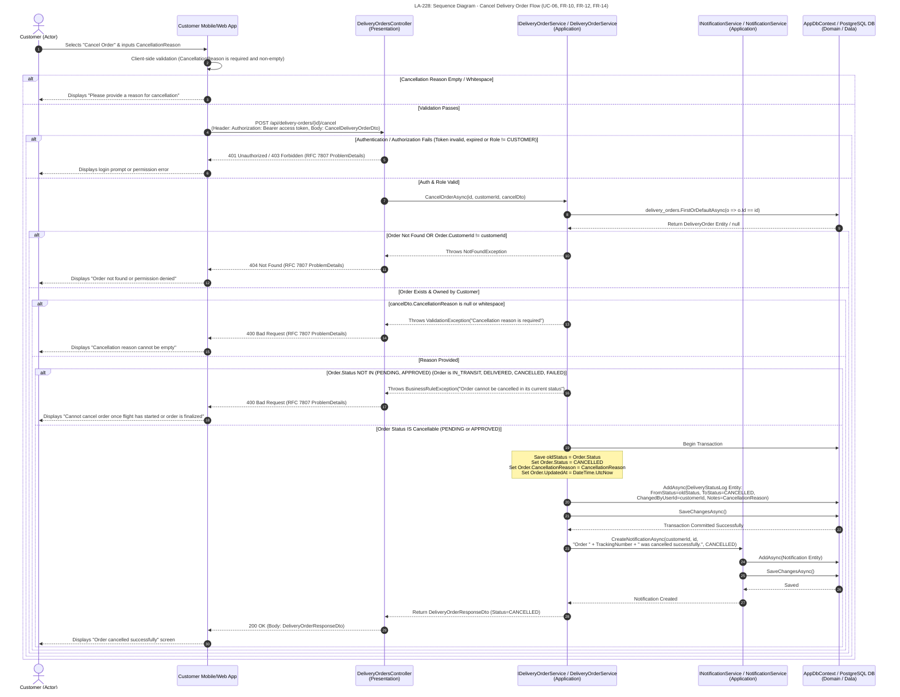

# LA-228: Sequence Diagram - Update/Cancel Delivery Order

## 1. Overview and Scope

This document specifies the customer interaction flows for updating an order (UC-06, FR-10) and cancelling an order with a reason (UC-06, FR-10, FR-12, FR-14). The update flow checks ownership, order status, and the submitted changes before saving. The cancellation flow validates the reason, checks whether the order can be cancelled, records the status history, and creates a customer notification.

### Participants

| Participant | Role / layer |
|---|---|
| Customer | Actor — customer initiating the request |
| Client | Customer Mobile/Web App — customer interface |
| Controller | `DeliveryOrdersController` — Presentation |
| OrderSvc | `IDeliveryOrderService` / `DeliveryOrderService` — Application |
| NotifSvc | `INotificationService` / `NotificationService` — Application |
| DbContext | `AppDbContext` / PostgreSQL DB — Domain / Data Access |

## 2. Mermaid Sequence Diagrams

### 2.1. Update Order Flow

### 2.2. Cancel Order Flow

## 3. Interaction Flow

1. **Update:** The customer edits the recipient details, destination station, or delivery address. The `UpdateDeliveryOrderDto` contains only `RecipientName`, `RecipientPhone`, `DestinationStationId`, and `DeliveryAddressId`; `PackageId` and `Status` cannot be updated. Package limits (`WeightGram <= 5000` g (5.0 kg), `LengthCm <= 40` cm, `WidthCm <= 30` cm, and `HeightCm <= 30` cm) are checked when the order is created, not in this update flow. A request that includes either prohibited field is rejected with `400 Bad Request`.
2. The controller authenticates the customer and checks the `CUSTOMER` role, then passes `id`, `customerId`, and the update data to the order service. The service verifies that the order exists, belongs to the customer, and is still in `PENDING` status.
3. The service checks that the new destination station is `OPERATIONAL` and differs from the origin station, and validates the delivery address if it has changed. If validation succeeds, the service updates the order properties and saves the changes; the API returns `200 OK` with a `DeliveryOrderDetailResponseDto`.
4. **Cancel:** The customer enters a non-empty cancellation reason. The application sends `POST /api/delivery-orders/{id}/cancel` with the JWT and a `CancelDeliveryOrderDto`; the service then checks ownership, the reason, and the order status.
5. Only orders in `PENDING` or `APPROVED` status can be cancelled. The service sets the status to `CANCELLED` and saves `CancellationReason` and a `DeliveryStatusLog` record (`FromStatus` → `CANCELLED`, `ChangedByUserId = customerId`, `Notes = CancellationReason`) in a transaction. `INotificationService` then creates a customer notification; the API returns `200 OK` with a `DeliveryOrderResponseDto`.

## 4. Responses and Exception Paths

| Scenario | Flow result |
|---|---|
| Scenario | Flow result |
|---|---|
| Client-side validation fails | The application displays form errors and does not send a request to the API. |
| JWT is invalid or expired, or the role is not `CUSTOMER` | The API returns `401 Unauthorized` or `403 Forbidden` with `ProblemDetails`; the application prompts the customer to sign in or displays a permission error. |
| The order cannot be found or does not belong to the customer | The API returns `404 Not Found` with `ProblemDetails`; the application reports that the order could not be found or accessed. |
| The order is in a state that does not permit updating or cancellation, or the submitted data/reason is invalid | The API returns `400 Bad Request` with `ProblemDetails`; the application displays the corresponding error. |
| An update request attempts to include `PackageId` or `Status` | The API rejects the disallowed field with `400 Bad Request`; neither field is part of `UpdateDeliveryOrderDto`. |
| The order is updated successfully | The API returns `200 OK` with a `DeliveryOrderDetailResponseDto`; the application displays the updated order details. |
| The order is cancelled successfully | The API returns `200 OK` with a `DeliveryOrderResponseDto`; the cancellation status and history are saved, and the customer is notified. |
