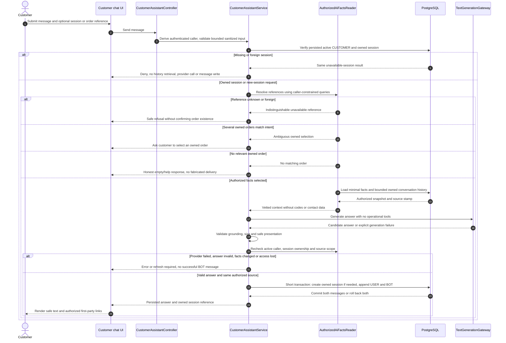
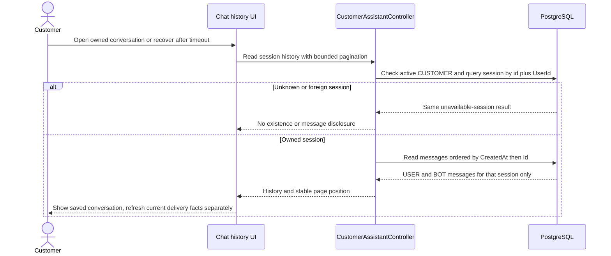

# Sequence Diagrams - Customer AI assistant

**Parent:** [LA-201](https://hungndemail.atlassian.net/browse/LA-201). **Task:** [LA-243](https://hungndemail.atlassian.net/browse/LA-243).

**Status:** Proposed design for Sprint 7 LA-165. Operation names describe responsibilities, not existing routes or an approved AI API contract.

## 1. Sources and privacy boundary

Basis: [SRS FR-31 / UC-09](../requirements/SRS.md), [functions F-17](../requirements/functions-user-management-and-analytics.md), [BR-UA-15/18/21/24](../requirements/business-rules.md), [AiChatSession](../../backend/SmartDroneDelivery.Api/Entities/AiChatSession.cs), [AiChatMessage](../../backend/SmartDroneDelivery.Api/Entities/AiChatMessage.cs), and [AI class specification](class-specification-ai-services.md).

The server derives the active CUSTOMER from bearer authentication. A session ID, tracking reference, model-generated tool argument or text instruction never grants authority. All session/message reads and writes are constrained through `session.UserId == caller`; all order context is constrained independently through `order.CustomerId == caller`. Staff-wide order visibility is not available through this customer assistant. Check these rules before loading history/context and again before publishing/persisting a generated answer.

## 2. Resolve a session and an owned order before generating

New-session requests do not insert a session until the successful persistence transaction in this proposal. No database transaction or row lock spans the provider call. Static refusal/clarification/help responses above do not create or mutate a session. If product requirements later require saving those interactions, they must use the same owned-session transaction and privacy rules.

## 3. Read conversation history and handle uncertain writes

Proposed failure behavior: on model failure, save neither the pending USER nor a fabricated BOT answer. On database failure, rollback the pair/session creation and return an error. A lost HTTP response may still follow a committed pair: reload owned history before an explicit retry. The existing schema has no client-request ID, delivery state or replay record, so it cannot promise exactly-once retry deduplication. Automatic write retries require a separately designed idempotency key/unique constraint.

## 4. Context and output guardrails

| Boundary | Required treatment |
|---|---|
| Customer input | Bound length and reject/redact secrets before prompt construction or message persistence. Exact redaction/limits require contract agreement; do not log raw request text. |
| Reference resolution | Resolve only owned IDs/tracking numbers; both foreign and unknown references produce the same response. A model may propose a reference but never choose the user scope. |
| History | Load only owned session messages under an agreed bounded context budget. Prior BOT text is untrusted conversation, not a database fact or continuing ownership grant. Reauthorize referenced facts each turn. |
| Delivery facts | Current status, vetted timeline, station-level context and labeled ETA availability/calculation time. No raw pickup code/QR, contact/address text, credentials or unrelated customers. |
| Prompt injection | USER text, history, remarks and retrieved text remain data. No instruction in them may change access rules, invoke arbitrary SQL/URLs or enable state-changing tools. |
| Model output | Validate allowed format/length and use safe text rendering. Ground order claims in current authorized facts; refuse unsupported questions honestly. No automatic pickup/cancel/flight actions. |
| Action links | Backend allowlist of first-party routes with an authorized opaque order reference. Never execute model-authored URLs or include credentials/codes in links. |
| Provider | Model choice, hosting, retention/training policy, prompt limits, timeout and privacy acceptance remain open; no external provider is approved by these diagrams. |

Earlier [LA-215 activity design](activity-analytics-and-ai-assistant.md) includes illustrative handoff, confidence thresholds and pickup-code action cards. These are not committed requirements: this design does not send codes to AI, add a human escalation/SignalR workflow, or assume Redis/vector storage. Implementing any of those requires a separate accepted contract.

Acceptance handoff: foreign/missing sessions and orders have parity; direct history reads enforce ownership; ambiguous orders ask for selection; zero orders produce help; malicious instructions cannot widen scope; raw secrets are rejected/redacted; inactive/demoted caller or ownership change during generation discards output; outage/invalid output saves no successful answer; lost-response recovery reads history; HTML/unsafe links are inert. No application test result is claimed by these diagrams.
