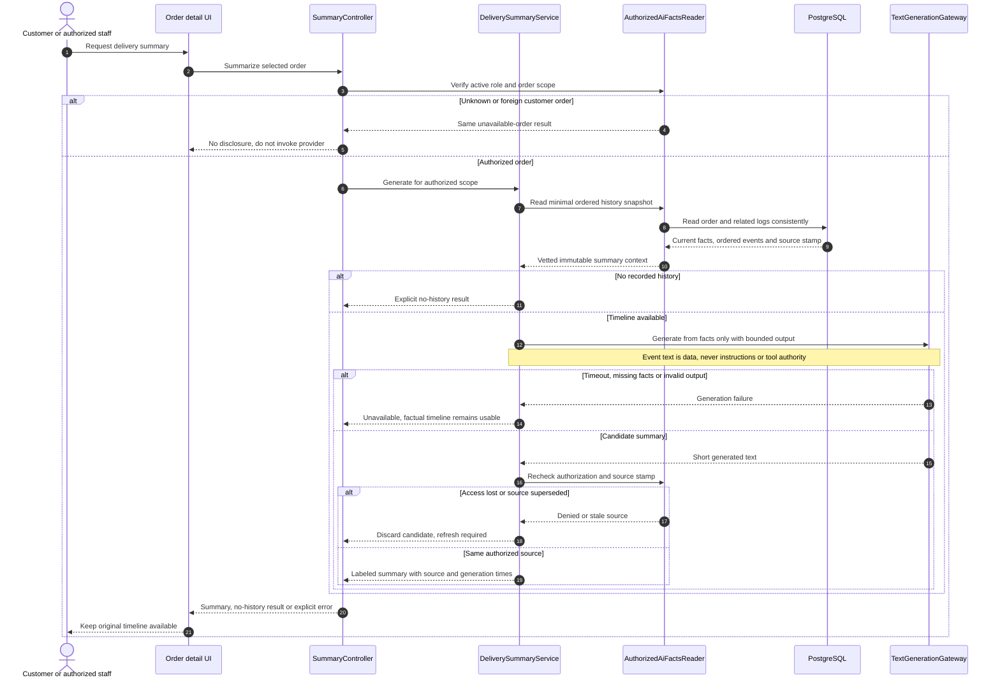

# Sequence Diagram - AI-assisted delivery summarization

**Parent:** [LA-201](https://hungndemail.atlassian.net/browse/LA-201). **Task:** [LA-242](https://hungndemail.atlassian.net/browse/LA-242).

**Status:** Proposed design for Sprint 7 LA-162. No summary endpoint, provider integration or persistent summary table is implemented by this documentation task.

## 1. Sources and authorized facts

Basis: [SRS FR-30](../requirements/SRS.md), [functions F-16](../requirements/functions-user-management-and-analytics.md), [BR-UA-15/18/23/24](../requirements/business-rules.md), [DeliveryStatusLog](../../backend/SmartDroneDelivery.Api/Entities/DeliveryStatusLog.cs), [DeliveryOrder](../../backend/SmartDroneDelivery.Api/Entities/DeliveryOrder.cs), and [AI class specification](class-specification-ai-services.md).

CUSTOMER is restricted to an owned order. DISPATCHER/MANAGER require current persisted operational authorization; no other role is inferred. Retrieve one authorized order and its related history under a consistent read snapshot. Sort status events by `CreatedAt`, then log `Id` ascending; preserve repeated transitions/reschedules rather than treating the latest mission as the entire history.

| Context | Permitted content / guard |
|---|---|
| Current order | Current order status and relevant actual/scheduled timestamps, labeled distinctly. Internal order ID is a server correlation key, not a provider requirement. |
| Timeline | FromStatus, ToStatus, event time and only vetted factual reason categories. Free-form Remarks may contain untrusted text or personal information; do not pass it verbatim. |
| ETA | Optional estimate with its calculation time and stale/unavailable label; never presented as an actual event. |
| Excluded | Pickup codes, customer/recipient identifiers, phone/address text, credentials, unrelated order histories and raw telemetry. No provider tool may retrieve another order. |

## 2. Generate a short summary from a frozen timeline

No transaction is held during generation. A source stamp must cover status/log changes and every fact used; it is proposed response/service metadata, not a current entity property. Recheck ownership after the model returns so an earlier authorization does not publish data after access is lost. A changed timeline invalidates the candidate under this proposed policy; retries must be bounded and user-visible.

## 3. Grounding and persistence rules

- ARRIVED means the parcel reached the destination; DELIVERED means receipt was confirmed. Mission COMPLETED alone cannot imply customer delivery. Distinguish CANCELLED, FAILED and a subsequent reschedule.
- Explain only recorded reasons. A missing event or reason is unknown, never an opportunity to infer weather, battery failure, blame or promised delivery time.
- The factual timeline is authoritative. Generation/validation failure must return an error or unavailable state and preserve access to that timeline; never report a fake successful summary.
- This design is read-only. The current ERD has no summary entity, cached-summary column or expiry/version metadata. Do not repurpose `AiChatMessage` as a summary cache or place generated prose in status/audit logs. Persistence/caching, if required, needs a scoped and versioned design/migration.
- Provider output is untrusted text: length/schema checks and safe UI rendering are required. It cannot execute commands or approve/cancel/retry flights. Exact language/length/latency limits and provider choice remain contract decisions.

Acceptance handoff: foreign-order parity; malicious/free-form remarks; out-of-order/tied log timestamps; missing history; reschedule after failure; ARRIVED versus DELIVERED; stale estimate versus actual time; timeout; permission change or timeline update during generation; HTML/script output; no operational writes. These are planned checks, not executed application tests.
