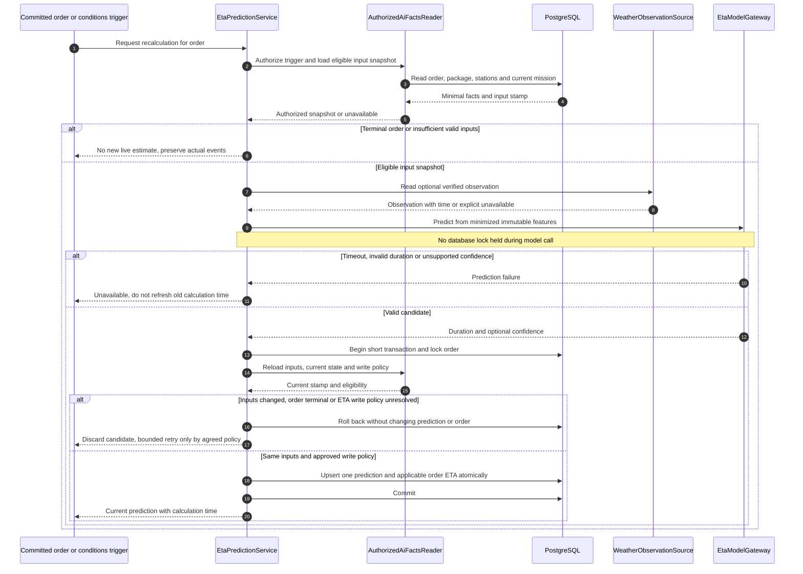
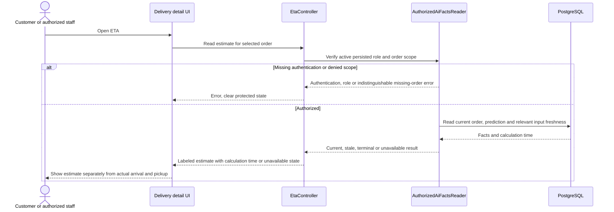

# Sequence Diagrams - AI-assisted ETA estimation

**Parent:** [LA-201](https://hungndemail.atlassian.net/browse/LA-201). **Task:** [LA-241](https://hungndemail.atlassian.net/browse/LA-241).

**Status:** Proposed implementation design for Sprint 7 LA-158. This document delivers the Sprint 6 diagram task, not an implemented AI endpoint, trained model or accepted prediction accuracy.

## 1. Sources and data boundary

Basis: [SRS FR-29](../requirements/SRS.md), [functions F-15](../requirements/functions-user-management-and-analytics.md), [business rules BR-UA-15/17/18/23](../requirements/business-rules.md), [DeliveryOrder](../../backend/SmartDroneDelivery.Api/Entities/DeliveryOrder.cs), [AiEtaPrediction](../../backend/SmartDroneDelivery.Api/Entities/AiEtaPrediction.cs), [EF mapping](../../backend/SmartDroneDelivery.Api/Data/AppDbContext.cs), and [AI class specification](class-specification-ai-services.md).

| Input / output | Source and treatment |
|---|---|
| Geometry / distance | Origin/destination station coordinates; optional authorized current-flight position. Validate ranges and freshness. Great-circle distance is a geometric input, not a verified flight route. Never use telemetry from an older mission. |
| Package weight | The order's linked package, validated positive and within existing delivery limits. Provider input needs weight, not package/customer identity. |
| Time anchor | Relevant scheduled departure before flight, or an agreed current-flight remaining-time anchor. Arrival at destination station and recipient pickup are distinct events. The target/anchor must be settled before implementation acceptance. |
| Weather / conditions | Optional verified observation with source/time and explicit missing/stale state. No weather entity/provider is implemented; unknown weather must not be called clear weather. |
| Prediction | Finite plausible duration, optional confidence in [0,1], calculation time and explicit availability/freshness. Duration rounding, maximum age and confidence thresholds remain open. |
| Persistence | Existing `AiEtaPrediction`: Id, unique OrderId, CalculatedDistanceKm, PredictedDurationMinutes, nullable WeatherCondition/ConfidenceScore, CreatedAt. One current row per order; no prediction history/model-version column is implied. Only scheduling-compatible full-route distance/full-flight duration may use this shared row; remaining-flight features require a separate informational path. |

Active CUSTOMER reads only owned orders. Active DISPATCHER/MANAGER access requires an explicit staff scope; ADMIN access is not inferred. A trusted recalculation trigger derives its order identity internally. Authentication/ownership precedes data retrieval and is checked again before publication. Neither provider prompts nor observability need recipient/contact data, address text, pickup codes, tokens or stable customer identifiers.

## 2. Recalculate and persist a current prediction

The input stamp is a proposed in-memory comparison value covering the actual model inputs, relevant order/mission versions and observation times. `Order.UpdatedAt` alone cannot detect edits to package/station inputs. It is not an existing database field. Competing first predictions must serialize on the order and respect the unique OrderId index; do not append a prediction history or let a slower result overwrite a newer input generation.

**Shared operational inputs:** both `DeliveryOrder.EstimatedDeliveryTime` and the prediction row affect scheduling. Existing [DeliveryRouteEstimate.GetAsync](../../backend/SmartDroneDelivery.Api/Services/DeliveryRouteEstimate.cs) treats any positive stored `CalculatedDistanceKm` / `PredictedDurationMinutes` as authoritative full-route distance / flight duration; [SchedulingService](../../backend/SmartDroneDelivery.Api/Services/SchedulingService.cs) uses them for scheduled arrival and drone range checks. Writing current-flight remaining distance/time into that row could therefore corrupt a later reschedule even if the timestamp is unchanged.

The proposed transaction must gate **both** prediction-row and order-timestamp writes on an agreed full-route/full-duration interpretation and reservation-safe synchronization policy. Never store remaining-flight distance/duration or a differently anchored duration in the shared row. In-flight informational predictions require separate storage/read semantics and reviewed changes to operational consumers, not merely a different UI label. If the policy is unresolved or unsafe, write neither shared value and report the candidate unavailable. A model prediction must not silently move a reserved slot window, change range eligibility or authorize rescheduling.

## 3. Read an estimate without invoking the model

Reading does not recompute. Terminal orders must not show a stale estimate as a live countdown. A provider outage does not rewrite `ActualDeliveryTime`, order status, mission status, notifications or slot state. Missing prediction returns an explicit unavailable result, not a fabricated timestamp.

## 4. Decisions and acceptance handoff

Before LA-158 acceptance: settle target/anchor semantics, eligible states and triggers, model/provider, verified weather source, timeout/retry/deduplication, freshness/confidence/duration bounds, precision and the shared prediction-row/timestamp scheduling rule. API URLs/DTOs and provider data-handling approval require a separate AI API contract; none are created by these diagrams.

Acceptance scenarios: own/foreign order; demoted viewer; no prediction; missing/stale weather or telemetry; invalid model output; concurrent reschedule/package change; terminal transition while prediction runs; concurrent initial upserts; database failure rolling back prediction plus order ETA; and read-only viewing during model outage. These are future tests, not results claimed here.
