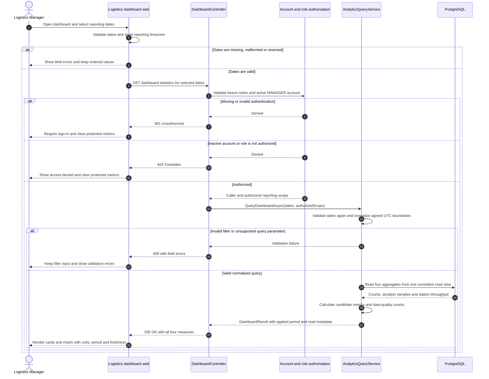
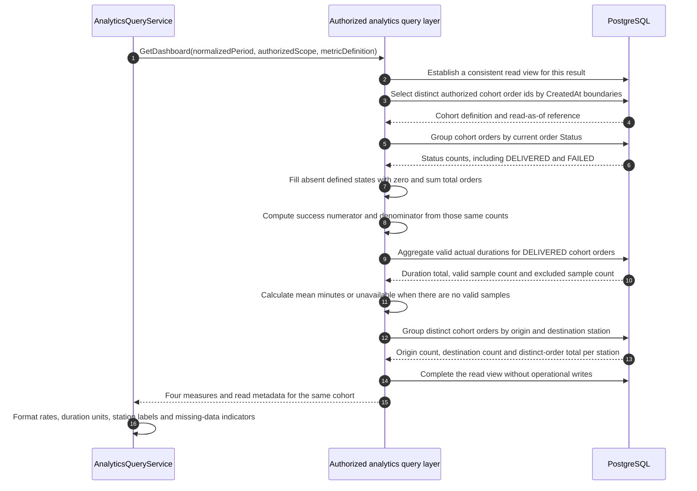
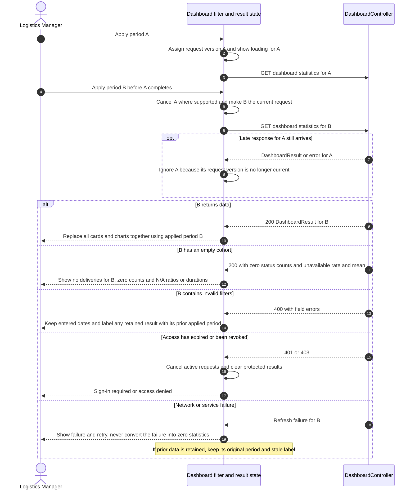

# Sequence Diagrams - Filtered Delivery Dashboard

**Parent:** [LA-200 - Tracking, confirmation and dashboard design](https://hungndemail.atlassian.net/browse/LA-200)

**Subtask:** [LA-240 - Sequence diagram for the dashboard](https://hungndemail.atlassian.net/browse/LA-240)

**Status:** Proposed for review. Dashboard endpoints and metric definitions are not confirmed API contracts or implemented behavior.

This document shows how the Logistics Manager's web portal requests, filters and receives delivery statistics (FR-28, UC-19). It covers the four required measures: orders by status, success rate, average delivery time and station usage. It does not implement analytics, exports, AI insights or operational actions.

## 1. Sources and design decisions

| Source | Basis |
|---|---|
| [SRS](../requirements/SRS.md), section 3.6 and [use cases](../requirements/use-cases.md) | FR-28 and UC-19, Logistics Manager dashboard with date filters |
| [Functions: user management and analytics](../requirements/functions-user-management-and-analytics.md), F-13/F-14 and section 7.1 | Dashboard/report behavior and candidate metric definitions, explicitly awaiting approval |
| [Business rules](../requirements/business-rules.md) | BR-UA-14 date boundaries, BR-UA-15 read-only analytics, BR-UA-16 four measures and N/A values, BR-UA-23 distinct order states, BR-LS-22 secure-code confidentiality |
| [Manager user flow](user-flows/logistics-manager.md) and [web wireframe index](wireframes/web/index.md) | Logistics dashboard, statistics/date filters and reports |
| [ERD](../architecture/erd.md), [DBML](../architecture/erd.dbml), [DeliveryOrder](../../backend/SmartDroneDelivery.Api/Entities/DeliveryOrder.cs), [StationSlot](../../backend/SmartDroneDelivery.Api/Entities/StationSlot.cs) | Order statuses, actual timestamps, station associations and current slot state |
| [Auth contract](../api/auth-api.md) | Bearer authentication, role codes, active-account checks and problem responses |

`DashboardController`, `AnalyticsQueryService`, `DashboardQuery` and `DashboardResult` below are proposed logical responsibilities. There is no dashboard route in the current API contract set. Labels such as **GET dashboard statistics** are operation descriptions, not committed URLs. The analytics contract must define the actual route, parameters, response fields, error shapes and permitted scope before implementation.

The source assigns this business dashboard to `MANAGER`. `ADMIN`, `DISPATCHER`, `STATION_OPERATOR` and `CUSTOMER` access is not inferred from the existence of their other dashboards. The server derives the caller and authorized data scope from the authenticated account, never from a client-supplied user id or role.

Candidate behavior used to make the diagrams concrete, inherited from source section 7.1 rather than declared as approved policy:

| Item | Candidate definition |
|---|---|
| Reporting dates | UI selects an inclusive calendar-date range in an agreed reporting timezone. Normalize its start and the day after its end into the half-open UTC interval `[startUtc, endExclusiveUtc)` |
| Cohort | Authorized distinct orders with `CreatedAt >= startUtc` and `CreatedAt < endExclusiveUtc`; evaluate their **current** status at the read snapshot, not historical status at period end |
| Orders by status | Count every cohort order once in its current state; include all eight states and zero counts for absent states |
| Success rate | `DELIVERED / (DELIVERED + FAILED) * 100`; return an unavailable value when the denominator is zero |
| Average delivery minutes | Mean of `ActualDeliveryTime - ActualDepartureTime` for DELIVERED cohort orders with both timestamps and a nonnegative duration; return unavailable if no valid samples, and return valid/excluded sample counts |
| Station usage | Distinct cohort orders associated with each station as origin or destination, with separate origin/destination counts and a deduplicated per-station total; label this measure **throughput**, not occupancy percentage |

No default reporting period, maximum date window, optional station/status/fleet filter, cache TTL or export format is assumed. Before querying, the user selects a valid period, or the future contract supplies a clearly displayed default. Calendar-day boundaries are computed in the reporting timezone before UTC conversion; do not assume that a local day is always 24 UTC hours.

## 2. Sequence 1: Open the dashboard and request a reporting period

Client-side validation is a convenience, not authorization or a substitute for backend validation. The date field used to build the cohort and the timezone are explicit in the returned period metadata. The UI renders the **applied** period from the result, rather than assuming the current input fields describe data that has not finished loading.

A logical `DashboardResult` groups the normalized period/timezone, metric-definition identifier, read/as-of and generation timestamps, eight status counts, success numerator/denominator/rate, average minutes with valid/excluded duration counts, and station-throughput rows. These are response design requirements to settle in the future contract, not fixed JSON property names. Return aggregate projections only; no pickup secure code, recipient phone, customer identity, raw telemetry, password hash or token is needed for these metrics.

## 3. Sequence 2: Query and aggregate statistics without double-counting

These are logical query steps, not a requirement to load every order into application memory or issue one database call per station. Prefer database aggregates over bounded projections. Use a single aggregate operation or a consistent read snapshot across multiple queries so a concurrent delivery transition cannot make the status chart and success-rate counts disagree within one response.

Build order-level counts from the order cohort before joining one-to-many status logs, telemetry or mission history. Retries and rescheduled missions must not count as additional orders. Duration samples use actual departure-to-recipient-confirmation timestamps under the candidate definition; they are not ETA values or mission flight duration. Missing or negative durations are excluded with an explicit count, not changed to zero.

Station-throughput totals across **different** stations do not sum to the number of orders: a delivery normally contributes to both its origin and destination. Deduplicate the combined count within each station and label the two directional counts. The `station_slots` table is a current snapshot with `Status` and `LastUpdated`; it cannot establish historical occupied-slot percentages for an arbitrary selected period. Do not mix current slot occupancy into the historical throughput chart.

Read-as-of metadata describes the consistency of the returned result, not guaranteed future immutability. An old created-date cohort can produce different current-status counts after a reschedule or later completion. Historical status-at-period-end reporting requires a separately approved definition and history query.

## 4. Sequence 3: Apply new filters, discard stale responses and handle empty/error results

Cancel/ignore superseded requests, including their errors, and dispose request handlers when leaving the dashboard. Do not relabel old metrics with newly entered dates, blend cards from different requests or leave an earlier response free to overwrite the selected period. Refresh/retry recomputes the currently selected normalized query. Filter validation failures preserve user input; authentication/authorization failures clear protected data rather than preserving it as a fallback.

For empty data, status counts are zero and undefined ratios/durations are N/A. A cohort can also contain orders but have a zero success denominator, for example only PENDING orders; its rate is still N/A. Station rows with no throughput may be omitted or represented as zero according to the future response contract, with the empty-state behavior stated explicitly.

## 5. Reports, decisions still required and design acceptance

The filtered report in F-14 must reuse the same authorization, date normalization, cohort and metric definitions as this dashboard. A report for the same period and read snapshot must agree with its cards. Newer reads may differ because current statuses changed; make freshness visible instead of claiming a historical snapshot. Export files, pagination, detail drill-down routes and AI-generated insights require their own contracts and implementation tasks.

The following decisions remain open before analytics implementation and metric acceptance:

1. Confirm the analytics URL, request/response schemas, default/max date range, date-only versus timestamp inputs and optional station/status/fleet filters. No route or parameter name in the diagrams is already an API promise.
2. Approve or replace the source's section 7.1 candidate definitions, especially created-date/current-status versus completed-date/historical cohorts, success denominator, rescheduled failures and duration anchor. Dashboard, reports and executable tests must change together if these definitions change.
3. Agree the reporting timezone and half-open boundaries. Do not derive business dates from a browser's local timezone or from UTC midnight silently.
4. Confirm reporting data scope for MANAGER and decide any extra-role access explicitly. Server authorization is required even when the navigation menu is hidden for other roles.
5. Choose station throughput or historical occupancy utilization. The latter needs additional occupancy history or an approved reconstruction source; current slot snapshots do not supply it.
6. Settle aggregate consistency, result freshness and any optional caching. Cache keys, if used, must include the authorized scope, normalized period/timezone and metric-definition version; no fixed TTL or new cache infrastructure is required by this subtask.

| Design check | Expected outcome under the candidate definitions |
|---|---|
| Authorized active Manager, valid period | One read-only result with all four required measures and applied-period/freshness metadata |
| Another role, inactive account or invalid token | Reject before querying protected statistics |
| Reversed/malformed dates, or unsupported filter | Validation error, no operational writes and no silent partial application |
| Orders exactly at the normalized boundaries | Include the start instant, exclude the next-day end instant |
| 6 DELIVERED, 2 FAILED, 1 CANCELLED and 1 IN_TRANSIT | Ten orders counted, success rate 75% under the proposed denominator, not 60% |
| Empty cohort or only unfinished orders | Zero counts where applicable, N/A for measures with no denominator or valid duration samples |
| DELIVERED orders with missing/negative actual duration | Exclude invalid samples, expose excluded count and show N/A if none remain |
| Multiple missions/logs for one order | Count one cohort order rather than counting joined history rows |
| Station origin/destination associations | Correct directional counts and deduplicated per-station totals, labeled throughput |
| Concurrent state transition while aggregates are read | Internally consistent counts/rates within one read result |
| Rapid A-to-B filter change with a late A response | Only B updates the displayed result and period |
| Service failure or access revocation | Distinct error handling, no fabricated zero/success result and no protected data retained after denial |

These are review scenarios, not executed analytics tests. LA-240 delivers a proposed sequence design; implementation remains subject to the analytics contract and metric decisions above.
