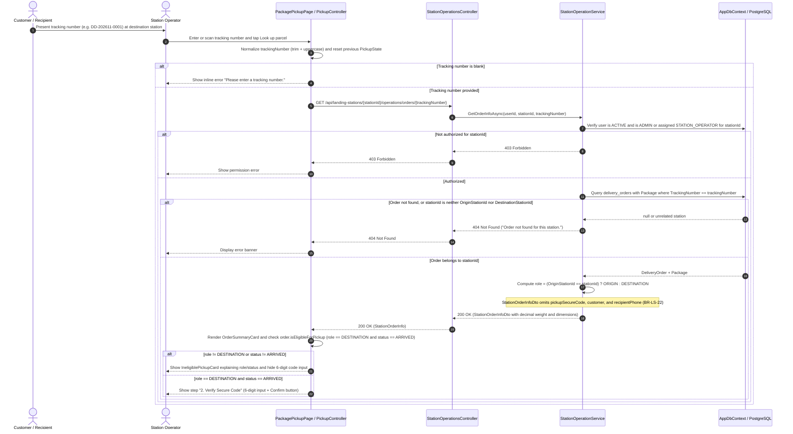
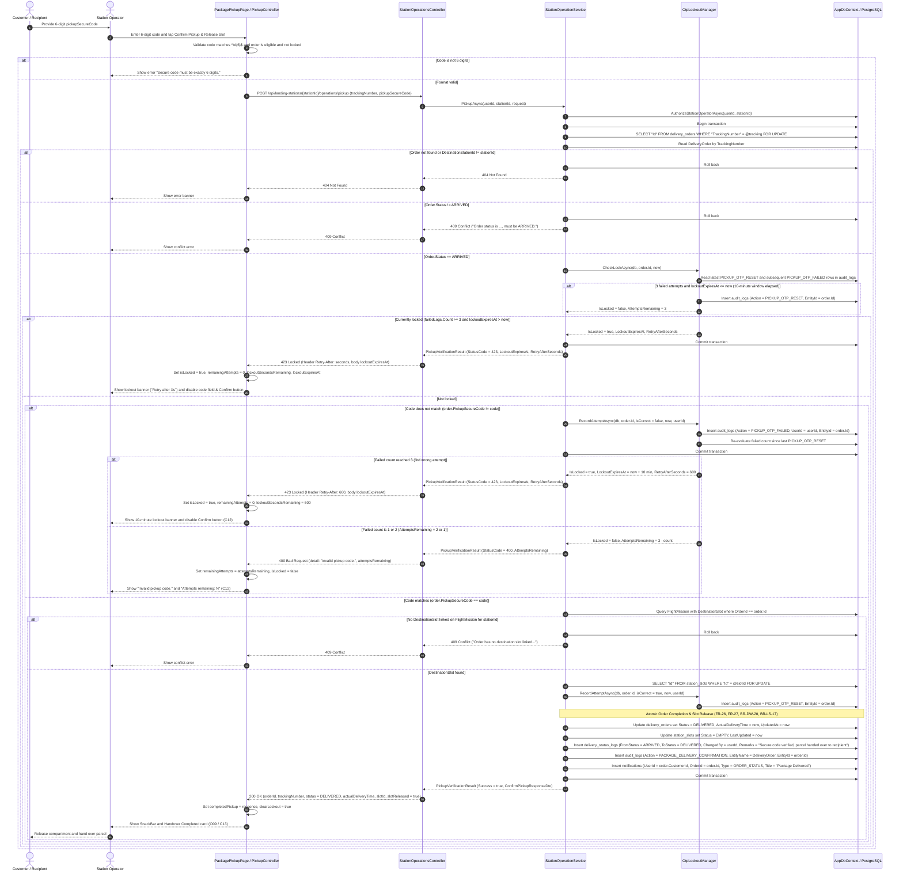
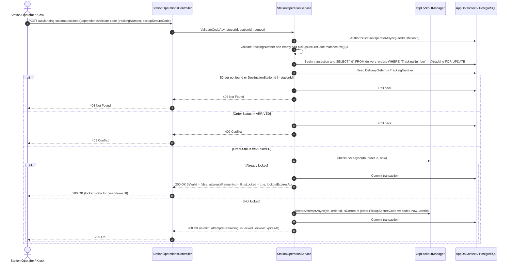

# Sequence Diagrams - Delivery Confirmation

**Parent:** LA-200 - Design documents: Delivery tracking and confirmation

**Subtask:** LA-239 - Sequence diagram for delivery confirmation

**Status:** Proposed for review

This document specifies the sequence diagrams for **Delivery Confirmation** (FR-26, FR-27, FR-12, FR-14, FR-32, UC-08): looking up an arrived order at the destination landing station, entering and verifying the 6-digit `pickupSecureCode`, enforcing the 3-attempt brute-force lockout policy, and completing the order (`ARRIVED` to `DELIVERED` with `actualDeliveryTime` recorded and the destination slot released to `EMPTY`).

While [sequence-package-pickup-confirmation.md](sequence-package-pickup-confirmation.md) (LA-232) drafted the initial station-side overview before the Sprint 4 and Sprint 5 contracts were finalized, this document aligns the delivery confirmation flow with the merged backend ([StationOperationsController.cs](../../backend/SmartDroneDelivery.Api/Controllers/StationOperationsController.cs), [StationOperationService.cs](../../backend/SmartDroneDelivery.Api/Services/StationOperationService.cs)), the merged mobile screens ([package_pickup_page.dart](../../frontend/mobile/lib/presentation/operator/pickup/package_pickup_page.dart), [pickup_controller.dart](../../frontend/mobile/lib/presentation/operator/pickup/pickup_controller.dart)), and the confirmed API contracts ([station-api.md](../api/station-api.md) section 4, [customer-order-api.md](../api/customer-order-api.md) section 8, [delivery-workflow-api.md](../api/delivery-workflow-api.md) section 4).

---

## 1. Sources and design boundaries

| Source | Basis |
|---|---|
| [SRS](../requirements/SRS.md), [use cases](../requirements/use-cases.md) | FR-26 confirm delivery with the secure code and reject a wrong code, FR-27 record the actual delivery time when the order is completed, FR-12 customer notification, FR-14 status transition log, FR-32 audit log, UC-08. |
| [functions-landing-station.md](../requirements/functions-landing-station.md), [functions-delivery-workflow.md](../requirements/functions-delivery-workflow.md) | Station function F-07 (verify pickup secure code and confirm destination delivery) and workflow state machine transition #11 (`ARRIVED` to `DELIVERED`). |
| [business rules](../requirements/business-rules.md) | BR-LS-14 to BR-LS-18, BR-LS-21, BR-LS-22, BR-DW-01, BR-DW-04, BR-DW-18, BR-DW-20, BR-DW-21, BR-DW-22. |
| [station-api.md](../api/station-api.md) section 4 | `GET /api/landing-stations/{stationId}/operations/orders/{trackingNumber}`, `POST .../operations/pickup`, `POST .../operations/validate-code`, `400` with `attemptsRemaining`, and `423 Locked` with `Retry-After` and `lockoutExpiresAt`. |
| [customer-order-api.md](../api/customer-order-api.md) section 8 | Decision 5 (`pickupSecureCode` returned at creation and never in order detail or staff responses) and Decision 7 (`423 Locked` after 3 wrong codes for 10 minutes). |
| [delivery-workflow-api.md](../api/delivery-workflow-api.md), [class-specification-delivery-workflow.md](class-specification-delivery-workflow.md) | Transition row 9 (`IN_TRANSIT` to `ARRIVED`) and row 11 (`ARRIVED` to `DELIVERED`, terminal state). |
| [Mobile wireframes](wireframes/app/index.md) | Customer screens `C08 Arrived Order & Pickup Code`, `C11 Confirm Delivery`, `C12 Incorrect OTP`, `C13 Delivery Completed`, and Station Operator screens `O05 Scan Order`, `O09`, `O10`. |
| Merged implementation | [StationOperationService.cs](../../backend/SmartDroneDelivery.Api/Services/StationOperationService.cs) (`OtpLockoutManager`, `GetOrderInfoAsync`, `PickupAsync`, `ValidateCodeAsync`) and [pickup_controller.dart](../../frontend/mobile/lib/presentation/operator/pickup/pickup_controller.dart). |

All station operation endpoints first pass authentication and station-level authorization (`AuthorizeStationOperatorAsync`): missing or invalid JWT returns `401 Unauthorized`, an inactive account or a `STATION_OPERATOR` not assigned to `{stationId}` (when caller is not `ADMIN`) returns `403 Forbidden`.

What changes when the 6-digit secure code is verified and the order is completed:

| Object | Before | After |
|---|---|---|
| `delivery_orders.status` | `ARRIVED` | `DELIVERED` (terminal, BR-DW-18) |
| `delivery_orders.actual_delivery_time` | `null` | `UtcNow` (FR-27, BR-LS-17) |
| Destination `station_slots.status` (via `flight_missions.destination_slot_id`) | `OCCUPIED` | `EMPTY` (released, BR-DW-20, BR-LS-17) |
| `delivery_status_logs` | rows up to `ARRIVED` | +1 row (`from_status = 'ARRIVED'`, `to_status = 'DELIVERED'`, `changed_by = operatorId`) |
| `audit_logs` | prior attempt rows | +1 `PICKUP_OTP_RESET` row and +1 `PACKAGE_DELIVERY_CONFIRMATION` row (never contains `pickup_secure_code`, BR-LS-22) |
| `notifications` | rows up to arrival | +1 row for `order.customer_id` (`title = 'Package Delivered'`) |

---

## 2. Sequence 1: Parcel lookup and pickup eligibility check at the destination station

Before the 6-digit secure code can be entered, the operator looks up the parcel by `trackingNumber` at their assigned landing station (`selectedStationId` from `stationAvailabilityNotifierProvider`). The client normalizes the tracking number (`trim().toUpperCase()`), resets any previous lookup or lockout state, and checks that the parcel belongs to this station as `DESTINATION` and is in `ARRIVED` status before exposing the secure-code keypad.

---

## 3. Sequence 2: Entering and verifying the secure code and completing the order (FR-26, FR-27, UC-08)

The recipient provides the 6-digit numeric `pickupSecureCode` received when the order was created (`C08` / `C17`). The operator enters the code and submits confirmation (`POST /api/landing-stations/{stationId}/operations/pickup`).

On PostgreSQL, `StationOperationService.PickupAsync` acquires a row-level lock (`SELECT "Id" FROM delivery_orders WHERE "TrackingNumber" = @tracking FOR UPDATE`) inside a database transaction before checking order status or lockout state in `OtpLockoutManager`. This prevents concurrent requests from bypassing the 3-attempt limit or double-completing the order.

---

## 4. Sequence 3: Advisory secure code validation (`POST .../operations/validate-code`)

[station-api.md](../api/station-api.md) section 4.5 also provides an advisory endpoint (`POST /api/landing-stations/{stationId}/operations/validate-code`) to verify the 6-digit code before physically opening the compartment without changing the order or slot status. To prevent brute-force guessing through the advisory endpoint, it shares the exact same `OtpLockoutManager` counter (`PICKUP_OTP_FAILED` / `PICKUP_OTP_RESET`) and row-level lock as `POST .../operations/pickup`.

---

## 5. Concurrency and race conditions

Because an `ARRIVED` order can be acted on by two operator terminals at the same time or by the background 24-hour pickup timeout worker (`PickupTimeoutBackgroundService`), PostgreSQL row-level locking (`SELECT ... FOR UPDATE`) serializes competing operations on `delivery_orders`:

| Competing operations | Resolution | Final state |
|---|---|---|
| Two pickup confirmations submitted concurrently for the same `ARRIVED` order | The first transaction acquires `FOR UPDATE` on `delivery_orders`, sets `Status = 'DELIVERED'`, releases the slot to `EMPTY`, and commits. The second transaction unblocks, reads `Status == 'DELIVERED'`, and fails the `order.Status != "ARRIVED"` check with `409 Conflict`. | `DELIVERED` once, one status log row, one notification, slot `EMPTY`. |
| Three parallel wrong-code requests trying to bypass the 3-attempt limit | Each request waits on `SELECT "Id" FROM delivery_orders ... FOR UPDATE` before calling `OtpLockoutManager.CheckLockAsync` and `RecordAttemptAsync`. Attempts are counted strictly sequentially (`attemptsRemaining`: `2`, then `1`, then `423 Locked`). | Locked after the 3rd wrong code, no extra attempts allowed. |
| Recipient confirms pickup at the exact 24-hour mark while `PickupTimeoutBackgroundService` runs | Both paths lock or check `Status == 'ARRIVED'`. If `PickupAsync` commits first, the order is `DELIVERED` and the timeout worker skips it. If the timeout worker commits `Status = 'FAILED'` first, `PickupAsync` sees `Status == 'FAILED'` and returns `409 Conflict`. | Either `DELIVERED` (slot `EMPTY`) or `FAILED` (slot stays `OCCUPIED` per BR-LS-20), never inconsistent. |

---

## 6. Alignment with merged code and differences across sources

1. **Operator-assisted confirmation vs Customer app wireframes (`C11–C13`):**
   - Customer wireframes `C11–C13` and [customer.md](user-flows/customer.md) depict entering the 6-digit code inside the Customer mobile app, whereas [station-api.md](../api/station-api.md) section 4.4 and the merged backend (`StationOperationsController.Pickup`) scope `POST /api/landing-stations/{stationId}/operations/pickup` to the station's assigned `STATION_OPERATOR` or `ADMIN`.
   - In the merged system (LA-125, LA-126), the customer receives `pickupSecureCode` upon order creation (`POST /api/delivery-orders`, `C17`) and presents it at the destination station, where the operator verifies it on `PackagePickupPage`. If customer self-service confirmation (`C11–C13`) is required later without operator involvement, a customer-scoped endpoint (`POST /api/delivery-orders/{id}/confirm-delivery`) delegating to the same verification logic can be added.
2. **Lockout status code (`423 Locked`) and persistence in `audit_logs`:**
   - Earlier documents ([functions-landing-station.md](../requirements/functions-landing-station.md) F-07 and [sequence-package-pickup-confirmation.md](sequence-package-pickup-confirmation.md) section 3) described `429 Too Many Requests` backed by a Redis/in-memory cache.
   - Per [customer-order-api.md](../api/customer-order-api.md) section 8 (decision 7) and [station-api.md](../api/station-api.md) section 4.4, the merged implementation returns **`423 Locked`** with the `Retry-After` header (in seconds) and `lockoutExpiresAt` in the RFC 7807 response body, and `OtpLockoutManager` persists attempt markers (`PICKUP_OTP_FAILED` and `PICKUP_OTP_RESET`) in `audit_logs` so lockout state is durable across restarts.
3. **Destination slot resolution (`flight_missions.destination_slot_id`):**
   - `delivery_orders` does not have a `destination_slot_id` column in the ERD. `PickupAsync` resolves the occupied destination slot through `flight_missions.destination_slot_id` (linked to `order.Id` and verified to belong to `stationId`) and locks the `station_slots` row with `FOR UPDATE` before setting `Status = 'EMPTY'`.
4. **Secure code confidentiality (BR-DW-22, BR-LS-22):**
   - `GET .../operations/orders/{trackingNumber}` never returns `pickupSecureCode`, and neither `delivery_status_logs` nor `audit_logs` (`PICKUP_OTP_FAILED`, `PICKUP_OTP_RESET`, `PACKAGE_DELIVERY_CONFIRMATION`) ever stores the submitted or expected code.
