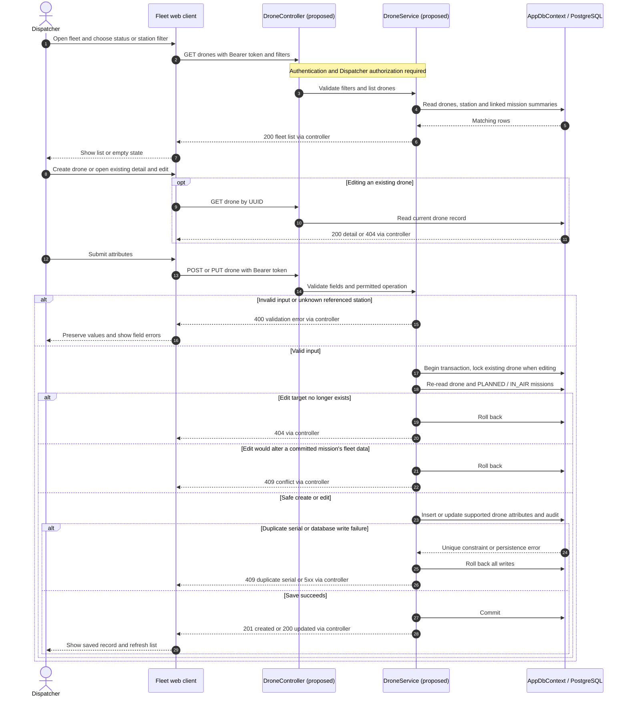
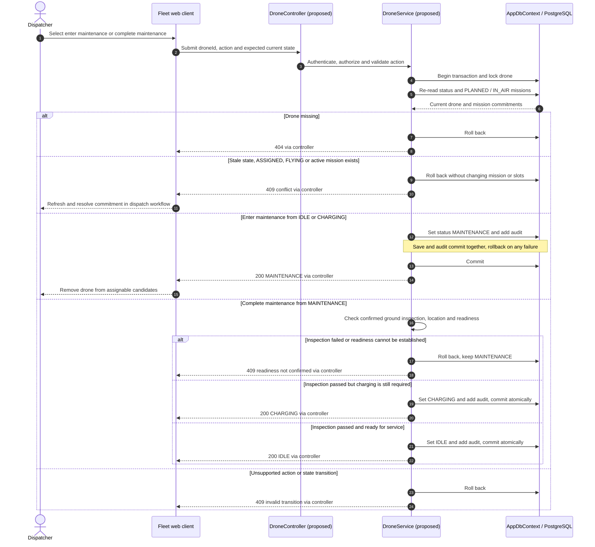
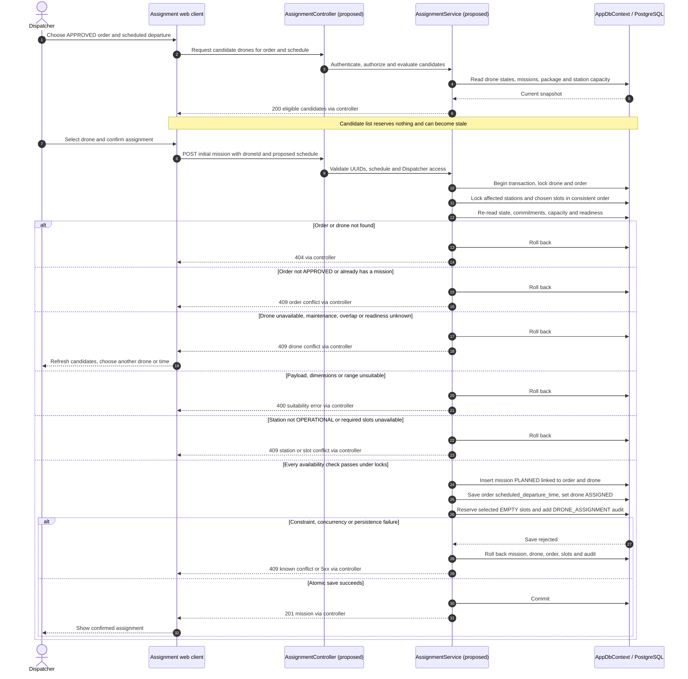

# Sequence Diagrams - Drone Management

**Parent:** LA-198 - Design documents: Landing stations, slots and drones

**Subtask:** LA-233 - Sequence diagram for drone management

**Status:** Proposed for review

This design covers fleet listing, creation/editing, entering and completing maintenance, and the server-side check that only an available drone can be assigned. The primary actor is the Dispatcher. It describes delivery operations, not flight-hardware control. No backend endpoint, database migration or UI implementation is introduced by this document.

## 1. Sources and design boundaries

| Source | Basis |
|---|---|
| [SRS](../requirements/SRS.md) | FR-19 / UC-15: create, update and list drones; FR-15 / UC-12: assignment; FR-16: no overlapping missions; FR-03: authorization; FR-32: sensitive-action audit. |
| [Use cases](../requirements/use-cases.md), [Dispatcher flow](user-flows/dispatcher.md) | Dispatcher fleet maintenance and the choose-time/choose-another-drone conflict path. |
| [Delivery Workflow functions](../requirements/functions-delivery-workflow.md) | F-04, F-05, F-10; readiness, maintenance and assignment constraints. |
| [Business rules](../requirements/business-rules.md) | BR-DW-06 to BR-DW-10, BR-DW-19, BR-DW-25; D-01, D-03 to D-06 identify unresolved policies. |
| [Business processes](business-processes.md), [ERD](../architecture/erd.md), [DBML](../architecture/erd.dbml) | Lifecycle, status values, relationships and storage fields. |
| [Drone](../../backend/SmartDroneDelivery.Api/Entities/Drone.cs), [FlightMission](../../backend/SmartDroneDelivery.Api/Entities/FlightMission.cs), [DeliveryOrder](../../backend/SmartDroneDelivery.Api/Entities/DeliveryOrder.cs), [AppDbContext](../../backend/SmartDroneDelivery.Api/Data/AppDbContext.cs) | Actual entity fields, unique serial number, unique mission per order and foreign keys. |
| [Auth contract](../api/auth-api.md), [architecture](../architecture/architecture.md) | Bearer authentication, role checks, problem-details errors and EF Core/PostgreSQL. |

At the reviewed `develop` revision `28b46e8`, drone and mission entities exist, but drone-management and assignment controllers/contracts do not. Controller/service names and requests below are **proposed**, not existing APIs.

All requests first pass authentication and server-side authorization: missing/invalid token returns `401`, signed-in but disallowed role returns `403`, and no mutation occurs. Use the existing one-time token-refresh flow where eligible. The diagrams below begin after this common gate. Dispatcher access is grounded in SRS/UC-15; extending fleet maintenance to `ADMIN` as suggested by F-10 needs API-policy agreement. Customer, Station Operator and Manager permissions are not inferred from the task's web/mobile labels.

| Proposed interface | Purpose |
|---|---|
| `GET /api/drones?status=IDLE&stationId={id}`; `GET /api/drones/{id}` | Fleet filters and current detail; optional filters, response shape and paging require contract review. |
| `POST /api/drones`; `PUT /api/drones/{id}` | Create or edit fleet attributes, excluding arbitrary operational-state changes. |
| `PUT /api/drones/{id}/maintenance` | Explicit enter/complete maintenance action; never directly assign or take off. |
| `GET /api/delivery-orders/{orderId}/available-drones` | Candidate query for the proposed schedule; advisory, never a reservation. |
| `POST /api/delivery-orders/{orderId}/flight-mission` | Revalidate and atomically assign the chosen drone for the initial mission. |

## 2. List, create and edit fleet records

Validate nonblank `serial_number` and `model_name` (maximum 100 characters), positive `max_payload_gram`, `max_flight_range_km` and `battery_capacity_mah`, supported numeric precision, and an existing station when `current_station_id` is supplied. Enforce the unique serial constraint in the database as well as any preliminary check. Units remain grams, kilometres and mAh; battery capacity is not charge percentage.

Proposed safe creation policy: a newly registered, not-yet-checked drone starts in `MAINTENANCE` explicitly, despite the schema's default `IDLE`; the readiness flow below releases it. This policy needs approval. General editing cannot set `ASSIGNED`, `FLYING` or arbitrary status, teleport a drone between stations, or modify capacity/location used by a `PLANNED`/`IN_AIR` mission. Physical station changes require verified ground presence; mission-related changes belong to the dispatch workflow. The conservative edit guard is a design proposal, not an existing API restriction. No hard-delete flow is added by FR-19.

## 3. Enter maintenance and return to service

Maintenance never cancels/reassigns a mission, frees an occupied slot or sends an aircraft control command. If a drone has a commitment, resolve it through the appropriate delivery workflow before retrying maintenance; do not force `FLYING` to `MAINTENANCE`. Completion confirms a ground readiness check, not an automatic assumption of readiness. Repeating a completed action must not generate duplicate state-change audits; refresh the current state and report an unchanged result or stale-state conflict according to the final API contract.

## 4. Check availability again when assigning

“Available” is a **computed eligibility result**, not a new drone status. Candidates start with `IDLE`; F-05 also permits `CHARGING` only if readiness by departure can be established under an approved policy. Until that policy and reliable data exist, exclude unverified charging drones. `MAINTENANCE`, `ASSIGNED` and `FLYING` are never selectable for a new assignment in this conservative design.

The server rechecks all of the following on submission, regardless of what the UI displayed:

- Drone state and readiness, verified presence at the origin station, and no conflicting commitment. An en-route drone is not presumed present; repositioning needs a separately agreed workflow.
- An `APPROVED` order with a valid future departure and no existing mission. `flight_missions.order_id` is unique; initial assignment does not create a second attempt or erase historical missions.
- Package weight within `max_payload_gram`, dimensions within the agreed cargo envelope, and route distance within usable `max_flight_range_km`. The model does not store a cargo envelope; do not invent drone dimension columns.
- No overlapping `PLANNED` or `IN_AIR` mission for the same drone. For known half-open intervals, conflict means `existingStart < requestedEnd && requestedStart < existingEnd`, with agreed preparation/turnaround buffers. Derive planned times from the related order's `scheduled_departure_time` / `estimated_delivery_time`; actual flight times remain on the mission. Missing bounds or an unfinished in-air mission cannot be interpreted as free time. Pending a complete scheduling policy, reject any unresolved active commitment, even if the drone's stored status incorrectly says `IDLE`.
- Origin/destination stations are `OPERATIONAL`; selected slots belong to the respective stations, are distinct, and are available for reservation. This initial-assignment flow reserves `EMPTY` slots, not someone else's reservation or a physically occupied slot. Actual loading/unloading belongs to the station workflow.

All competing assignment, maintenance and station-capacity writers must use a consistent transaction/locking protocol, including a shared lock on the same drone for maintenance versus assignment. For example, if maintenance commits first, assignment re-reads `MAINTENANCE` and rejects; if assignment commits first, maintenance re-reads `ASSIGNED`/`PLANNED` and rejects. Two assignments for one drone likewise cannot both pass. A read-only availability query, client-side disabled button, or unique order index alone cannot prevent double booking. The exact PostgreSQL locking/isolation implementation is to be agreed, not implemented here.

Assignment leaves the order `APPROVED`; it does not write `READY_FOR_TAKEOFF` or `IN_TRANSIT`. Station intake and subsequent lifecycle events perform those transitions and append `delivery_status_logs`. A drone-only maintenance change uses `audit_logs`, not an order status log. Notify or refresh clients only after commit; a failed push must not undo a saved assignment. On network timeout, reload the order/mission before retrying to avoid a duplicate create.

## 5. Persistence alignment and decisions to confirm

| Topic | ERD-aligned interpretation / open decision |
|---|---|
| Status vocabulary | Drone: `IDLE`, `ASSIGNED`, `FLYING`, `CHARGING`, `MAINTENANCE`. Mission: `PLANNED`, `IN_AIR`, `COMPLETED`, `ABORTED`. Do not store `AVAILABLE`, `OFFLINE`, `READY_FOR_TAKEOFF` or `COMPLETED` as drone states. |
| Telemetry and timestamps | `Drone` has `battery_capacity_mah` and `created_at`, not `battery_percentage` or `updated_at`. Charge readings are in `flight_telemetry_logs` via a mission; freshness/current charging data need a defined source. Old mission telemetry is not proof of present readiness. F-10's additional fields require a separate schema decision. |
| Scheduling | `scheduled_departure_time` and `estimated_delivery_time` belong to `delivery_orders`, not `flight_missions`. `start_time` / `end_time` represent flight timing; do not silently repurpose them to persist a proposed booking window. Persistent planned intervals and future multi-booking need contract/schema review. |
| Maintenance record | There is no maintenance-history table, inspection result, notes or repair-completion field in `drones`. Inspection confirmation is proposed command input; durable reports/reasons require an explicitly approved extension, not imaginary columns. |
| Audit | Use current `audit_logs` fields: user ID, action, entity name/ID, IP, user agent and timestamp. Proposed action names: `DRONE_CREATE`, `DRONE_UPDATE`, `DRONE_MAINTENANCE_START`, `DRONE_MAINTENANCE_COMPLETE`, plus F-05's `DRONE_ASSIGNMENT`. The model has no before/after/reason JSON field. Audit and mutation save together; failures roll back both. |
| Readiness policy | Confirm new-drone initial state, maintenance release criteria, charging eligibility, trusted reading source and maximum age. Never equate mAh capacity with current charge. |
| Numerical limits | 80% assignment battery, 90% return-to-IDLE, 30% range margin and 15/20-minute buffers in DW/LS are proposals (business-rules D-04), not fixed acceptance values here. Conflicting package dimensions/weights require agreement (D-01); SRS requires fitting the assigned drone. |
| API and role contract | Confirm paths/DTOs, input error codes, list paging, create/edit rights for ADMIN, maintenance completion confirmation, locking protocol and retry behavior. No new screen/API permissions are granted by this document. |

## 6. Acceptance traceability

| LA-233 requirement / scenario | Design evidence |
|---|---|
| Maintain drones | Section 2: list/create/edit; section 3: enter maintenance, failed inspection, charging and return to service. |
| Only available drones can be assigned | Section 4: advisory candidate list plus authoritative submit-time eligibility checks. |
| Maintenance or busy drone cannot be assigned | MAINTENANCE/ASSIGNED/FLYING and active-mission conflicts reject without mutation. |
| No overlapping bookings | Interval predicate, unknown-bound handling and serialized commit-time checks; losing concurrent request receives conflict. |
| Safe maintenance versus assignment | Both flows lock/re-read the drone and mission commitments; neither silently overwrites the other. |
| Consistency with ERD and order lifecycle | Section 5 maps actual fields/statuses; assignment creates PLANNED/ASSIGNED and leaves the order APPROVED. |
| Failure handling | 400 invalid/unsuitable input, 401/403 authorization, 404 missing resource, 409 stale/busy/duplicate, rollback on save failure. UI keeps input, shows failure and offers refresh/retry; failed reads are not rendered as an empty fleet. |

This is the required sequence-design artifact only. It does not add optional test reports, backend/frontend changes, migrations or hardware-control behavior.
