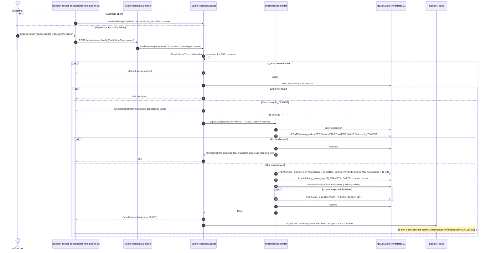
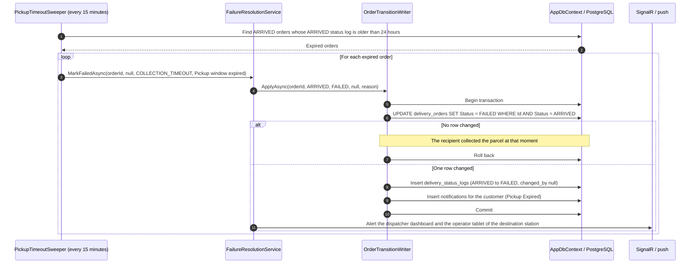
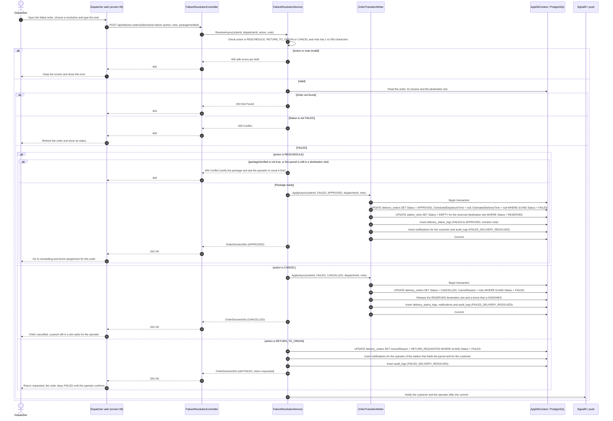
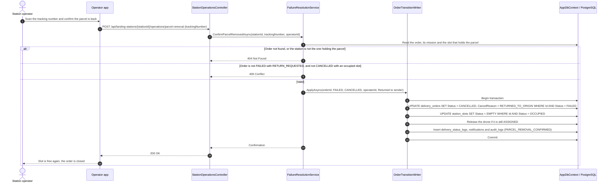

# Sequence Diagrams - Failed Delivery Handling

**Parent:** LA-199 - Design documents: Delivery workflow

**Subtask:** LA-237 - Sequence diagram for failed delivery handling

**Status:** Proposed for review

This document specifies the sequence diagrams for a delivery that fails and for the dispatcher's decision afterwards: detecting a failure in the air, the 24 hour pickup timeout, and the three resolutions **reschedule**, **return to origin** and **cancel** (FR-18, FR-14, FR-12, FR-32; UC-14). Controllers, services and the return confirmation endpoint are **proposed**; see [class-diagram-delivery-workflow.md](class-diagram-delivery-workflow.md).

---

## 1. Sources and design boundaries

| Source | Basis |
|---|---|
| [SRS](../requirements/SRS.md), [use cases](../requirements/use-cases.md) | FR-18 mark a delivery failed with a reason and choose reschedule, return or cancel; UC-14. |
| [functions-delivery-workflow.md](../requirements/functions-delivery-workflow.md) | F-08 detect and mark failure; F-09 resolve a failed delivery; open decisions on the timeout and the return. |
| [business-processes.md](business-processes.md) | Section 4 failed delivery flow and the rule that a return ends as `CANCELLED`. |
| [business rules](../requirements/business-rules.md) | BR-DW-13, BR-DW-15 to BR-DW-20, BR-DW-23, BR-LS-15, BR-LS-20. |
| [sequence-package-pickup-confirmation.md](sequence-package-pickup-confirmation.md) section 4 | The scheduled sweep of unclaimed parcels. |
| [class-specification-delivery-workflow.md](class-specification-delivery-workflow.md) | Transition rows 10, 12, 13 and 14, and the one writer for the status. |

A drone control command is **not** part of this system (the software coordinates; the autopilot flies). "The drone returns to the nearest station" is a fact reported by telemetry, not a command sent by these sequences. Requests from people pass authentication and authorization first: `401`, then `403` for a role other than `DISPATCHER` or `ADMIN`.

A failure is handled in two steps with a person in between: the system or a dispatcher **marks** the order `FAILED` (sequences 1 and 2), then a dispatcher **resolves** it (sequences 3 and 4). A `FAILED` order stays `FAILED` until a dispatcher decides (BR-DW-17).

---

## 2. Sequence 1: Mark a delivery failed in the air (F-08)

The trigger is an automatic abort reported with the telemetry (low battery, weather, hardware fault) or a dispatcher using "Report failure" on the live tracking screen. A telemetry gap of more than 60 seconds only raises a warning on the dispatcher screen (BR-DW-13); it does not fail the order by itself.

What does **not** change at this moment:

- The drone stays `FLYING` and keeps `current_station_id` empty until the telemetry shows that it has landed at a station. Only then the drone becomes `CHARGING` or `IDLE` and gets that station as its location. A drone is never freed while it is still in the air.
- The destination slot stays `RESERVED`; the dispatcher's decision in sequence 3 releases it.
- The secure code is not touched (BR-DW-22).

---

## 3. Sequence 2: Pickup timeout (F-08, BR-DW-16)

This is the scheduled sweep of [sequence-package-pickup-confirmation.md](sequence-package-pickup-confirmation.md) section 4, drawn here with the shared failure path.

The destination slot stays `OCCUPIED` and the compartment stays locked until an operator moves the parcel (BR-LS-20). Reminders to the recipient at 12 and 20 hours are proposed in the functions document and are not drawn here.

The age is measured from the `created_at` of the `ARRIVED` row in `delivery_status_logs`, not from `delivery_orders.updated_at`, because `updated_at` also changes for unrelated edits and would restart the 24 hours.

---

## 4. Sequence 3: The dispatcher resolves a failed order (F-09)

Summary of the three resolutions:

| Resolution | Order status afterwards | Mission and drone | Slots |
|---|---|---|---|
| `RESCHEDULE` | `APPROVED`, schedule cleared | Old mission stays `ABORTED` as history, a new one is created by the next assignment | Reserved destination slot released; a slot that holds the parcel must already be emptied |
| `RETURN_TO_ORIGIN` | stays `FAILED` until the operator confirms (sequence 4), then `CANCELLED` | Released when the order is cancelled | Released by the operator confirmation |
| `CANCEL` | `CANCELLED` | Assigned drone `IDLE` | Reserved slot `EMPTY`; an `OCCUPIED` slot stays so until the operator removes the parcel |

---

## 5. Sequence 4: The operator confirms the returned parcel

The dispatcher's return request is stored on the order (`cancel_reason = RETURN_REQUESTED` while the status is `FAILED`). No new status is added (BR-DW-01). When the parcel is back in the hands of the operator, the order is closed.

The same confirmation also empties a slot that still holds the parcel of an order the dispatcher simply cancelled; in that case the order is already `CANCELLED`, only the slot is updated, and the first conflict branch does not apply.

---

## 6. Persistence alignment and decisions to confirm

| Concern | Design alignment |
|---|---|
| Status log | One row per status change (`IN_TRANSIT` to `FAILED`, `ARRIVED` to `FAILED`, `FAILED` to `APPROVED`, `FAILED` to `CANCELLED`). The return request is not a status change, so it has no log row (it is in `audit_logs`). `changed_by` is empty for automatic changes. |
| Mission | `ABORTED` with `end_time` when the flight fails in the air. A timeout failure leaves the mission `COMPLETED`. |
| Reason fields | The failure reason is in `delivery_status_logs.remarks`. `audit_logs` has no reason column (see [station-api.md](../api/station-api.md) open point 9). |
| Notifications | Customer on every status change (BR-DW-21). Operator on a return request. |
| Secure code | Never in a log, an alert or a notification (BR-DW-22). |

Points to confirm:

1. **Marker for a requested return.** Proposed: `cancel_reason = RETURN_REQUESTED` on a `FAILED` order, replaced by `RETURNED_TO_ORIGIN` when it closes. It needs no new column. A cleaner alternative is a `details` column on `audit_logs` or a small task table, which the team may prefer if returns must be listed (see [class-specification-delivery-workflow.md](class-specification-delivery-workflow.md) section 6, item 5).
2. **A new station operation.** `parcel-removal` is not in [station-api.md](../api/station-api.md) yet. It must be added to that contract before the work starts. Without it, a slot that holds a failed parcel can never return to `EMPTY`, because the API does not let anyone set an `OCCUPIED` slot by hand.
3. **Who verifies the package for a reschedule.** F-09 says the package must be verified undamaged. Proposed: the dispatcher confirms with `packageVerified` after the operator's check; the system cannot see the parcel.
4. **Drone after an abort.** The drone is freed from telemetry (landed at a station), not from the failure itself. The landing detection rule is the same open point as for a normal landing ([class-specification-delivery-workflow.md](class-specification-delivery-workflow.md) section 6, item 7).
5. **Weather as a trigger.** F-08 lists adverse weather. There is no weather source in the schema or the ERD, so the abort reason arrives as text from the flight source or the dispatcher. A wind threshold is not implemented here.
