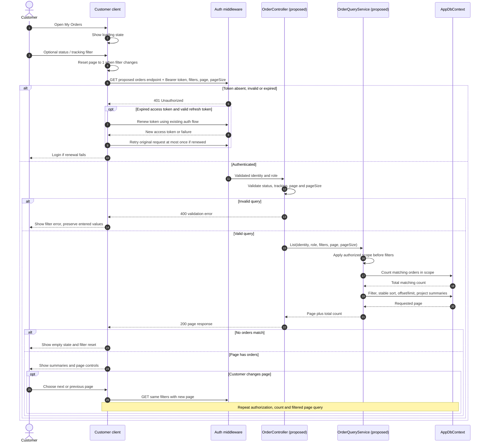
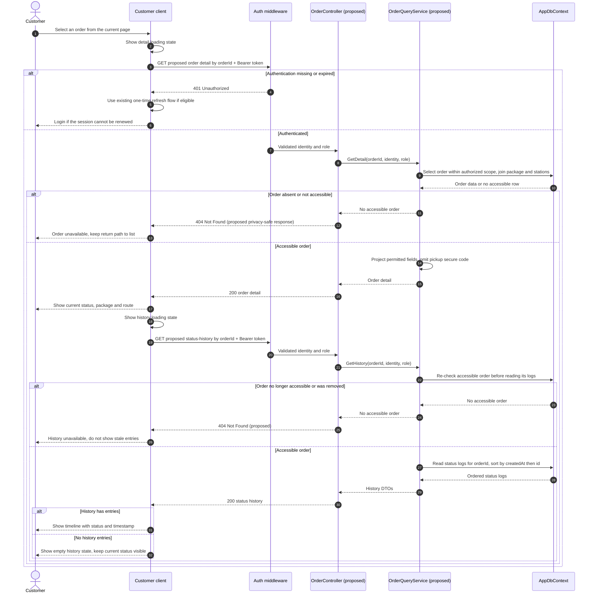

# Sequence Diagram - Listing Delivery Orders and Details

**Parent:** [LA-197](https://hungndemail.atlassian.net/browse/LA-197) - Customer and Order management design documents

**Subtask:** [LA-229](https://hungndemail.atlassian.net/browse/LA-229) - Sequence diagram for listing orders and details

This design shows how a Customer filters and pages through their orders, opens one order, and loads its status history. Dispatcher and Logistics Manager read access is described as a role-specific extension below. The diagrams specify behavior for a future order API; they do not claim these endpoints or classes are implemented today.

## Sources and scope

- [SRS](../requirements/SRS.md): FR-03 (authorization), FR-11 (own orders, filters and history), FR-13 (Dispatcher pending list), FR-28 (Manager reports). UC-07 is the primary use case; UC-11 and UC-19 supply staff entry points.
- [Use-case catalog](../requirements/use-cases.md), [Customer flow](user-flows/customer.md), [Dispatcher flow](user-flows/dispatcher.md), [Manager flow](user-flows/logistics-manager.md) and [business processes](business-processes.md).
- [ERD](../architecture/erd.md), [DBML](../architecture/erd.dbml) and the current `DeliveryOrder`, `DeliveryStatusLog` and `AppDbContext` classes establish the fields and relationships below.
- [Auth API contract](../api/auth-api.md) and [auth sequence](sequence-auth.md) establish Bearer authentication and one-time refresh on an expired access token. There is no delivery-order API contract in `docs/api` yet.

SmartDroneDelivery manages delivery operations; this read-only flow does not control the drone or change an order status. Live drone position and map loading are separate from the status-history query.

## Participants and proposed interface

| Participant | Responsibility |
|---|---|
| Customer | Opens My Orders, changes a filter or page, and selects an order. |
| Client | Flutter Customer app for the primary flow; shows loading, empty, error, list, detail and history states. Staff web clients can use the same server flow with their own authorization policy. |
| OrderController *(proposed)* | Validates request parameters and invokes order queries. `/api/delivery-orders` follows the repository's route convention but is **not** an implemented endpoint. |
| OrderQueryService *(proposed)* | Applies the authenticated user's scope, filters, stable sorting, paging and projection. Does not accept a caller-supplied Customer ID as authority. |
| AppDbContext | Reads `delivery_orders`, the related package and stations, and `delivery_status_logs` in PostgreSQL. |
| Auth middleware | Validates the Bearer token before the controller; role and resource checks remain server side. |

Proposed requests for API-contract review:

| Action | Proposed request | Proposed response content |
|---|---|---|
| Filtered list | `GET /api/delivery-orders?status=IN_TRANSIT&trackingNumber=DD-...&page=1&pageSize=20` | Page of order summaries, total matching count, page and page size. Filters are optional and only an example of query naming. |
| Detail | `GET /api/delivery-orders/{orderId}` | One order's permitted customer, package, origin/destination, recipient, current status and timestamps. Sensitive values are projected by role. |
| Status history | `GET /api/delivery-orders/{orderId}/status-history` | Chronological entries with `fromStatus`, `toStatus`, `remarks`, `createdAt` and a permitted actor label if available. |

The `orderId` is the UUID primary key; `trackingNumber` is a unique searchable field. The product/API owner must confirm whether the final API uses these three endpoints or embeds history in the detail response. The sequence of server checks and the ERD relationships apply either way. No new persistence tables are introduced.

## 1. Filter and paginate My Orders

For a Customer, the query starts with `delivery_orders.customer_id == authenticated user id`; this restriction applies to **both** count and rows. Then apply requested filters. A status filter must use one of the eight `delivery_orders.status` values: `PENDING`, `APPROVED`, `READY_FOR_TAKEOFF`, `IN_TRANSIT`, `ARRIVED`, `DELIVERED`, `CANCELLED`, `FAILED`. Tracking search must not reveal matches outside the authorized scope. Sort by `delivery_orders.created_at DESC, delivery_orders.id DESC` before paging so equal timestamps have a deterministic order. The database applies `Skip`/`Take` (or equivalent) after the scoped filter; it does not load every order and paginate in the client. Page numbers start at 1; a bounded positive `pageSize` and maximum are to be agreed in the API contract. If a stale page is beyond the last page after data changes, return an empty page with the current total so the client can move to a valid page.

## 2. Open order detail and load status history

`delivery_status_logs.order_id` links each log to its order. Logs contain nullable `from_status`, required `to_status`, nullable `changed_by`, optional `remarks` and `created_at`. The first entry may have no previous status or actor. Order logs are sorted by `created_at ASC, id ASC` so entries with the same timestamp have stable order. The current order status comes from `delivery_orders.status`; the timeline must not infer a new current state from a delayed or missing log. A history failure has its own retry/error state and must not replace a successfully loaded detail with a false empty timeline. On back navigation, the client retains the selected filters and page where practical, then may refresh to reflect changed order data.

## Authorization and data boundaries

| Role / entry point | Allowed query scope | Notes |
|---|---|---|
| Customer / My Orders | Own orders only (`customer_id` from validated token) | FR-11/UC-07 baseline. This is the principal LA-229 flow. |
| Dispatcher / Pending orders or operational lists | Orders required for assigned delivery operations, under a server policy | FR-13/UC-11 requires pending review; the precise staff visibility policy is not specified here. Do not apply Customer ownership to this role. |
| Logistics Manager / Report detail | Orders permitted by reporting policy | UC-19/UC-20 drill-down is read-only. The final reporting scope and filters need approval. |
| Station Operator, Administrator | No general order-list access is inferred by LA-229 | Additional access requires an explicit requirement and API policy. |

Role filtering in the UI is for navigation only; the API re-checks it on every list, detail and history request. For a signed-in but unauthorized role, return `403`. For an inaccessible individual order, `404` is proposed to avoid revealing another Customer's order existence; this response policy needs agreement with the order API contract. Neither list nor detail should return `pickup_secure_code`, another Customer's private data, password material or unrestricted recipient contact details. Exact recipient-field visibility for staff is to be specified with the order API.

## Acceptance mapping and decisions to confirm

| Acceptance point | Evidence in the design |
|---|---|
| Filtering | Status and tracking filters are validated and applied after server-side authorized scope. Changing a filter returns to page 1. |
| Pagination | Total and rows use the same scope/filter; deterministic sort precedes server-side offset/limit. Empty and out-of-range pages are handled. |
| Detail | Selecting one UUID loads permitted order, package and station fields; missing or inaccessible orders have an explicit result. |
| Status history | History is requested only for an accessible order, ordered by timestamp and log ID; empty and failed loads differ. |
| ERD/status consistency | `delivery_orders`, `packages`, `landing_stations`, `delivery_status_logs` and all eight order status values match the current model. |

Before implementation, the order API owner must confirm endpoint paths, DTO field visibility, filter operators, `pageSize` cap, detail/history response shape, staff access scope and whether inaccessible detail uses `403` or `404`. Those are proposed interface choices, not claims about current backend behavior. Status updates and real-time tracking are designed in their own flows. No code or database migration is introduced by this document.
