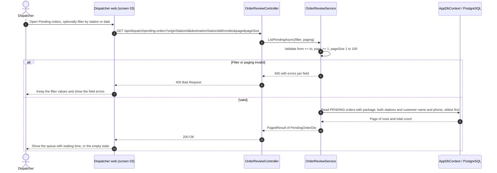
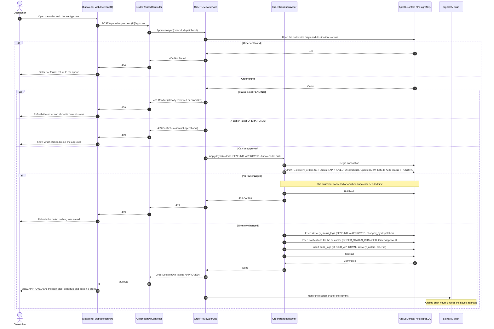
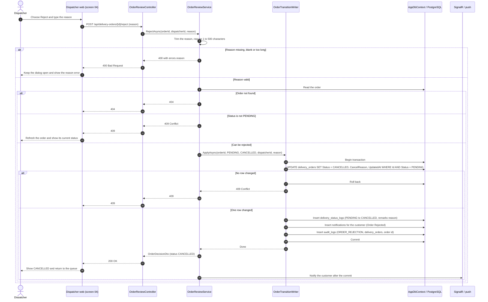

# Sequence Diagrams - Reviewing, Approving and Rejecting an Order

**Parent:** LA-199 - Design documents: Delivery workflow

**Subtask:** LA-235 - Sequence diagram for approving or rejecting a request

**Status:** Proposed for review

This document specifies the sequence diagrams for the first dispatcher step after a customer creates an order: listing the `PENDING` orders, then approving or rejecting one (FR-13, FR-14, FR-12, FR-32; UC-11). It describes server behaviour only. The controllers and services named below are **proposed**; see [class-diagram-delivery-workflow.md](class-diagram-delivery-workflow.md).

---

## 1. Sources and design boundaries

| Source | Basis |
|---|---|
| [SRS](../requirements/SRS.md), [use cases](../requirements/use-cases.md) | FR-13 list pending orders and approve or reject each with a reason; UC-11. FR-14 transitions and log; FR-12 notification; FR-32 audit. |
| [functions-delivery-workflow.md](../requirements/functions-delivery-workflow.md) | F-01 list pending delivery requests; F-02 review and approve or reject. |
| [business-processes.md](business-processes.md) | Status model and the rule that a rejection is `CANCELLED`. |
| [business rules](../requirements/business-rules.md) | BR-DW-01 to BR-DW-04, BR-DW-19, BR-DW-21, BR-DW-22, BR-DW-23. |
| [customer-order-api.md](../api/customer-order-api.md) | The customer can cancel a `PENDING` order at any time, so a decision can lose a race (section 4). |
| [Dispatcher wireframes](wireframes/web/index.md) | Screens `03 Pending orders` and `04 Order detail and approval`. |
| Entities and `DeliveryOrderMutationService` | Conditional update pattern (`WHERE Status = expected`), tested on PostgreSQL in LA-322. |

All requests first pass authentication and authorization: no or invalid token gives `401`, a signed-in user whose role is not `DISPATCHER` or `ADMIN` gives `403`, and nothing is read or changed. The diagrams start after that gate.

Approving does not choose a time or a drone. That is the next step ([sequence-scheduling-and-drone-assignment.md](sequence-scheduling-and-drone-assignment.md)). The order stays `APPROVED` until the origin station operator confirms the package.

---

## 2. Sequence 1: List pending orders (F-01)

`PendingOrderDto` has the tracking number, customer name and phone, package name, weight, size and fragile flag, origin and destination station names, and `createdAt`. It never has `PickupSecureCode` (BR-DW-22). The waiting time is computed by the client from `createdAt`. The read writes nothing.

---

## 3. Sequence 2: Approve an order (F-02)

---

## 4. Sequence 3: Reject an order (F-02)

A rejection is a cancellation by the dispatcher. The order becomes `CANCELLED` and the reason is stored in `cancel_reason` (BR-DW-02). No other status is used for it.

---

## 5. Decisions against a customer cancel

A customer can cancel a `PENDING` order while the dispatcher is looking at it, so a decision can arrive after the order has changed. The conditional update decides, and the loser gets `409` without any partial write:

| Who commits first | The other request gets | Final state |
|---|---|---|
| Dispatcher approves, then the customer cancels | The customer cancel runs on an `APPROVED` order, which the customer may still cancel | `CANCELLED` with the customer's reason, two log entries |
| Customer cancels, then the dispatcher approves or rejects | `409`, the order is already `CANCELLED` | `CANCELLED`, one log entry |
| Two dispatchers decide at the same time | `409` for the second one | The first decision, one log entry |

This is the same guard that LA-322 tests for update and cancel. The decision endpoints need the same kind of test on PostgreSQL when they are built.

---

## 6. Persistence alignment and decisions to confirm

| Concern | Design alignment |
|---|---|
| Status log | One row per decision with `from_status`, `to_status`, `changed_by` and the reason in `remarks` (BR-DW-04). |
| Audit | `ORDER_APPROVAL` and `ORDER_REJECTION` in `audit_logs`, written in the same transaction. The table has no reason column, so the reason lives in `delivery_status_logs.remarks` and `delivery_orders.cancel_reason`. |
| Notification | One `notifications` row for the customer (BR-DW-21). The pickup code is never in it (BR-DW-22). |
| Dispatcher id | `delivery_orders.dispatcher_id` is set on approval. A rejection does not set it, so the rejecting user is found in the status log and the audit entry. |

Points to confirm:

1. **Station check.** F-02 validates that both stations are `OPERATIONAL`. Proposed answer `409` (a state problem), not `400`.
2. **Approval note.** F-02 allows an optional note for an approval. The approve endpoint in this design has no body; a note would go to `remarks`. Add it only if the team wants it.
3. **Who can reject after approval.** After `APPROVED` the dispatcher cancels through the cancellation flow, not through reject ([class-specification-delivery-workflow.md](class-specification-delivery-workflow.md) section 3, row 5).
