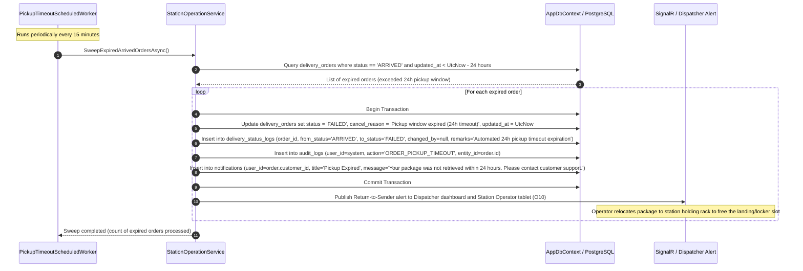

# Sequence Diagrams - Package Pickup Confirmation

**Parent:** LA-198 - Design documents: Landing stations, slots and drones

**Subtask:** LA-232 - Sequence diagram for package pickup confirmation

**Status:** Proposed for review

This document specifies the sequence diagrams for **Package Pickup Confirmation** in the SmartDroneDelivery platform. It covers both critical operational handover touchpoints at landing stations:
1. **Origin Station Package Intake & Pickup Confirmation (FR-23 / UC-18):** Station Operator receives the package from the customer/sender, conducts the 3-point physical check, loads it into the designated slot/drone cargo bay, transitioning the slot to `OCCUPIED` and order status to `READY_FOR_TAKEOFF`.
2. **Destination Station Package Pickup & Handover Confirmation with Secure Code (FR-26, FR-27 / UC-08):** Recipient or Station Operator verifies the 6-digit numeric secure code (`delivery_orders.pickup_secure_code`), releases the destination slot to `EMPTY`, transitions order status to `DELIVERED`, and records `actual_delivery_time`.
3. **Brute-Force Security & Lockout Protection:** Enforcement of the 3-attempt limit and 10-minute temporary lockout policy.
4. **Pickup Timeout Exception (FR-14 / F-08):** Background sweep of 24-hour unclaimed parcels transitioning from `ARRIVED` to `FAILED`.

---

## 1. Sources and design boundaries

| Source | Basis |
|---|---|
| [SRS](../requirements/SRS.md) | FR-23: confirm package received at origin station; FR-26: confirm delivery with secure code; FR-27: record actual delivery time; FR-14: status logging; FR-32: audit logging. |
| [Landing Station Functions](../requirements/functions-landing-station.md) | F-06: Origin package intake & 3-point verification; F-07: Destination package handover & secure code verification; F-08: 24h pickup timeout sweep. |
| [Use Cases](../requirements/use-cases.md) | UC-18: Station operator package intake and handover; UC-08: Customer / Recipient pickup parcel with secure code. |
| [Station & Pickup Activity Diagram](activity-station-and-pickup.md) | Detailed workflows for physical measurements, OTP validation, lockout thresholds, and slot status transitions. |
| [Business Rules](../requirements/business-rules.md) | BR-LS-07 to BR-LS-16, BR-LS-21, BR-LS-22; BR-DW-11, BR-DW-20, BR-DW-22. |
| [AppDbContext / Entities](../../backend/SmartDroneDelivery.Api/Data/AppDbContext.cs) | `delivery_orders` (`status`, `pickup_secure_code`, `actual_delivery_time`), `station_slots` (`status`, `last_updated`), `delivery_status_logs`, `audit_logs`, `notifications`. |
| [Mobile wireframes](../design/wireframes/app/index.md) | Station Operator: `O05 Scan`, `O07 Confirm Loading`, `O08 Destination Handover`, `O09 Pickup Success`, `O10 Timeout/Failed`. Customer: `C08 Arrived`, `C11-C13 Pickup`. |

---

## 2. Sequence 1: Origin Station Package Intake & Loading Confirmation (UC-18 / FR-23)

This flow shows how the Station Operator inspects the package, places it into the origin station slot/drone cargo bay, and transitions the order to `READY_FOR_TAKEOFF` and the slot to `OCCUPIED`.

```mermaid
sequenceDiagram
    autonumber
    actor Sender as Customer / Sender
    actor Operator as Station Operator
    participant UI as Operator Mobile Tablet (O05/O07)
    participant API as StationOperationsController
    participant Service as StationOperationService
    participant DB as AppDbContext / PostgreSQL
    participant Hub as SignalR / Push Notification

    Sender->>Operator: Present package and tracking barcode/QR at origin station counter
    Operator->>UI: Scan tracking barcode (delivery_orders.tracking_number)
    UI->>API: GET /api/delivery-orders/{trackingNumber} (Bearer token)
    API->>DB: Query order with package and origin station
    DB-->>API: Order details (status, sender, weight, dimensions, originStationId)
    API-->>UI: 200 OK (Order verified)

    Operator->>Operator: Conduct 3-point physical inspection:
    Note over Operator: 1. Place on station scale: measured weight <= 3000g (3.0 kg) and <= drone max payload<br/>2. Verify dimensions <= 30 x 20 x 15 cm<br/>3. Inspect packaging seal and fragile markings

    alt Physical inspection fails (Overweight / Oversized / Damaged)
        Operator->>UI: Select inspection failure reason (e.g. "Exceeds 3000g limit")
        UI->>API: POST /api/landing-stations/{stationId}/operations/intake-reject
        API->>DB: Update delivery_orders set status = 'FAILED', cancel_reason = reason
        API->>DB: Insert delivery_status_logs (from='APPROVED', to='FAILED', remarks=reason)
        API-->>UI: 200 OK (Intake rejected)
        Operator-->>Sender: Return package to sender with explanation
    else Physical inspection passes
        Operator->>UI: Select assigned empty origin slot (or drone cargo bay) and confirm intake
        UI->>API: POST /api/landing-stations/{stationId}/operations/intake (PackageIntakeRequestDto)
        Note over API: Check STATION_OPERATOR role and station assignment

        API->>Service: IntakeOriginPackageAsync(stationId, dto, operatorId)
        Service->>DB: Query order by trackingNumber and slot by slotId
        DB-->>Service: Order and Slot entities

        alt Order status != 'APPROVED' or Slot status != 'EMPTY'
            Service-->>API: 409 Conflict (Order not approved or slot already occupied)
            API-->>UI: 409 Conflict
            UI-->>Operator: Show conflict error
        else Validation passes
            Service->>DB: Begin Database Transaction
            
            Note over Service,DB: Atomic Order and Slot State Transitions
            Service->>DB: Update delivery_orders set status = 'READY_FOR_TAKEOFF', updated_at = UtcNow
            Service->>DB: Update station_slots set status = 'OCCUPIED', last_updated = UtcNow where id = dto.SlotId
            Service->>DB: Insert into delivery_status_logs (order_id, from_status='APPROVED', to_status='READY_FOR_TAKEOFF', changed_by=operatorId, remarks='Package intake completed; loaded into slot ' + slotNumber)
            Service->>DB: Insert into audit_logs (user_id=operatorId, action='PACKAGE_INTAKE_CONFIRMATION', entity_id=order.id)
            Service->>DB: Insert into notifications (user_id=order.customer_id, title='Ready for Takeoff', message='Your parcel has been verified and loaded at origin station.')
            
            Service->>DB: Commit Transaction
            DB-->>Service: Transaction committed successfully

            Service->>Hub: Publish slot state update (topic: station-slots-{stationId}) -> Slot now OCCUPIED
            Service->>Hub: Dispatch push notification to Customer Mobile App
            Service-->>API: PackageIntakeResponseDto
            API-->>UI: 200 OK (Intake confirmed)
            UI-->>Operator: Display success checkmark (O07); station pad lock engaged
        end
    end
```

---

## 3. Sequence 2: Destination Station Package Handover & Pickup Confirmation with Secure Code (UC-08 / FR-26, FR-27)

This flow shows the recipient retrieving the parcel at the destination station. The operator or automated kiosk verifies the 6-digit `pickup_secure_code`. Upon success, the compartment unlocks, the slot transitions to `EMPTY` (releasing the resource), the order transitions to `DELIVERED`, and `actual_delivery_time` is permanently recorded.

```mermaid
sequenceDiagram
    autonumber
    actor Recipient as Recipient / Customer
    actor Operator as Station Operator / Smart Kiosk
    participant UI as Kiosk Screen / Operator Tablet (O08/O09)
    participant API as StationOperationsController
    participant Service as StationOperationService
    participant Cache as Redis / Memory (Lockout Tracker)
    participant DB as AppDbContext / PostgreSQL
    participant Hub as SignalR (station-slots-{stationId})

    Recipient->>Operator: Arrive at destination station; present tracking number and 6-digit OTP
    Operator->>UI: Input tracking number and 6-digit secure code (delivery_orders.pickup_secure_code)
    UI->>API: POST /api/landing-stations/{stationId}/operations/pickup (ConfirmPickupRequestDto)

    API->>Service: ConfirmDestinationPickupAsync(stationId, dto, operatorId)
    
    Service->>Cache: Check lockout status for trackingNumber
    alt Account/Tracking is currently locked (failed attempts >= 3)
        Cache-->>Service: Locked (Remaining seconds)
        Service-->>API: 429 Too Many Requests (ProblemDetails: 10-minute lockout active due to repeated invalid codes)
        API-->>UI: 429 Too Many Requests
        UI-->>Operator: Screen locked: "Maximum attempts exceeded. Please wait 10 minutes or contact staff with photo ID."
    else Not locked
        Service->>DB: Query delivery_orders with destination slot (where tracking_number == dto.TrackingNumber)
        DB-->>Service: DeliveryOrder entity (status, pickup_secure_code, destination_station_id, destination_slot_id)
        
        alt Order status != 'ARRIVED'
            Service-->>API: 409 Conflict (Order is not in ARRIVED status)
            API-->>UI: 409 Conflict
            UI-->>Operator: Error: Parcel is not ready for pickup (current status: In Transit or Pending)
        else Order status == 'ARRIVED'
            alt Secure Code does not match (dto.PickupSecureCode != order.PickupSecureCode)
                Service->>Cache: Increment failed attempts counter
                Cache-->>Service: Current attempts = N
                alt N >= 3
                    Service->>Cache: Set 10-minute lockout timer
                    Service-->>API: 429 Too Many Requests (Lockout initiated)
                    API-->>UI: 429 Too Many Requests
                    UI-->>Operator: 3 invalid attempts. Terminal locked for 10 minutes.
                else N < 3
                    Service-->>API: 400 Bad Request (Invalid code, attempts remaining: 3 - N)
                    API-->>UI: 400 Bad Request
                    UI-->>Operator: "Invalid pickup code. Attempt N of 3. Please re-enter."
                end
            else Secure Code matches (dto.PickupSecureCode == order.PickupSecureCode)
                Service->>Cache: Reset failed attempts counter
                
                Service->>DB: Begin Database Transaction
                
                Note over Service,DB: Atomic Order Completion and Slot Release (FR-26, FR-27, BR-DW-20)
                Service->>DB: Update delivery_orders set status = 'DELIVERED', actual_delivery_time = UtcNow, updated_at = UtcNow
                Service->>DB: Update station_slots set status = 'EMPTY', last_updated = UtcNow where id = order.destination_slot_id
                Service->>DB: Insert into delivery_status_logs (order_id=order.id, from_status='ARRIVED', to_status='DELIVERED', changed_by=operatorId, remarks='Secure code verified; parcel handed over to recipient')
                Service->>DB: Insert into audit_logs (user_id=operatorId, action='PACKAGE_DELIVERY_CONFIRMATION', entity_id=order.id)
                Service->>DB: Insert into notifications (user_id=order.customer_id, title='Package Delivered', message='Your delivery has been successfully picked up.')
                
                Service->>DB: Commit Transaction
                DB-->>Service: Transaction committed successfully

                Service->>Hub: Broadcast slot release event over SignalR (station-slots-{stationId}) -> Slot now EMPTY
                Note over Hub: Dispatchers immediately see destination pad available for next flight assignment
                Service-->>API: PickupConfirmationResponseDto
                API-->>UI: 200 OK (Pickup confirmed, compartment unlocked)
                UI-->>Operator: Compartment unlocked; display success screen (O09)
                Operator-->>Recipient: Hand over package; recipient retrieves items
            end
        end
    end
```

---

## 4. Sequence 3: 24-Hour Pickup Window Expiration & Failure Handling (FR-14 / F-08)

This flow models the automated scheduled background worker that sweeps orders that have remained in `ARRIVED` status longer than the 24-hour pickup window without being retrieved.



---

## 5. Security and business rule traceability

| Business Rule / Constraint | Implementation Evidence |
|---|---|
| **BR-LS-07 / BR-DW-11 (Origin Intake Guard)** | Transition to `READY_FOR_TAKEOFF` occurs strictly after physical 3-point check (weight $\le 3000\text{g}$, dimensions $30 \times 20 \times 15\text{cm}$, seal integrity). |
| **BR-LS-08 / BR-DW-12 (Origin Slot Occupancy)** | Slot transitions from `EMPTY` to `OCCUPIED` upon origin intake confirmation, preventing double-loading into the same pad/compartment. |
| **BR-LS-11 / BR-DW-22 (Secure Code Privacy)** | The 6-digit numeric OTP (`delivery_orders.pickup_secure_code`) is validated exclusively against the database hash/value; it is never logged in plaintext in telemetry or audit logs. |
| **BR-LS-12 (Brute-Force Defense)** | Maximum 3 consecutive incorrect OTP entries triggers an automatic 10-minute temporary lockout via Redis/in-memory cache to prevent automated brute-force attacks. |
| **BR-LS-13 / BR-DW-20 (Slot Release on Completion)** | Completing delivery (`DELIVERED`) immediately releases the destination slot (`OCCUPIED` $\rightarrow$ `EMPTY`), preventing deadlock in the station network. |
| **BR-LS-14 / FR-27 (Actual Delivery Timestamp)** | `delivery_orders.actual_delivery_time` is permanently recorded upon successful OTP verification. |
| **BR-LS-15 / F-08 (24-Hour Pickup Window)** | Unclaimed parcels exceeding 24 hours in `ARRIVED` status are transitioned to `FAILED` by the automated background sweep worker. |
