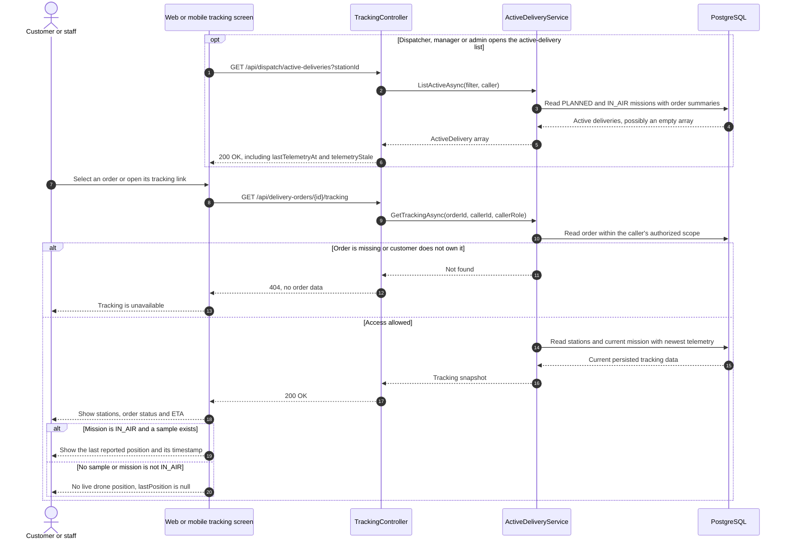
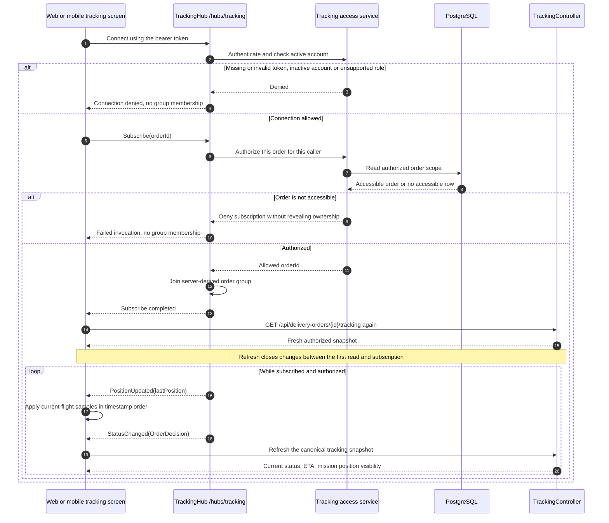
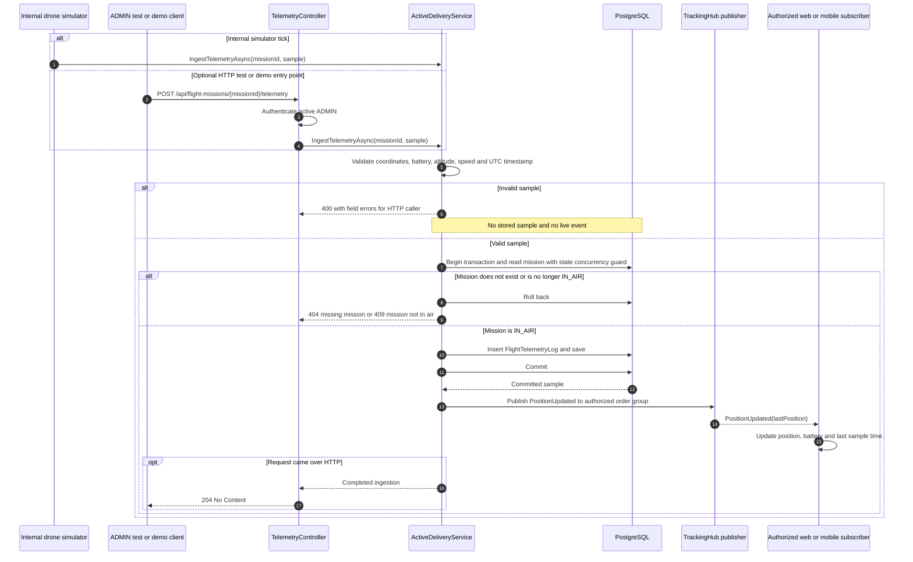
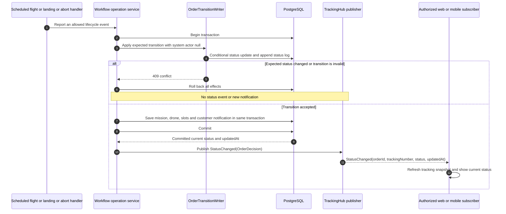
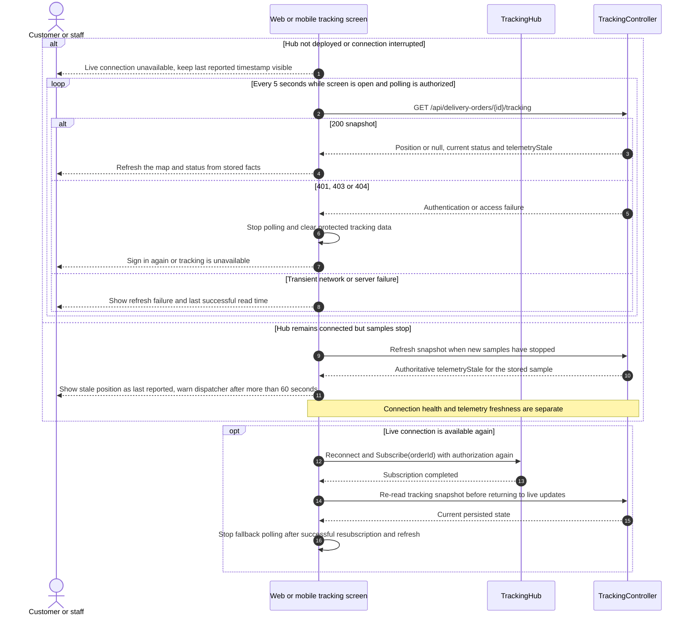

# Sequence Diagrams - Real-Time Delivery Tracking

**Parent:** [LA-200 - Tracking, confirmation and dashboard design](https://hungndemail.atlassian.net/browse/LA-200)

**Subtask:** [LA-238 - Sequence diagram for real-time tracking](https://hungndemail.atlassian.net/browse/LA-238)

**Status:** Proposed for review. These diagrams describe the planned tracking flow, not an implemented hub or telemetry API.

The scope is telemetry intake, SignalR subscription, and position/status updates to a selected order on web and mobile (FR-24, FR-25, UC-07). Delivery confirmation belongs to LA-239; dashboard statistics belong to LA-240. The system coordinates delivery software and does not issue hardware flight commands.

## 1. Sources and boundaries

| Source | Contract used here |
|---|---|
| [Delivery workflow API](../api/delivery-workflow-api.md), sections 5.1 to 5.4 | Active deliveries, tracking snapshot, `/hubs/tracking`, `Subscribe(orderId)`, `PositionUpdated`, `StatusChanged`, simulator telemetry and polling fallback |
| [SRS](../requirements/SRS.md), section 3.5 and [use cases](../requirements/use-cases.md) | FR-24 status/position updates, FR-25 map, UC-07 track delivery |
| [Business rules](../requirements/business-rules.md) | BR-DW-04 status history, BR-DW-12 takeoff, BR-DW-13 stale telemetry warning, BR-DW-14 map, BR-DW-21 notifications, BR-DW-22 secure-code exclusion, BR-DW-24 sample validation |
| [Workflow class specification](class-specification-delivery-workflow.md) and [class diagram](class-diagram-delivery-workflow.md) | `IActiveDeliveryService`, `FlightMission`, `FlightTelemetryLog`, shared transition writer and transaction boundaries |
| [Failed-delivery sequences](sequence-failed-delivery-handling.md) | A reported mission abort can fail an order; a telemetry gap alone cannot |
| [Dispatcher wireframes](wireframes/web/index.md) | Screen 08, live delivery tracking |

All HTTP calls require a valid bearer token and an active account. Missing/invalid authentication returns `401`; an inactive account or unsupported role returns `403`.

| Operation | Authorized caller |
|---|---|
| `GET /api/dispatch/active-deliveries` | `DISPATCHER`, `MANAGER`, `ADMIN` |
| `GET /api/delivery-orders/{id}/tracking` | Owning `CUSTOMER`, or `DISPATCHER`, `MANAGER`, `ADMIN` |
| `/hubs/tracking` and `Subscribe(orderId)` | Authenticate the connection, then apply the tracking ownership/role rule to each requested order |
| `POST /api/flight-missions/{missionId}/telemetry` | `ADMIN` only, proposed test/demo entry point; the internal simulator calls the same ingestion service |

A customer requesting an unknown order or another customer's order gets `404`. A hub subscription must enforce the equivalent non-disclosure rule through a failed invocation, not expose whether an unauthorized order exists. Hub invocation errors are not HTTP response status codes. Clients cannot choose arbitrary server groups; the hub derives an order group only after authorization. Backend class names below are proposed responsibilities.

## 2. Open tracking and obtain the initial snapshot

The list is staff-only and unpaged; `stationId` matches origin or destination. The tracking snapshot contains `orderId`, `trackingNumber`, `status`, both stations and coordinates, nullable `estimatedDeliveryTime`, nullable `lastPosition` and `telemetryStale`. `lastPosition` contains latitude, longitude, altitude, speed, battery and sample timestamp. A customer does not receive the drone serial number. No response or live event contains `pickupSecureCode`.

The map uses stored station coordinates and the latest reported position. A route line is a display aid, not a flight plan or proof that the drone followed that path. Missing telemetry is never replaced with an invented position.

## 3. Subscribe the selected order over SignalR

Register event handlers before connecting/subscribing, and dispose handlers/connection when the tracking screen closes or the selected order changes. The diagram shows one selected order per connection because the proposed `PositionUpdated` payload has no order id (section 7). Do not grant extra roles merely because the same client also has an operator screen.

The refresh after subscription and after reconnect is mandatory in this design: events are an update signal, while the database snapshot is authoritative. Buffer events while applying a snapshot and discard older position samples; a slow HTTP response must not move the marker backwards. `StatusChanged` carries `orderId`, `trackingNumber`, `status`, `updatedAt`; refresh on it rather than deriving resource state from the status string. A snapshot outside `IN_TRANSIT` clears live position according to the API's mission rule.

## 4. Ingest telemetry and publish committed positions

Latitude is -90 to 90, longitude -180 to 180, battery 0 to 100, altitude and speed are nonnegative, and `timestamp` is UTC and not in the future (BR-DW-24). Unknown missions return `404`; valid samples for a mission outside `IN_AIR` return `409`. An internal caller receives the equivalent service failure without an HTTP response. The mission check must remain valid when inserting the sample, including when a landing or abort races with ingestion.

Publish only after persistence succeeds; never publish a rolled-back sample. A transient live-delivery failure does not undo a committed sample or turn a successful HTTP ingest into a duplicate-retry trigger. Log transport failures without payload secrets and recover the UI through a fresh snapshot. Each sample stores telemetry only, without appending order status logs or creating customer notification rows. An accepted late sample must not replace a newer map position; duplicate-sample handling and server ordering are still open in section 7.

## 5. Push an order status change after its transaction commits

Takeoff is `READY_FOR_TAKEOFF -> IN_TRANSIT`; landing is `IN_TRANSIT -> ARRIVED`; a reported in-air abort is `IN_TRANSIT -> FAILED`. Each operation must apply the mission/drone/slot effects defined by the workflow contract in the same transaction. The writer is not a public arbitrary-status endpoint. Exact automatic takeoff/landing detection thresholds remain an API/design open point; the diagrams do not invent a sensor rule. Pickup and its secure-code handling are outside this subtask.

The stored customer notification and the transient SignalR event serve different purposes. Live transport failure does not undo a status transition or the notification row. Persistent replay/outbox delivery is not defined by the current contract, so clients must recover by reading the snapshot.

## 6. Connection loss, stale telemetry and polling fallback

The 5-second fallback interval comes from API section 5.3. Permit only one in-flight polling request, dispose its timer when leaving the screen, and keep the last successful timestamp visible during transient failures. Reconnection does not imply missed events were replayed. A customer or account that loses access must stop receiving data; how already-connected group memberships are revoked is an open implementation decision below.

`telemetryStale` is true when the latest sample is older than 60 seconds. Staleness must be reevaluated even when no event arrives, by refreshing server snapshots while the stream is idle. A missing sample shows no marker and a no-telemetry state. A stale sample may be displayed only as the last reported location with a warning, never as a fresh or extrapolated position. No telemetry for 60 seconds does **not** change order, mission, drone or slot status and does not invoke failure handling.

## 7. Open implementation decisions and verification checklist

The following details are not fixed by the proposed contract and need confirmation during implementation:

1. Whether the SignalR hub ships in Sprint 5 or Sprint 6. Polling works against the same authorized snapshot API until it exists.
2. `PositionUpdated` currently has no `orderId` or `missionId`. The selected-order flow above is unambiguous; a connection subscribing to several orders needs a reviewed event envelope/correlation rule. Do not silently add fields in implementation.
3. Duplicated/out-of-order telemetry and ordering across HTTP snapshots and live events. Proposed client behavior is to buffer while refreshing, use sample timestamps for positions and refresh after status changes. The server must define latest-sample ordering and mission identity rules before multi-mission replay is supported.
4. Revocation of existing subscriptions after token expiry, account deactivation or access change. Handshake and per-subscription checks alone are insufficient for a long-lived connection; implementation must define disconnection/revalidation behavior and verify it prevents further data delivery.
5. No-sample `telemetryStale` semantics, idle-stream refresh cadence and clock handling. Show no telemetry without fabricating a marker; confirm the boolean behavior for a mission that has never emitted a sample.
6. Automatic landing/takeoff thresholds, optional HTTP simulator ingress and any durable live-event replay. These remain the workflow API's open points; no hardware flight command is introduced here.

| Check | Expected result |
|---|---|
| Own customer order and authorized staff order | Snapshot and subscription succeed on both web and mobile |
| Another customer's order, invalid token or inactive account | Denied without an order-data leak or group membership |
| Valid/invalid telemetry, missing mission, mission already landed | Accept only valid in-air samples; store/publish nothing on failure |
| Status transaction rolls back | No changed status, new log/notification or `StatusChanged` event |
| Commit succeeds but live publish fails | Stored facts remain committed and snapshot refresh recovers the client |
| No initial sample, terminal order, stale sample | No invented position; correct null/stale display and dispatcher warning |
| Stream pauses for more than 60 seconds | Warning only, no automatic `FAILED` transition |
| Gap between first read and subscription, or reconnect | Authorized post-subscription snapshot recovers missed changes |
| Old event or slow snapshot, navigation or logout | No backwards marker jump, duplicate timers or protected data retained after access denial |

These are design acceptance checks for LA-238. Executable tracking/API/SignalR tests belong to the corresponding implementation/testing tasks; this document does not claim those features have shipped.
