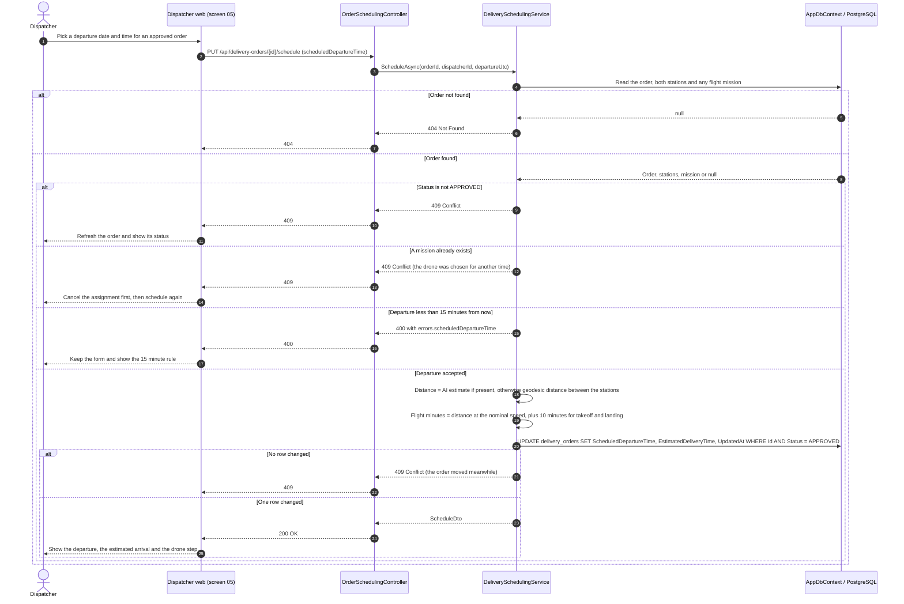
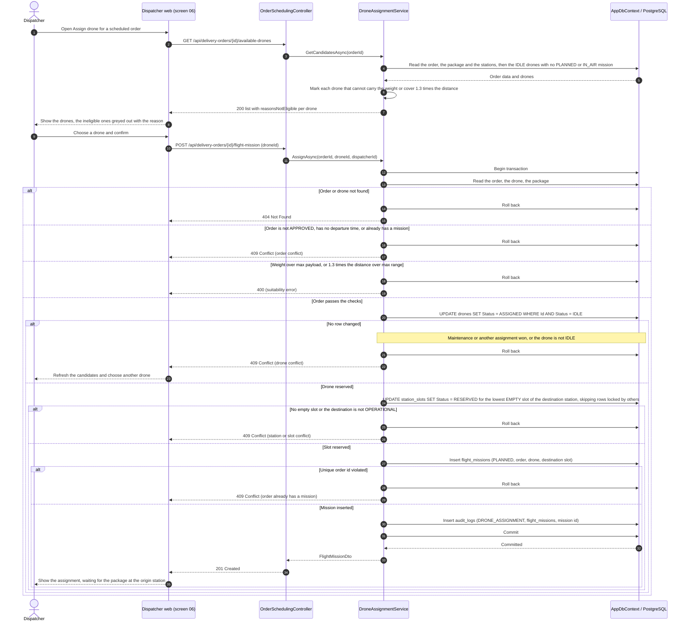
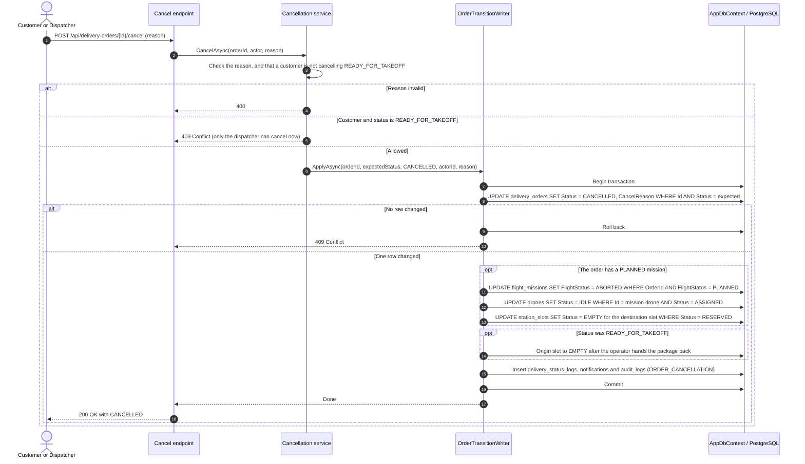

# Sequence Diagrams - Scheduling and Drone Assignment

**Parent:** LA-199 - Design documents: Delivery workflow

**Subtask:** LA-236 - Sequence diagram for scheduling and drone assignment

**Status:** Proposed for review

This document specifies the sequence diagrams for the dispatcher steps between an approved order and the package intake: choosing the departure time, choosing a drone, and giving the resources back when an assigned order is cancelled (FR-15, FR-16, FR-14, FR-32; UC-12). [sequence-drone-management.md](sequence-drone-management.md) section 4 already describes the assignment from the **drone** side. This document describes it from the **order** side, adds the departure time and the cancellation, and corrects one point (section 6, item 1). Controllers and services are **proposed**; see [class-diagram-delivery-workflow.md](class-diagram-delivery-workflow.md).

---

## 1. Sources and design boundaries

| Source | Basis |
|---|---|
| [SRS](../requirements/SRS.md), [use cases](../requirements/use-cases.md) | FR-15 schedule departure and assign an available drone, creating a flight mission; FR-16 reject an overlapping assignment; UC-12. |
| [functions-delivery-workflow.md](../requirements/functions-delivery-workflow.md) | F-04 schedule departure time; F-05 validate and assign drone. |
| [business rules](../requirements/business-rules.md) | BR-DW-05 to BR-DW-10, BR-DW-19, BR-DW-20, BR-DW-23, BR-LS-06. |
| [sequence-drone-management.md](sequence-drone-management.md) | Candidate query is advisory, the submit rechecks everything under locks, drone states, no hard-coded limits. |
| [class-specification-delivery-workflow.md](class-specification-delivery-workflow.md) | Entities and the rule that the planned times are on the order, not on the mission. |
| [station-api.md](../api/station-api.md), [drone-api.md](../api/drone-api.md) | Slot statuses, drone statuses, who sets `RESERVED`. |

Every request passes authentication and authorization first: `401` for no or invalid token, `403` for a role other than `DISPATCHER` or `ADMIN`. The diagrams begin after that gate.

What changes when a drone is assigned (the order does **not** change status):

| Object | Before | After |
|---|---|---|
| `delivery_orders.status` | `APPROVED` | `APPROVED` |
| `flight_missions` | none | one row, `PLANNED`, with `DroneId` and `DestinationSlotId`; `StartSlotId` empty |
| `drones.status` | `IDLE` | `ASSIGNED` |
| Destination `station_slots.status` | `EMPTY` | `RESERVED` |

---

## 2. Sequence 1: Schedule the departure (F-04)

Scheduling is a plain update: it changes no status, so it writes no status log and no notification. `UpdatedAt` is the concurrency token that makes a stale save lose (open point 2).

---

## 3. Sequence 2: Candidate drones and assignment (F-05)

The candidate list reserves nothing and can be out of date when the dispatcher confirms. The assignment therefore checks everything again, and the decisive steps are conditional updates inside one transaction.

How the rules of the functions document map to this flow:

| Rule | Where it is enforced |
|---|---|
| Drone `IDLE` only (BR-DW-07, with the change in [class-specification-delivery-workflow.md](class-specification-delivery-workflow.md) section 6, item 3) | Conditional `UPDATE drones ... WHERE Status = IDLE`; the candidate list is only advice. |
| Payload (BR-DW-08) | `max_payload_gram >= package.weight_gram`, read inside the transaction. The cargo envelope was already checked when the order was created. |
| Range with a 30 percent reserve (BR-DW-09) | `max_flight_range_km >= distance * 1.3`, using the AI estimate when it exists, otherwise the geodesic distance. |
| No overlap (BR-DW-10, FR-16) | A drone with an active mission is `ASSIGNED` or `FLYING`, so the status guard rejects a second one. In this version a drone holds one active mission at a time; booking a drone for several future windows is not supported (open point 3). |
| Destination slot (BR-DW-06) | One `EMPTY` slot of the destination station becomes `RESERVED`. The origin slot is not reserved here (section 6, item 1). |
| Audit (BR-DW-19) | `DRONE_ASSIGNMENT` in the same transaction. |

Two assignments at the same time for the same order or the same drone cannot both pass: the second `UPDATE drones` finds the drone already `ASSIGNED`, and the second mission insert breaks the unique `order_id`. A maintenance request and an assignment for one drone are ordered the same way ([sequence-drone-management.md](sequence-drone-management.md) section 3).

---

## 4. Sequence 3: Release the resources when an assigned order is cancelled

Cancelling an `APPROVED` order (customer or dispatcher) or a `READY_FOR_TAKEOFF` order (dispatcher only, BR-DW-03) must give back the drone and the slots at once (BR-DW-20). The merged customer cancel does not do this yet, because no mission can exist today; this is a required change when assignment is built.

Every `UPDATE` of the drone and of the slot is conditional on the status it expects. If another process already changed it, the update affects no row and the cancel still completes; the dispatcher sees the difference in the audit log. A drone that is `FLYING` is never touched by a cancel, because a cancel is not allowed once the order is `IN_TRANSIT` (BR-DW-03).

---

## 5. Persistence alignment

| Topic | Interpretation |
|---|---|
| Planned times | `scheduled_departure_time` and `estimated_delivery_time` are on `delivery_orders`. `flight_missions.start_time` and `end_time` are the actual flight and stay empty until takeoff. |
| Status log | Scheduling and assignment are not status changes, so they add no row to `delivery_status_logs`. The assignment is in `audit_logs` (`DRONE_ASSIGNMENT`). |
| Slot status | The API sets `RESERVED` only through assignment, `OCCUPIED` only through intake and landing, `EMPTY` through takeoff, pickup, cancellation and release ([station-api.md](../api/station-api.md) section 1). |
| Notifications | None for scheduling or assignment: the customer is told at `APPROVED`, `READY_FOR_TAKEOFF` and the later statuses (BR-DW-21). |
| After commit | Any push to dispatchers is sent after the commit and never undoes it. |

---

## 6. Corrections and decisions to confirm

1. **Origin slot at assignment.** Section 4 of [sequence-drone-management.md](sequence-drone-management.md) says the assignment reserves "the selected `EMPTY` slots" of both stations. This document reserves only the **destination** slot, as BR-DW-06 and F-05 say, and leaves `StartSlotId` empty until the operator loads the package: the intake in [station-api.md](../api/station-api.md) needs an `EMPTY` origin slot, so a slot reserved earlier would make it fail with `409`. That section of the drone document should be corrected to match.
2. **Schedule an order that has a mission.** Proposed: refused with `409`; the dispatcher cancels the assignment and schedules again. Changing the time under an existing mission would need the drone checks to be repeated for the new window. A dedicated "unassign" action is not part of this design; in this version the way to remove a mission is to cancel the order, or to resolve a failure.
3. **One active mission per drone.** BR-DW-10 describes an interval check with 15 and 20 minute buffers, which only matters when a drone can hold several future missions. This version keeps the simpler rule (one active mission, status guard). The interval check and the buffers (still proposed, business rule D-04) are for a later change, together with a column or table for the planned window.
4. **Operating hours of a station.** F-04 asks the departure to fall within the operating schedule of both stations. No such schedule exists in the schema. Proposed: not checked in this version.
5. **Nominal speed and the clearance minutes.** 15 m/s and 10 minutes come from F-04 and are proposals. They should be constants in one place, so the AI estimate can replace them later.
6. **Reschedule after a failure.** The order returns to `APPROVED` and goes through these sequences again; this needs the schema change of [class-specification-delivery-workflow.md](class-specification-delivery-workflow.md) section 6, item 1 (one mission per order is unique today).
