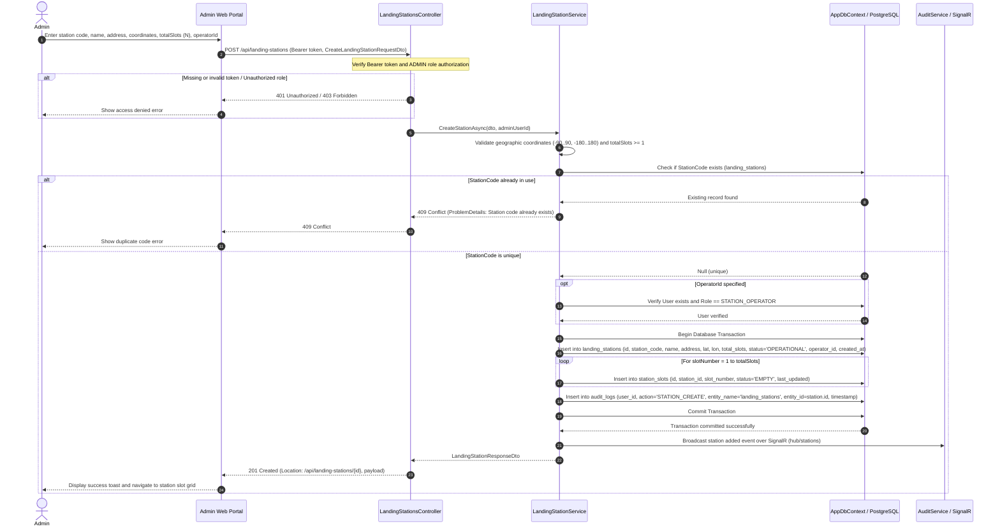
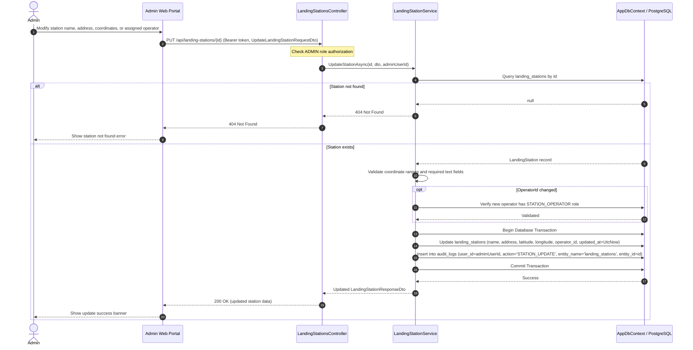
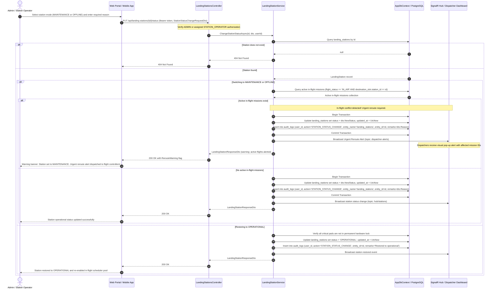
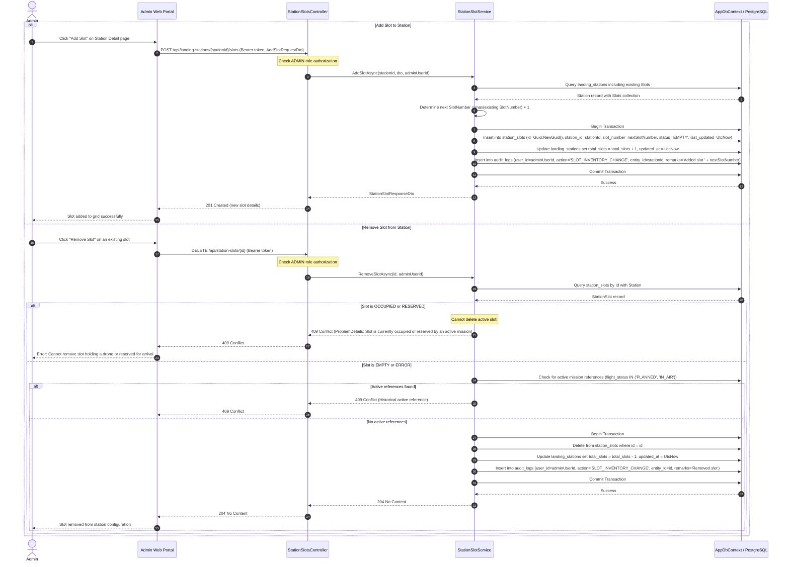
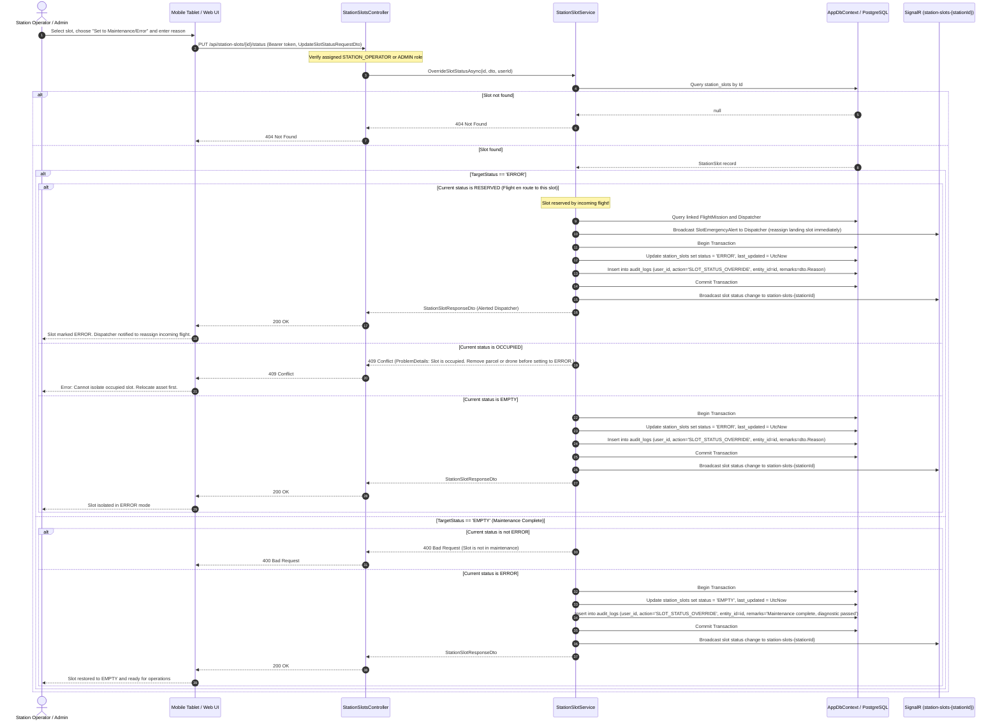

# Sequence Diagrams - Landing Station and Slot Management

**Parent:** LA-198 - Design documents: Landing stations, slots and drones

**Subtask:** LA-231 - Sequence diagram for station and slot management

**Status:** Proposed for review

This document specifies the sequence diagrams for **Landing Station and Slot Management** in the SmartDroneDelivery platform. It models the end-to-end interactions across Web/Mobile clients, API controllers, application services, database transactions, and real-time SignalR notifications for the creation, update, operational mode change, deactivation, and slot lifecycle management.

---

## 1. Sources and design boundaries

| Source | Basis |
|---|---|
| [SRS](../requirements/SRS.md) | FR-20: create, update, deactivate and list landing stations; FR-21: manage slots of each station and their status; FR-22: real-time availability; FR-03: authorization; FR-32: sensitive-action audit logging. |
| [Landing Station Functions](../requirements/functions-landing-station.md) | F-01: List stations; F-02: Create/update station & mode toggle; F-03: Manage slots inventory; F-04: Slot operational override; F-05: Real-time availability monitoring. |
| [Station & Pickup Activity Diagram](activity-station-and-pickup.md) | Station/slot maintenance workflows, in-flight arrival conflict resolution, and rerouting alerts. |
| [Station Operator User Flow](user-flows/station-operator.md) | Screen flow: Dashboard $\rightarrow$ Slot grid $\rightarrow$ Maintenance toggle $\rightarrow$ Diagnostic check. |
| [Business Rules](../requirements/business-rules.md) | BR-LS-01 to BR-LS-06, BR-LS-21; conflict handling, unique codes, and audit integrity. |
| [AppDbContext / Entities](../../backend/SmartDroneDelivery.Api/Data/AppDbContext.cs) | `LandingStation`, `StationSlot`, `FlightMission`, `AuditLog`, `User`. Unique index on `(station_id, slot_number)` and `station_code`. |
| [Auth contract](../api/auth-api.md) | Bearer token authentication, role validation (`ADMIN`, `STATION_OPERATOR`, `DISPATCHER`), problem details error format. |

---

## 2. Sequence 1: Create Landing Station and Provision Slots

This flow models an Administrator creating a new landing hub. The system validates uniqueness, inserts the station record, and automatically provisions $N$ empty slots numbered 1 to $N$ in a single database transaction.

---

## 3. Sequence 2: Update Landing Station Attributes and Operator Assignment

This flow allows an Administrator to update physical attributes (name, address, coordinates) or reassign the operational staff for an existing hub.

---

## 4. Sequence 3: Station Operational Mode Toggle, Emergency Shutdown, and Deactivation

This flow handles changing the station operational mode (`OPERATIONAL` $\rightarrow$ `MAINTENANCE` / `OFFLINE` or vice versa). It explicitly models the **aeronautical conflict check** for in-flight missions en route to the hub.

---

## 5. Sequence 4: Station Slot Inventory Management (Add & Remove Slots)

This flow models expanding or shrinking the slot capacity of a landing station.

---

## 6. Sequence 5: Slot Operational Override and Maintenance Isolation

This flow models a Station Operator or Administrator isolating an individual faulty slot (`ERROR`) due to pad debris, charging pin malfunction, or locker door jam, and restoring it to `EMPTY` after repairs.

---

## 7. Persistence alignment and atomic consistency

| Concern | Design Alignment |
|---|---|
| **Atomic Transactions** | Station creation and slot provisioning execute in a single database transaction. If slot insertion fails, station creation rolls back completely. |
| **Audit Compliance** | All sensitive administrative and operational state changes write immutable records to `audit_logs` storing user ID, action code, entity identifier, and reason (SRS FR-32). |
| **Real-Time Synchronization** | Slot state changes publish immediately over SignalR topic `station-slots-{stationId}`, keeping Dispatcher scheduling views and mobile tablet grids synchronized without client-side polling. |
| **Conflict Invariants** | An occupied or reserved slot cannot be deleted (`409 Conflict`). Deactivating a station with flights en route triggers an immediate high-priority reroute alert to flight dispatchers. |
