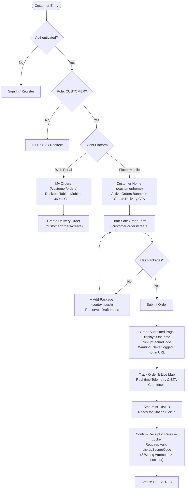
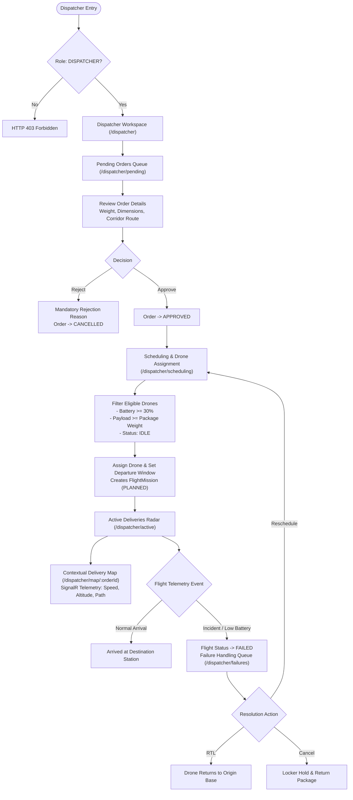
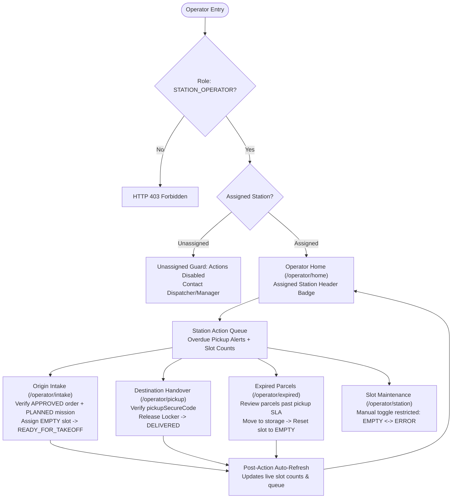
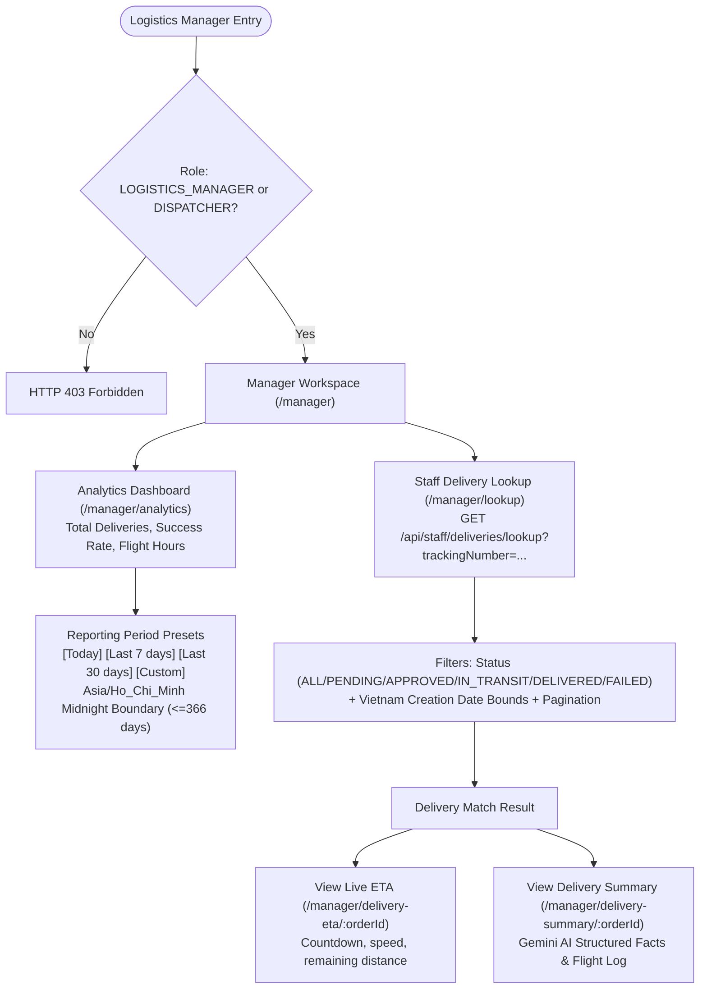
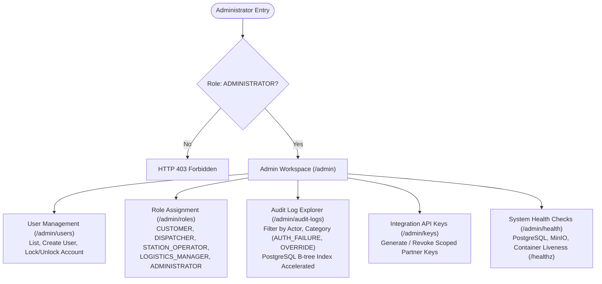

# 3.1 UI/UX & Implemented Screen Flows (SmartDroneDelivery)

**Parent Story:** [LA-351](https://hungndemail.atlassian.net/browse/LA-351) | **Task:** [LA-361](https://hungndemail.atlassian.net/browse/LA-361)  
**Confluence Target:** [Page 11894809 (3.1 UI/UX & Screen Flows)](https://hungndemail.atlassian.net/wiki/pages/viewpage.action?pageId=11894809)  
**Baseline Tested Commit:** [`ef7ddec`](https://github.com/nguyentuio1/learning_app/commit/ef7ddecf4875b6504ce2352468a2f3e8fda6a90c) (develop)  
**Owner / Author:** Trần Nguyễn (`LA-361`)  
**Design History:** v1 (2026-10-28) by Phan Van Khai; v2–v4 (2026-11-04) by TBA Review (translation & chapter-relative layout); v5 (2026-11-18) by Trần Nguyễn (synchronized with reviewed UI fixes from Sprint 7–8).

---

## 1. Overview and Architectural Distinction

This document synchronizes the canonical UI/UX and screen flows for the **SmartDroneDelivery** platform across its **5 authorized actors** (Customer, Dispatcher, Station Operator, Logistics Manager, and System Administrator).

### 1.1 Designed Wireframes vs. Implemented Screens

A critical distinction is maintained between the early design artifacts and the verified production applications:

| Characteristic | Designed Wireframes (`docs/design/wireframes/`) | Implemented Production Screens (`develop` `ef7ddec`) |
| :--- | :--- | :--- |
| **Creation Period** | Sprint 2–4 conceptual phase | Sprint 7–8 integrated implementation |
| **Technology Stack** | Static wireframe drawings (Draw.io, SVG, PNG) | Dynamic React 18 (TypeScript, Tailwind, SignalR) & Flutter 3.24+ (Riverpod, GoRouter) |
| **Data & State** | Mock static placeholders and idealized layouts | Real ASP.NET Core 8 Web API, PostgreSQL 16, MinIO storage, live SignalR telemetry |
| **Responsive Viewports** | Fixed desktop (1280px) and generic phone wireframes | Verified responsive breakpoints: Narrow Mobile (360px–390px), Tablet (768px), Desktop (1440px) |
| **Navigation & Auth** | Abstract linear flow arrows | Role-based JWT authentication, route guards, automatic redirection, session expiry handling |
| **Business Logic Guards** | Unvalidated input fields | Strict domain guards: unassigned operator lockout, draft form preservation, one-time pickup code warning, battery & weight suitability checks |
| **Accessibility** | Unmeasured grayscale/color tones | Verified WCAG AA contrast ratios (5.66:1–6.66:1 foreground/background) and minimum 44px touch targets |

---

## 2. Implemented Role Journeys for the 5 Actors

### 2.1 Customer Journey (Web Portal & Flutter Mobile App)

The customer initiates and monitors parcel deliveries, manages address books and packages, tracks flights in real time with AI arrival estimation, and interacts with the AI Assistant.

#### Primary Navigation & Route Map:
- **Web Portal:**
  - `/customer/orders` — **My Orders**: Entry point at customer sign-in. Desktop displays paginated table with status chips; narrow screens (360px–390px) display touch-friendly order cards with direct action buttons (`Track`, `Confirm receipt`).
  - `/customer/orders/create` — **Create Delivery**: Multi-step order submission form. Requires at least one declared package and address. Preserves draft state across package/address creation via non-destructive router pushes.
  - `/customer/orders/:orderId` — **Order Details**: Comprehensive delivery summary, package attributes, origin/destination landing stations, route map preview, and contextual links to ETA countdown and AI Delivery Summary.
  - `/customer/orders/tracking/:orderId` — **Live Delivery Tracking & Map**: Real-time SignalR drone position updates along the scheduled flight corridor between stations.
  - `/customer/addresses` — **Address Book**: Add/edit delivery addresses with validated 44px touch targets.
  - `/customer/packages` — **Package Management**: Register packages with weight, dimensions, and photo uploads to MinIO.
  - `/customer/assistant` — **AI Customer Assistant**: Interactive natural-language support for delivery queries.
- **Flutter Customer Mobile App (`AppFlavor.customer`):**
  - `/customer/home` — **Customer Home**: Elevated primary CTA **"Create delivery"**. Active orders card prioritizing `PENDING`, `APPROVED`, `SCHEDULED`, `READY_FOR_TAKEOFF`, `IN_TRANSIT`, `ARRIVED` with instant contextual actions.
  - `/customer/orders/create` — **Draft-Safe Order Creation**: Prompts **"Add package"** CTA if user has 0 packages. Preserves form state (`originStationId`, `destinationStationId`, recipient details, notes) when navigating away.
  - `/customer/orders/submitted` — **Order Submitted Guidance**: Prominently displays the one-time `pickupSecureCode` for recipient handover. Explicitly informs the user that this code is never stored in URLs, query params, or client logs.
  - `/customer/orders/confirm` — **Confirm Delivery**: Recipient enters `pickupSecureCode` to release destination station locker.

#### Order & Package Prerequisites:
1. Customer must have at least one registered package (`weightKg <= 10.0 kg`, valid dimensions within locker limits).
2. Customer must specify origin landing station and destination landing station.
3. Destination station must have an available empty locker slot.

#### Error, Empty & Disabled States:
- **Zero packages / addresses:** Empty state view displays friendly illustrations and immediate action buttons to register the first item without losing navigation context.
- **API Failure / Network Disconnect:** Inline retry banners with clear user recovery actions.
- **Pickup Code Lockout:** After 3 consecutive incorrect `pickupSecureCode` entries, the locker confirmation is locked for security and requires operator/support escalation.

---

### 2.2 Dispatcher Journey (Web Portal)

The dispatcher reviews incoming delivery orders, schedules flights, assigns suitable drones, monitors active missions on the live tracking radar, and handles delivery failures.

#### Primary Navigation & Route Map:
- `/dispatcher/pending` — **Pending Orders Review**: Table of incoming `PENDING` orders with package weight, volume, origin, destination, and creation timestamp. Actions:
  - **Approve Order**: Transitions status to `APPROVED`.
  - **Reject Order**: Requires mandatory rejection reason from dispatcher; transitions status to `CANCELLED` and notifies customer.
- `/dispatcher/scheduling` — **Schedule & Drone Assignment**:
  - Sets scheduled departure time within operational station hours.
  - Evaluates drone fleet availability: filters drones by battery level (`>= 30%`), operational status (`IDLE`), maximum payload capacity (`>= package weight`), and destination reach.
  - Successful assignment creates a `FlightMission` in `PLANNED` status and reserves origin/destination station slots.
- `/dispatcher/active` — **Active Deliveries Monitoring**: Real-time table of flights in `IN_TRANSIT` or `READY_FOR_TAKEOFF` status with SignalR live updates.
- `/dispatcher/map/:orderId` — **Contextual Delivery Map**: Focused geospatial view of the active drone flight corridor, origin/destination coordinates, current altitude/speed telemetry, and battery depletion rate.
- `/dispatcher/failures` — **Failure Handling Workspace**: Active queue of deliveries in `FAILED` status (e.g. adverse weather, low battery diversion, destination locker occupied). Actions:
  - **Reschedule**: Assigns a new flight mission and departure window.
  - **Return to Base (RTL)**: Directs drone back to origin station.
  - **Cancel & Locker Hold**: Marks parcel for origin retrieval.

#### Operational Prerequisites:
1. Drone assignment requires `DeliveryOrder.Status == APPROVED`.
2. Drone selection requires battery charge `>= 30%` and max payload `>= package.WeightKg`.
3. Origin station must have package intake completed (`READY_FOR_TAKEOFF`) before mission launch.

---

### 2.3 Station Operator Journey (Flutter Mobile App & Web Portal)

The station operator manages landing station physical operations: package intake into origin lockers, drone landing/take-off clearance, recipient pickup handover, slot status overrides, and clearing expired parcels.

#### Primary Navigation & Route Map:
- **Flutter Station Operator App (`AppFlavor.operator`):**
  - `/operator/home` — **Operator Home**:
    - **Assigned Station Context**: Prominent header badge displaying the assigned station name and address.
    - **Strict Unassigned Guard**: If operator is unassigned (`isUnassignedOperator`), operational CTAs are strictly locked out with guidance to contact dispatcher/manager.
    - **Station Action Queue**: Consolidates live empty vs. occupied slot counts and overdue pickup timeout alerts with direct **"Review expired"** navigation.
    - **Post-Action Auto-Refresh**: Returning from Intake or Handover automatically refetches slot availability and queue metrics.
  - `/operator/intake` — **Origin Package Intake**: Verifies physical parcel matches order details for an `APPROVED` order with a `PLANNED` mission. Operator assigns an empty slot, places parcel, and confirms intake -> order transitions to `READY_FOR_TAKEOFF`.
  - `/operator/pickup` — **Destination Pickup Handover**: Recipient presents `pickupSecureCode`. Operator verifies code in app -> locker unlocks -> recipient collects parcel -> order transitions from `ARRIVED` to `DELIVERED`.
  - `/operator/expired` — **Expired Parcels Clearance**: Lists parcels left in locker slots past SLA (`pickupDeadline`). Operator removes parcel to secure warehouse storage and clears slot back to `EMPTY`.
  - `/operator/station` — **Slot Maintenance**: View slot grid (`EMPTY`, `OCCUPIED`, `RESERVED`, `ERROR`). Manual override is strictly restricted between `EMPTY <-> ERROR` with audit logging.
- **Web Portal (`/operator/stations`):**
  - Visual station slot grid for desktop monitoring and manual override when maintenance is required.

#### Strict Business Rule Guards:
1. **Unassigned Operator Lockout:** Station operators without an assigned station cannot perform intake or pickup actions.
2. **Order Intake Guard:** Cannot intake an order unless it is `APPROVED` with an assigned `PLANNED` mission.
3. **Pickup Verification Guard:** Destination pickup strictly requires matching `pickupSecureCode`; 3 failed attempts triggers security rate-limit lockout.

---

### 2.4 Logistics Manager Journey (Web Portal)

The logistics manager evaluates operational fleet KPIs, delivery success rates, station utilization, and conducts delivery lookups by tracking number for live ETA and summary insights.

#### Primary Navigation & Route Map:
- `/manager/dashboard` & `/manager/analytics` — **Operational Analytics Dashboard**:
  - Fleet KPIs: Total deliveries, success rate (%), average delivery turnaround time, and drone flight hours.
  - **Preset Reporting Periods**: Instant one-click selection for **Today**, **Last 7 days**, and **Last 30 days**, alongside custom date picker.
  - **Timezone Boundary Alignment**: All cohorts strictly evaluate from midnight to midnight within `Asia/Ho_Chi_Minh` timezone (UTC+7), bounded by a 366-day maximum query window.
- `/manager/lookup` — **Staff Delivery Lookup & Insights**:
  - **Authorized Tracking Number Lookup**: Replaces raw GUID searches with human-readable tracking numbers (`GET /api/staff/deliveries/lookup?trackingNumber=...`).
  - **Combined Filters**: Status filter (`ALL`, `PENDING`, `APPROVED`, `IN_TRANSIT`, `DELIVERED`, `FAILED`), Vietnam creation-date bounds, and pagination.
  - **Contextual Intelligence Links**: Direct one-click navigation to:
    - `/manager/delivery-eta/:orderId` — AI arrival estimate countdown and flight prediction factors.
    - `/manager/delivery-summary/:orderId` — Gemini structured facts, journey milestones, and flight incident logs.

#### Access Control & Security:
- Restricted to `LOGISTICS_MANAGER` and `DISPATCHER` roles; unauthorized roles (`CUSTOMER`, `STATION_OPERATOR`) receive `HTTP 403 Forbidden`.

---

### 2.5 System Administrator Journey (Web Portal)

The system administrator oversees platform identity, user role assignments, security audit logs, external integration keys, and container/infrastructure health.

#### Primary Navigation & Route Map:
- `/admin/users` — **User Management**: Search, view, create user accounts, edit profiles, and toggle account lock status (`isActive`).
- `/admin/roles` — **Role Management**: Assign user accounts to one of the 5 canonical system roles (`CUSTOMER`, `DISPATCHER`, `STATION_OPERATOR`, `LOGISTICS_MANAGER`, `ADMINISTRATOR`). Enforces role segregation.
- `/admin/audit-logs` — **Security Audit Log Explorer**: Search and filter immutable audit trails by Actor User ID, action category (`AUTH_FAILURE`, `ORDER_STATUS_OVERRIDE`, `SLOT_STATUS_OVERRIDE`, `KEY_MANAGEMENT`), and date range. Backed by PostgreSQL composite B-tree indexes.
- `/admin/keys` — **External Integration Keys**: Generate and revoke scoped API keys with rate-limiting policies for external warehouse and logistics partners.
- `/admin/health` — **System Health Checks**: Real-time status of `/healthz`, `/healthz/live`, `/healthz/ready`, monitoring PostgreSQL database connection, MinIO object store reachability, and Docker container liveness.

---

## 3. Implemented vs. Wireframe Comparison & Screenshot Evidence Catalog

The following catalog establishes complete visual traceability between conceptual wireframes and the verified production UI implementation on `develop` (`ef7ddec`). Every production screen has been captured at both **Desktop (1440px)** and **True Narrow Mobile Viewport (360px–390px with native touch emulation, without desktop cropping)** across all 5 authorized system roles and public authentication journeys:

### 3.1 Authentication & Public Access
| Screen / Flow | Designed Wireframe (`docs/design/wireframes/`) | Implemented Production Screen (`develop` `ef7ddec`) | Verified Actual Screenshot Evidence (`screenshots/`) | Key Evolutionary Differences & Responsive UI Highlights |
| :--- | :--- | :--- | :--- | :--- |
| **Sign In (`/login`)** | `web/dispatcher/01-login.png` | `frontend/web/src/pages/LoginPage.tsx` | Desktop: [auth-login-desktop-1440px.png](screenshots/auth-login-desktop-1440px.png) Narrow Mobile: [auth-login-narrow-390px.png](screenshots/auth-login-narrow-390px.png) | Vector drone route illustration on desktop; collapsible clean single-column login card on narrow screens; accessible password visibility toggle and 44px minimum touch targets. |
| **Register (`/register`)** | `app/customer/C02-Register.png` | `frontend/web/src/pages/RegisterPage.tsx` | Desktop: [auth-register-desktop-1440px.png](screenshots/auth-register-desktop-1440px.png) Narrow Mobile: [auth-register-narrow-390px.png](screenshots/auth-register-narrow-390px.png) | Unified user registration form with live field validation, phone formatting, responsive viewport scaling, and direct sign-in transition link. |

### 3.2 Customer Role Journeys
| Screen / Flow | Designed Wireframe (`docs/design/wireframes/`) | Implemented Production Screen (`develop` `ef7ddec`) | Verified Actual Screenshot Evidence (`screenshots/`) | Key Evolutionary Differences & Responsive UI Highlights |
| :--- | :--- | :--- | :--- | :--- |
| **My Orders (`/orders`)** | Web Wireframes (1280px table only) | `frontend/web/src/pages/CustomerOrdersPage.tsx` (PR #271 / LA-349) | Desktop: [customer-orders-desktop-1440px.png](screenshots/customer-orders-desktop-1440px.png) Narrow Mobile: [customer-orders-narrow-390px.png](screenshots/customer-orders-narrow-390px.png) | Full 5-column sortable table on desktop; responsive 360px–390px stacked card layout with prominent tracking number badge, expandable date filter drawer, and direct touch CTAs (`Track`, `Confirm receipt`). |
| **Order Details (`/orders/:id`)** | Wireframe details modal | `frontend/web/src/pages/CustomerOrderDetailPage.tsx` | Desktop: [customer-order-detail-desktop-1440px.png](screenshots/customer-order-detail-desktop-1440px.png) Narrow Mobile: [customer-order-detail-narrow-390px.png](screenshots/customer-order-detail-narrow-390px.png) | End-to-end status lifecycle stepper, origin/destination station metadata, package weight specifications, and contextual AI summary shortcuts. |
| **Create Delivery (`/orders/new`)** | `C14-CreateDelivery.png`, `C15-CreateDelivery-Errors.png` | `frontend/web/src/pages/CreateDeliveryOrderPage.tsx` | Desktop: [customer-create-order-desktop-1440px.png](screenshots/customer-create-order-desktop-1440px.png) Narrow Mobile: [customer-create-order-narrow-390px.png](screenshots/customer-create-order-narrow-390px.png) | Real-time reactive Delivery Summary sidebar on desktop; stacked step form on narrow mobile; draft-safe form state preservation across package/address registration pushes. |
| **Customer Tracking Map (`/orders/:id/map`)** | `C07-TrackLive.png` | `frontend/web/src/features/deliveryMap/DeliveryMapPage.tsx` (PR #264 / LA-345) | Desktop: [customer-tracking-map-desktop-1440px.png](screenshots/customer-tracking-map-desktop-1440px.png) Narrow Mobile: [customer-tracking-map-narrow-390px.png](screenshots/customer-tracking-map-narrow-390px.png) | Dedicated customer flight corridor view; live drone waypoint telemetry, origin/destination station pins, altitude/speed stats, and ETA countdown. |
| **Saved Packages (`/packages`)** | `C05-Packages.png` | `frontend/web/src/pages/CustomerPackagesPage.tsx` | Desktop: [customer-packages-desktop-1440px.png](screenshots/customer-packages-desktop-1440px.png) Narrow Mobile: [customer-packages-narrow-390px.png](screenshots/customer-packages-narrow-390px.png) | Package cards with weight, dimensions, fragile flags, and MinIO photo thumbnails; quick package creation dialog. |
| **Address Book (`/addresses`)** | `C06-Addresses.png` | `frontend/web/src/pages/CustomerAddressesPage.tsx` | Desktop: [customer-addresses-desktop-1440px.png](screenshots/customer-addresses-desktop-1440px.png) Narrow Mobile: [customer-addresses-narrow-390px.png](screenshots/customer-addresses-narrow-390px.png) | Verified default address tags, recipient contact metadata, and direct create/edit modals. |
| **AI Delivery Assistant (`/delivery-assistant`)** | Conceptual chat bot wireframe | `frontend/web/src/features/customerAssistant/CustomerAssistantPage.tsx` | Desktop: [customer-assistant-desktop-1440px.png](screenshots/customer-assistant-desktop-1440px.png) Narrow Mobile: [customer-assistant-narrow-390px.png](screenshots/customer-assistant-narrow-390px.png) | Natural-language query interface with live order context, AI-backed ETA updates, flight progress, and friendly fallback recommendations. |
| **Customer Notifications (`/notifications`)** | Conceptual alerts list | `frontend/web/src/pages/CustomerNotificationsPage.tsx` | Desktop: [customer-notifications-desktop-1440px.png](screenshots/customer-notifications-desktop-1440px.png) Narrow Mobile: [customer-notifications-narrow-390px.png](screenshots/customer-notifications-narrow-390px.png) | Real-time flight departure alerts, locker arrival alerts, one-click "Mark all as read" CTA, and unread counter badges. |

### 3.3 Dispatcher Role Journeys
| Screen / Flow | Designed Wireframe (`docs/design/wireframes/`) | Implemented Production Screen (`develop` `ef7ddec`) | Verified Actual Screenshot Evidence (`screenshots/`) | Key Evolutionary Differences & Responsive UI Highlights |
| :--- | :--- | :--- | :--- | :--- |
| **Dispatcher Workspace (`/`)** | `02-dashboard.png` | `frontend/web/src/pages/HomePage.tsx` (PR #262 / LA-343) | Desktop: [dispatcher-workspace-desktop-1440px.png](screenshots/dispatcher-workspace-desktop-1440px.png) Narrow Mobile: [dispatcher-workspace-narrow-390px.png](screenshots/dispatcher-workspace-narrow-390px.png) | High-level triage console prioritizing pending approvals, dispatch scheduling, active deliveries, and fleet drone readiness. |
| **Pending Approvals Queue (`/dispatcher/approvals`)** | `03-pending-orders.png`, `04-order-detail-approval.png` | `frontend/web/src/features/approvals/ApprovalsPage.tsx` | Desktop: [dispatcher-approvals-desktop-1440px.png](screenshots/dispatcher-approvals-desktop-1440px.png) Narrow Mobile: [dispatcher-approvals-narrow-390px.png](screenshots/dispatcher-approvals-narrow-390px.png) | Incoming delivery review table with station filters; Approve button and Reject modal requiring mandatory dispatcher rationale. |
| **Flight Scheduling & Drones (`/dispatcher/scheduling`)** | `05-scheduling.png`, `06-drone-assignment.png` | `frontend/web/src/features/scheduling/SchedulingPage.tsx` | Desktop: [dispatcher-scheduling-desktop-1440px.png](screenshots/dispatcher-scheduling-desktop-1440px.png) Narrow Mobile: [dispatcher-scheduling-narrow-390px.png](screenshots/dispatcher-scheduling-narrow-390px.png) | Approved order queue with drone eligibility engine (battery >= 30%, max payload capacity, station proximity), flight window assignment. |
| **Failed Deliveries & Incidents (`/dispatcher/failures`)** | `07-incident-management.png` | `frontend/web/src/features/failures/FailureHandlingPage.tsx` | Desktop: [dispatcher-failures-desktop-1440px.png](screenshots/dispatcher-failures-desktop-1440px.png) Narrow Mobile: [dispatcher-failures-narrow-390px.png](screenshots/dispatcher-failures-narrow-390px.png) | Incident queue (adverse weather, low battery, locker timeout); action triage for Reschedule, Return to Base (RTL), and Return to Origin. |
| **Fleet Delivery Tracking (`/delivery-tracking`)** | `08-live-tracking.png` | `frontend/web/src/features/tracking/DeliveryTrackingPage.tsx` | Desktop: [dispatcher-delivery-tracking-desktop-1440px.png](screenshots/dispatcher-delivery-tracking-desktop-1440px.png) Narrow Mobile: [dispatcher-delivery-tracking-narrow-390px.png](screenshots/dispatcher-delivery-tracking-narrow-390px.png) | System-wide active delivery tracking table with telemetry staleness indicators, flight status badges, and rapid tracking number lookup. |
| **Dispatcher Fleet Radar Map (`/delivery-map`)** | `08-live-tracking.png` | `frontend/web/src/features/deliveryMap/DeliveryMapPage.tsx` (PR #264 / LA-345) | Desktop: [dispatcher-delivery-map-desktop-1440px.png](screenshots/dispatcher-delivery-map-desktop-1440px.png) Narrow Mobile: [dispatcher-delivery-map-narrow-390px.png](screenshots/dispatcher-delivery-map-narrow-390px.png) | Full-screen interactive corridor map with active drone telemetry overlays, flight paths, station locations, and altitude meters. |
| **Drone Fleet Management (`/drones`)** | `09-fleet-management.png` | `frontend/web/src/features/drones/DronesPage.tsx` | Desktop: [dispatcher-fleet-drones-desktop-1440px.png](screenshots/dispatcher-fleet-drones-desktop-1440px.png) Narrow Mobile: [dispatcher-fleet-drones-narrow-390px.png](screenshots/dispatcher-fleet-drones-narrow-390px.png) | Drone inventory with battery capacity, payload grams, flight range, operational status (`FLYING`, `IDLE`, `CHARGING`, `MAINTENANCE`), and maintenance logs. |

### 3.4 Station Operator Role Journeys
| Screen / Flow | Designed Wireframe (`docs/design/wireframes/`) | Implemented Production Screen (`develop` `ef7ddec`) | Verified Actual Screenshot Evidence (`screenshots/`) | Key Evolutionary Differences & Responsive UI Highlights |
| :--- | :--- | :--- | :--- | :--- |
| **Landing Stations Overview (`/stations`)** | Station hub wireframe | `frontend/web/src/features/stations/StationsPage.tsx` | Desktop: [operator-stations-desktop-1440px.png](screenshots/operator-stations-desktop-1440px.png) Narrow Mobile: [operator-stations-narrow-390px.png](screenshots/operator-stations-narrow-390px.png) | Landing station registry showing active station hubs, addresses, geo-coordinates, total vs. available locker slots, and operational status. |
| **Station Slot Grid (`/station-slots`)** | Locker grid layout wireframe | `frontend/web/src/features/slots/StationSlotsPage.tsx` | Desktop: [operator-station-slots-desktop-1440px.png](screenshots/operator-station-slots-desktop-1440px.png) Narrow Mobile: [operator-station-slots-narrow-390px.png](screenshots/operator-station-slots-narrow-390px.png) | Interactive locker slot grid displaying `OCCUPIED`, `EMPTY`, `RESERVED`, and `MAINTENANCE` statuses with parcel tracking badges and slot toggle actions. |
| **Station Availability Matrix (`/station-availability`)** | Station capacity wireframe | `frontend/web/src/features/availability/StationAvailabilityPage.tsx` | Desktop: [operator-station-availability-desktop-1440px.png](screenshots/operator-station-availability-desktop-1440px.png) Narrow Mobile: [operator-station-availability-narrow-390px.png](screenshots/operator-station-availability-narrow-390px.png) | Real-time station capacity and slot availability matrix across all urban drone hubs. |

### 3.5 Logistics Manager Role Journeys
| Screen / Flow | Designed Wireframe (`docs/design/wireframes/`) | Implemented Production Screen (`develop` `ef7ddec`) | Verified Actual Screenshot Evidence (`screenshots/`) | Key Evolutionary Differences & Responsive UI Highlights |
| :--- | :--- | :--- | :--- | :--- |
| **Analytics Dashboard (`/manager/analytics`)** | `01-dashboard.png`, `02-statistics-filters.png` | `frontend/web/src/features/analytics/AnalyticsPage.tsx` (PR #276 / LA-350) | Desktop: [manager-analytics-dashboard-desktop-1440px.png](screenshots/manager-analytics-dashboard-desktop-1440px.png) Narrow Mobile: [manager-analytics-dashboard-narrow-390px.png](screenshots/manager-analytics-dashboard-narrow-390px.png) | Executive KPI cards (Total Orders, 94.6% Success Rate, 22.4 min Avg Delivery, Station Throughput); preset reporting periods ([Today], [Last 7 days], [Last 30 days]) aligned to Vietnam midnight boundaries. |
| **Deliveries Performance Report (`/manager/analytics?tab=reports`)** | `03-reports-analytics.png` | `frontend/web/src/features/analytics/AnalyticsPage.tsx` (PR #276 / LA-350) | Desktop: [manager-delivery-report-desktop-1440px.png](screenshots/manager-delivery-report-desktop-1440px.png) Narrow Mobile: [manager-delivery-report-narrow-390px.png](screenshots/manager-delivery-report-narrow-390px.png) | Comprehensive delivery audit table with departure/arrival durations, origin/destination hubs, and contextual one-click links to live ETA and AI summary. |
| **Delivery ETA Countdown (`/delivery-eta`)** | ETA detail wireframe | `frontend/web/src/features/deliveryEta/DeliveryEtaPage.tsx` | Desktop: [manager-delivery-eta-desktop-1440px.png](screenshots/manager-delivery-eta-desktop-1440px.png) Narrow Mobile: [manager-delivery-eta-narrow-390px.png](screenshots/manager-delivery-eta-narrow-390px.png) | Live flight ETA prediction factors, confidence score (0.95), and estimated minutes remaining. |
| **Delivery Summary & Flight Log (`/delivery-summary`)** | Flight log wireframe | `frontend/web/src/features/deliverySummary/DeliverySummaryPage.tsx` | Desktop: [manager-delivery-summary-desktop-1440px.png](screenshots/manager-delivery-summary-desktop-1440px.png) Narrow Mobile: [manager-delivery-summary-narrow-390px.png](screenshots/manager-delivery-summary-narrow-390px.png) | Gemini AI structured flight milestones, departure/arrival timestamps, total elapsed duration (23 mins), and distance covered (14.5 km). |

### 3.6 System Administrator Role Journeys
| Screen / Flow | Designed Wireframe (`docs/design/wireframes/`) | Implemented Production Screen (`develop` `ef7ddec`) | Verified Actual Screenshot Evidence (`screenshots/`) | Key Evolutionary Differences & Responsive UI Highlights |
| :--- | :--- | :--- | :--- | :--- |
| **User Directory (`/admin/users`)** | User table wireframe | `frontend/web/src/pages/UsersPage.tsx` | Desktop: [admin-users-desktop-1440px.png](screenshots/admin-users-desktop-1440px.png) Narrow Mobile: [admin-users-narrow-390px.png](screenshots/admin-users-narrow-390px.png) | Managed user account table with role filtering, status tags (`ACTIVE`, `INACTIVE`), account deactivation, and Create User action. |
| **Role Management (`/admin/roles`)** | Roles list wireframe | `frontend/web/src/pages/RolesPage.tsx` | Desktop: [admin-roles-desktop-1440px.png](screenshots/admin-roles-desktop-1440px.png) Narrow Mobile: [admin-roles-narrow-390px.png](screenshots/admin-roles-narrow-390px.png) | 5 canonical role cards (`CUSTOMER`, `DISPATCHER`, `STATION_OPERATOR`, `MANAGER`, `ADMIN`) showing user count, permissions explanation, and quick links to filtered user lists. |
| **Security Audit Logs (`/admin/audit-logs`)** | Audit logs wireframe | `frontend/web/src/pages/AuditLogsPage.tsx` | Desktop: [admin-audit-logs-desktop-1440px.png](screenshots/admin-audit-logs-desktop-1440px.png) Narrow Mobile: [admin-audit-logs-narrow-390px.png](screenshots/admin-audit-logs-narrow-390px.png) | Security event log explorer with action filter (`APPROVE_ORDER`, `ASSIGN_ROLE`, `CREATE_ORDER`, `EXPORT_REPORT`), user IP address, timestamp, and audit reason. |
| **Admin & Staff Profile (`/profile`)** | User profile wireframe | `frontend/web/src/pages/ProfilePage.tsx` | Desktop: [admin-profile-desktop-1440px.png](screenshots/admin-profile-desktop-1440px.png) Narrow Mobile: [admin-profile-narrow-390px.png](screenshots/admin-profile-narrow-390px.png) | Account information, assigned role badge, contact details, and session security status. |

---

## 4. Responsive Viewport Specifications & Verification

Tested across verified responsive viewports:

| Viewport Category | Target Dimensions | Verified Layout & Behavior | Tested Component Examples |
| :--- | :--- | :--- | :--- |
| **Narrow Mobile** | 360px – 390px width | Single-column stacked cards; 44px touch targets; expandable date filters; sticky primary CTAs; WCAG AA contrast (>= 5.66:1). | Customer Order Card (`OrdersPage.tsx`), Mobile Navigation (`AccountMobileNavigation.tsx`). |
| **Tablet** | 768px – 1024px width | Two-column grid layouts; adaptive drawer navigation; side-by-side order summary and map preview. | Workspace Layout (`DeliveryWorkspaceLayout.tsx`), Station Slot Matrix. |
| **Desktop Workspace** | 1280px – 1440px+ width | Full-width data tables with sorting, multi-column filters, and pagination; split-pane flight radar map; persistent sidebar navigation. | Dispatcher Review Table, Manager Analytics Dashboard (`AnalyticsPage.tsx`). |

---

## 5. Traceability and Publication Ledger

| Attribute | Specification / Value |
| :--- | :--- |
| **Jira Parent Story** | [LA-351 (Correct Confluence test evidence and installation guidance)](https://hungndemail.atlassian.net/browse/LA-351) |
| **Jira Subtask** | [LA-361 (Update Confluence screen flows with implemented role journeys)](https://hungndemail.atlassian.net/browse/LA-361) |
| **Assignee** | Trần Nguyễn |
| **Integration Baseline** | `origin/develop` [`ef7ddec`](https://github.com/nguyentuio1/learning_app/commit/ef7ddecf4875b6504ce2352468a2f3e8fda6a90c) |
| **Integrated PRs** | PR #271 (LA-349 Customer Web Journey), PR #276 (LA-350 Staff Lookup & Presets), PR #264 (LA-345 Delivery Maps), PR #262 (LA-343 Web Workspaces), PR #267 (LA-355 Tracking Lookup), PR #265 (LA-348 Gemini AI) |
| **Mobile Candidate PRs** | PR #277 (LA-363 Customer Journey), PR #278 (LA-364 Operator Journey) |
| **Target Confluence Page** | [3.1 UI/UX & Screen Flows (Page ID: 11894809)](https://hungndemail.atlassian.net/wiki/pages/viewpage.action?pageId=11894809) |
| **Target Confluence Version** | **v5** (updated from v4 dated 2026-11-04) |
