# Customer User Flow - SmartDroneDelivery

Screen flow for the Customer mobile application (`C01–C27`). It covers account access and profile management, saved delivery addresses and packages, delivery order creation and tracking, cancellation, pickup-code confirmation, AI Assistant, and notifications.

The flow uses the Customer use cases in [use-cases.md](../../requirements/use-cases.md), the delivery lifecycle and failure rules in [business-processes.md](../business-processes.md), the customer, package, address, delivery order, notification and AI models in [erd.md](../../architecture/erd.md), and the Customer mobile wireframes documented for LA-76 and completed in Sprint 7 (LA-169).

> [!IMPORTANT]
> **Proposed AI Endpoints (Baseline Contract Preview — Not Yet Implemented):**
> The following AI endpoints are proposed baseline contracts only and are **not yet implemented or deployed on the backend**:
> - `GET /api/delivery-orders/{id}/eta` (AI ETA prediction)
> - `POST /api/delivery-orders/{id}/ai-summary` (AI delivery telemetry summary)
> - `POST /api/ai-assistant/messages` (AI chat message prompt)
> - `GET /api/ai-assistant/sessions` (AI session list)
> - `GET /api/ai-assistant/sessions/{id}/messages` (AI session messages)
>
> In the Customer mobile application (`C23`), the AI Assistant operates strictly in local preview mode without making network calls to `/api/ai-assistant/*` or `/ai-summary`. AI ETA predictions in `C06` and `C14` are subject to backend contract availability.

## User flow

```mermaid
flowchart TB
    Start((Start)) --> Open["Open Customer mobile app"]
    Open --> Login["Log in (C01)"]
    Login --> Credentials{"Credentials valid?"}
    Credentials -->|no| LoginError["Show login error"]
    LoginError --> Login
    Credentials -->|yes| Home["Customer Home (C03 / C04 when empty)"]

    Login -->|create account| Register["Register (C02)"]
    Register --> RegisterValid{"Registration data valid?"}
    RegisterValid -->|no| RegisterError["Show validation error"]
    RegisterError --> Register
    RegisterValid -->|yes| Home

    %% Quick shortcuts from Home
    Home -->|create delivery| CreateDelivery["Create Delivery (C14)"]
    Home -->|my orders| Orders["My Orders (C05)"]
    Home -->|manage addresses| Addresses["Delivery Addresses (C20)"]
    Home -->|manage packages| Packages["My Packages (C18)"]
    Home -->|notifications| Notifications["Notifications (C22)"]
    Home -->|assistant| Assistant["AI Assistant (C23)"]
    Home -->|profile & settings| Profile["Profile and Settings (C24)"]

    %% Section 1: Orders and tracking
    Orders --> SelectOrder["Select an order from list / search"]
    SelectOrder --> OrderDetails["Order Details (C06 / C07 / C08)"]
    OrderDetails --> OrderStatus{"Current order status"}

    OrderStatus -->|PENDING| PendingDetails["Pending Order Detail (C07)"]
    PendingDetails --> EditOrder["Edit delivery order"]
    EditOrder --> CreateDelivery
    PendingDetails --> CancelOrder["Cancel order (C09 Cancel Sheet)"]
    CancelOrder --> CancelReason["Enter cancellation reason"]
    CancelReason --> ConfirmCancel{"Confirm cancellation?"}
    ConfirmCancel -->|no| PendingDetails
    ConfirmCancel -->|yes| CancelAllowed{"Cancellation allowed?"}
    CancelAllowed -->|no| CancelError["Show cancellation unavailable"]
    CancelError --> PendingDetails
    CancelAllowed -->|yes| Cancelled["Order status: CANCELLED"]
    Cancelled --> Orders

    OrderStatus -->|APPROVED| Approved["Approved Order Detail"]
    Approved --> CancelOrder
    OrderStatus -->|READY_FOR_TAKEOFF| Ready["Ready for takeoff at origin station"]
    OrderStatus -->|IN_TRANSIT| InTransit["In-Transit Order Detail & Live Map (C06)"]
    OrderStatus -->|ARRIVED| Arrived["Arrived Order & Pickup Notice (C08)"]

    %% Pickup confirmation (C11 - C13)
    Arrived --> EnterCode["Enter Pickup OTP (C11)"]
    EnterCode --> CodeAttempts{"OTP validation attempt"}
    CodeAttempts -->|incorrect, attempts < 3| CodeError["Show incorrect OTP error (C12)"]
    CodeError --> EnterCode
    CodeAttempts -->|3 consecutive failures| Locked["HTTP 423 Locked (10-minute lockout)"]
    Locked --> Arrived
    CodeAttempts -->|valid 6-digit OTP| Delivered["Delivery Completed (C13)"]
    Delivered --> Orders

    OrderStatus -->|DELIVERED| Delivered
    OrderStatus -->|CANCELLED| CancelledDetails["Show cancellation reason"]
    OrderStatus -->|FAILED| Failed["Show failure reason and guidance"]

    %% Audit Log & Assistant from Order Details
    OrderDetails --> History["View Order History & Audit Log (C10)"]
    History --> OrderDetails
    OrderDetails --> Assistant
    Ready --> Assistant
    InTransit --> Assistant
    Failed --> Assistant

    %% Section 2: Create delivery
    CreateDelivery --> SelectPackage["Select saved package"]
    SelectPackage --> PackageAvailable{"Use existing package?"}
    PackageAvailable -->|no, add new| AddPackage["Add package (C19)"]
    AddPackage --> PackageValid{"Package data valid?"}
    PackageValid -->|no| PackageError["Show validation errors (C15)"]
    PackageError --> AddPackage
    PackageValid -->|yes| SavePackage["Save package"]
    SavePackage --> SelectStations
    PackageAvailable -->|yes| SelectStations["Select origin and destination stations"]
    SelectStations --> StationsValid{"Both stations operational<br/>and different?"}
    StationsValid -->|no| StationError["Show station selection error"]
    StationError --> SelectStations
    StationsValid -->|yes| Recipient["Enter recipient details<br/>or choose saved address"]
    Recipient --> RecipientValid{"Required details valid?"}
    RecipientValid -->|no| DeliveryError["Show form validation errors (C15)"]
    DeliveryError --> Recipient
    RecipientValid -->|yes| Estimate["Show AI delivery estimate (Proposed contract)"]
    Estimate --> Review["Review Delivery (C16)"]
    Review --> ReviewChoice{"Submit request?"}
    ReviewChoice -->|edit| CreateDelivery
    ReviewChoice -->|submit| SubmitOrder["Submit delivery request"]
    SubmitOrder --> Submitted["Order Submitted (C17)<br/>tracking number & initial OTP"]
    Submitted --> OrderDetails

    %% Section 3: Packages and addresses
    Packages --> PackageAction{"Choose action"}
    PackageAction -->|add| AddPackage
    PackageAction -->|edit| EditPackage["Edit package (C19)"]
    EditPackage --> PackageValid
    PackageAction -->|delete| DeletePackage["Delete package"]
    DeletePackage --> PackageInUse{"Attached to unfinished order?"}
    PackageInUse -->|yes| PackageDeleteError["Show package cannot be deleted"]
    PackageDeleteError --> Packages
    PackageInUse -->|no| PackageDeleted["Delete package"]
    PackageDeleted --> Packages

    Addresses --> AddressAction{"Choose action"}
    AddressAction -->|add| AddAddress["Add address (C21)"]
    AddressAction -->|edit| EditAddress["Edit address (C21)"]
    AddressAction -->|set default| DefaultAddress["Set default address"]
    AddressAction -->|delete| DeleteAddress["Delete address"]
    AddAddress --> AddressValid{"Address data valid?"}
    EditAddress --> AddressValid
    AddressValid -->|no| AddressError["Show address validation error"]
    AddressError --> AddAddress
    AddressValid -->|yes| SaveAddress["Save address"]
    SaveAddress --> Addresses
    DefaultAddress --> Addresses
    DeleteAddress --> Addresses

    %% Section 4: Profile, notifications and assistant
    Profile --> ProfileAction{"Choose action"}
    ProfileAction -->|edit profile| EditProfile["Edit Profile (C25)"]
    EditProfile --> ProfileValid{"Profile data valid?"}
    ProfileValid -->|no| ProfileError["Show validation error"]
    ProfileError --> EditProfile
    ProfileValid -->|yes| SaveProfile["Save profile"]
    SaveProfile --> Profile
    ProfileAction -->|delivery addresses| Addresses
    ProfileAction -->|change password| ChangePassword["Change Password (C26)"]
    ChangePassword --> PasswordValid{"Current and new password valid?"}
    PasswordValid -->|no| PasswordError["Show password error"]
    PasswordError --> ChangePassword
    PasswordValid -->|yes| PasswordUpdated["Update password & revoke sessions"]
    PasswordUpdated --> Login
    ProfileAction -->|theme settings| Theme["Theme Settings: Light / Dark / System (C27)"]
    Theme --> Profile
    ProfileAction -->|notifications| Notifications
    ProfileAction -->|assistant| Assistant
    ProfileAction -->|log out| Logout["Log out"]
    Logout --> Login

    %% Notifications flow
    Notifications --> NotificationAction{"Choose notification"}
    NotificationAction -->|open order update| OrderDetails
    NotificationAction -->|mark all as read| Notifications
    NotificationAction -->|back| Home

    %% AI Assistant flow
    Assistant --> Chat["Send query or tap quick suggestion chip"]
    Chat --> OwnOrder{"Query concerns own order?"}
    OwnOrder -->|no, foreign tracking code| AssistantDenied["Decline access: only own orders allowed"]
    AssistantDenied --> Assistant
    OwnOrder -->|yes or general help| AssistantReply["Simulated local response (Contract preview)"]
    AssistantReply --> Assistant
```

## Main screens and decisions (`C01–C27`)

| Screen ID | Screen Name | Purpose | Related Use Case |
|---|---|---|---|
| **C01** | Customer Login | Authenticate customer via email & password, entry to registration | UC-01 |
| **C02** | Customer Registration | Create new Customer account with name, phone, email & password | UC-01 |
| **C03** | Customer Home (Active) | Central dashboard with active deliveries, unread notification count, and quick shortcuts | UC-03, UC-07 |
| **C04** | Customer Home (Empty) | Initial empty home view with guidance and shortcuts to create delivery | UC-03 |
| **C05** | My Orders | List signed-in customer's orders; filter by status, search tracking number, pagination | UC-06, UC-07 |
| **C06** | In-Transit Order Detail | Real-time tracking view with live telemetry, map trajectory, stepper, history link, and assistant link | UC-07, UC-20 |
| **C07** | Pending Order Detail | Awaiting approval with Edit Order and Cancel Order actions, history link, and assistant link | UC-06 |
| **C08** | Arrived Order & Pickup Notice | Arrival state showing destination station info and "Enter pickup code" button | UC-08 |
| **C09** | Cancel Order Sheet | Modal sheet collecting cancellation reason for PENDING/APPROVED orders | UC-06 |
| **C10** | Order History & Audit Log | Chronological vertical timeline stepper of status transitions (`statusLogs`), timestamps, and remarks | UC-07, UC-10 |
| **C11** | Confirm Delivery — Enter OTP | Keypad interface for entering 6-digit compartment pickup code | UC-08 |
| **C12** | Confirm Delivery — Incorrect OTP | Error state handling invalid secure code entry; triggers HTTP 423 Locked (10 min) after 3 consecutive failures | UC-08 |
| **C13** | Delivery Completed | Successful pickup confirmation screen with delivery summary | UC-08 |
| **C14** | Create Delivery | Multi-step form selecting package, origin/destination stations, and recipient details | UC-05, UC-20 |
| **C15** | Create Delivery — Validation Errors | Form validation error state highlighting missing fields or invalid stations | UC-05 |
| **C16** | Review Delivery | Pre-submission confirmation reviewing route, package, recipient, and estimated duration | UC-05 |
| **C17** | Order Submitted | Success screen displaying generated tracking number and initial pickup secure code | UC-05 |
| **C18** | My Packages List | Saved package templates list with weight, dimensions, and fragile indicators | UC-04 |
| **C19** | Add / Edit Package | Form to add or edit package profile (name, weight, dimensions, fragile flag) | UC-04 |
| **C20** | Delivery Addresses List | Address book managing saved pickup and dropoff locations | UC-03 |
| **C21** | Add / Edit Address | Address entry form with label, recipient name, phone, and address text | UC-03 |
| **C22** | Notifications Center | Notification center displaying order/system updates, filter unread, mark all read, and tap-to-open order | UC-10 |
| **C23** | AI Assistant | Conversational assistant interface with quick chips, simulated responses, and data-privacy protection | UC-09 |
| **C24** | Profile & Settings | Main profile overview with links to Edit Profile, Addresses, Password, Theme, Notifications, Assistant, Logout | UC-02 |
| **C25** | Edit Profile | User contact information update form (full name, phone number; email read-only) | UC-02 |
| **C26** | Change Password | Security form to update account password; successful change redirects to Login | UC-01, UC-02 |
| **C27** | Theme Settings | Appearance preferences selection (Light, Dark, or System Default) wired into app ThemeMode | UC-02 |

## Flow rules

- **Authentication (`C01`, `C02`, `C26`)**
  - Valid credentials lead to the Customer Home screen (`C03`); invalid credentials return an error on Login (`C01`).
  - Registration (`C02`) validates required fields before creating the account.
  - Changing password (`C26`) successfully invalidates active sessions and navigates back to Login (`C01`).
  - Signing out from `C24` returns the user to Login (`C01`).

- **Delivery creation (`C14`–`C17`)**
  - A Customer selects a saved package (`C18`/`C19`) or adds a new one, selects origin and destination stations, and enters recipient details before reviewing (`C16`).
  - The origin and destination stations must be operational and different.
  - The submitted order starts in `PENDING` status, displaying tracking number (`DD-YYYYMM-NNNN`) and initial pickup code (`C17`).
  - The review screen (`C16`) allows returning to edit details before final submission.

- **Order lifecycle and cancellation (`C05`–`C09`)**
  - The Customer can view only their own orders (`C05`).
  - Editing is permitted while the order is `PENDING` (`C07`).
  - Cancellation via Cancel Sheet (`C09`) is allowed while status is `PENDING` or `APPROVED`.
  - From `READY_FOR_TAKEOFF` onward, cancellation through the app is blocked.

- **Tracking and history (`C06`, `C10`)**
  - Order Details (`C06`) displays live status, route, and telemetry bar for in-transit orders.
  - Both `C06`, `C07`, and `C08` provide the "View Order History" action that navigates directly to `C10`.
  - Order History (`C10`) displays a chronological vertical timeline of status transitions (`statusLogs`), timestamps, and remarks. If no logs exist, it displays standard empty state `EmptyStateView` with `MSG-P-GEN-05` (`"No order history found."`).

- **Pickup secure-code confirmation (`C11`–`C13`)**
  - The code-entry screen (`C11`) is available when the order reaches `ARRIVED` (`C08`).
  - Customer enters the 6-digit pickup OTP.
  - If incorrect, an error message is shown (`C12`, `MSG-P-LS-15`).
  - **Lockout Policy:** If the customer enters an incorrect OTP 3 consecutive times, the backend enforces HTTP `423 Locked` with a 10-minute lockout window (`MSG-P-LS-16`: `"Too many attempts. Try again after 10 minutes."`).
  - Upon valid OTP entry, status transitions to `DELIVERED` and navigates to Delivery Completed (`C13`).

- **Package and address management (`C18`–`C21`)**
  - Packages (`C18`/`C19`) and addresses (`C20`/`C21`) belong to the authenticated Customer.
  - Packages attached to active/unfinished orders cannot be deleted.
  - Saved addresses can be selected to prefill recipient information during delivery creation.

- **Notifications (`C22`)**
  - Notifications display order events, arrivals, and system alerts.
  - Tapping an order-related notification navigates directly to the corresponding order detail (`C06` for in-transit, `C07` for pending, `C08` for arrived).
  - Provides a "Mark all read" action.

- **AI Assistant (`C23`) & Proposed AI Endpoints**
  - Accessible from Customer Home (`C03`), Order Details (`C06`, `C07`, `C08`), and Profile & Settings (`C24`).
  - **Proposed API Contract Preview:** Backend AI assistant endpoints (`/api/ai-assistant/*`) and summary endpoints (`/api/delivery-orders/{id}/ai-summary`) are proposed baseline contracts and are **not yet implemented/deployed**.
  - `C23` runs entirely in local simulation mode and does NOT send network requests to proposed AI endpoints.
  - Privacy guard: queries requesting information about another customer's order tracking number are safely declined with an ownership privacy message.

- **Profile and settings (`C24`–`C27`)**
  - Profile overview (`C24`) provides complete navigation to Edit Profile (`C25`), Delivery Addresses (`C20`), Change Password (`C26`), Theme Settings (`C27`), Notifications (`C22`), AI Assistant (`C23`), and Sign out (`C01`).
  - Theme Settings (`C27`) allows choosing between Light, Dark, or System Default (`ThemeMode`), taking effect immediately.
  - Responsive design: all profile menus maintain zero overflow at compact mobile viewports (e.g., `320x568`).
