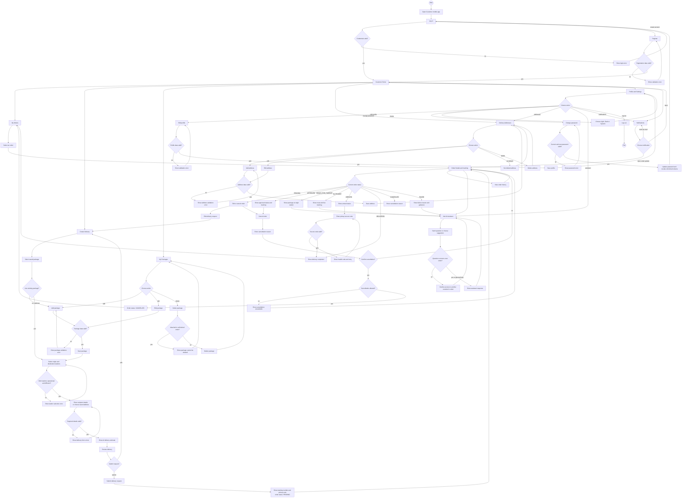

# Customer User Flow - SmartDroneDelivery

Screen flow for the Customer mobile application. It covers account access and profile management, saved delivery addresses and packages, delivery order creation and tracking, cancellation, pickup-code confirmation, AI Assistant, and notifications.

The flow uses the Customer use cases in [use-cases.md](../../requirements/use-cases.md), the delivery lifecycle and failure rules in [business-processes.md](../business-processes.md), the customer, package, address, delivery order, notification and AI models in [erd.md](../../architecture/erd.md), and the Customer mobile wireframes documented for LA-76. Confirm any rule marked as unresolved against the current source documents and project leader before implementation.

## User flow

## Main screens and decisions

| Screen or decision | Purpose | Related use case |
|---|---|---|
| Customer Login | Authenticate the Customer and provide an entry to registration | Customer authentication use case |
| Customer Registration | Create a Customer account and validate required fields | Customer registration use case |
| Customer Home | Central entry point for delivery summary, orders, packages, addresses, notifications and profile | Customer home/dashboard use case |
| My Orders | List the signed-in Customer's orders; search by tracking number and filter by status | UC-01 to UC-10 mapping to be verified against `use-cases.md` |
| Order Details and tracking | Show current order status, route, tracking timeline and status-dependent actions | Order tracking use case |
| Order History | Show order status changes, timestamps, actor and notes | Order history use case |
| Create Delivery | Select a package, origin/destination stations and recipient details | Create delivery use case |
| AI delivery estimate | Display the estimate described by the source, such as distance, flight duration and weather | AI delivery estimate use case |
| Review Delivery | Let the Customer review details and return to edit before submission | Delivery review/submission use case |
| Order Submitted | Show the tracking number, pickup secure code and pending status | Create delivery use case |
| Cancel Order | Collect a cancellation reason and confirm cancellation when the current status allows it | Cancel delivery use case |
| My Packages | List and manage saved packages | Package management use case |
| Add/Edit Package | Capture package name, weight, dimensions, description, fragile flag and optional image | Package management use case |
| Delivery Addresses | List and manage saved addresses; choose a default address where supported | Address management use case |
| Add/Edit Address | Capture label, recipient name, phone and address | Address management use case |
| Confirm Delivery | Allow the Customer to enter the pickup secure code after the order reaches `ARRIVED` | Delivery confirmation use case |
| Invalid Secure Code | Explain failed verification and allow retry | Delivery confirmation use case |
| Notifications | Show order and delivery updates and support read-state actions | Notification use case |
| AI Assistant | Answer questions about the Customer's own order or provide general delivery support | AI Assistant use case |
| Profile and Settings | Provide access to profile editing, password, theme, addresses, notifications, assistant and logout | Profile management use case |
| Edit Profile | Update editable profile details; email remains read-only if required by the source | Profile management use case |
| Change Password | Validate current/new password and end old sessions as specified by the source | Password management use case |
| Order status decision | Determine available actions from the current delivery-order status | Order lifecycle rules |

> **Use-case IDs:** The exact UC IDs for each Customer row must be checked against `../../requirements/use-cases.md`. Do not infer that the Station Operator UC numbers apply to Customer flows.

## Flow rules

- **Authentication**
  - Valid credentials lead to the Customer Home screen; invalid credentials return an error to Login.
  - Registration must validate the required fields before creating the account.
  - Signing out returns the user to Login. Session/token behavior must follow the authentication API and project security rules.

- **Delivery creation**
  - A Customer selects a saved package or adds a new one, selects origin and destination stations, and enters recipient details before reviewing the request.
  - The origin and destination stations must be different.
  - The supplied source flow says station selection should list stations with status `OPERATIONAL`; verify this against the current requirements/API.
  - The submitted order starts in `PENDING` according to the supplied source flow.
  - The review screen must allow the Customer to return and edit the request before submission.

- **Order lifecycle and cancellation**
  - The Customer can view only their own orders.
  - The supplied source allows editing while the order is `PENDING` and cancellation while it is `PENDING` or `APPROVED`.
  - From `READY_FOR_TAKEOFF` onward, the source says the Customer cannot cancel directly and should contact the dispatcher.
  - Available details/actions must reflect the order's current status: `PENDING`, `APPROVED`, `READY_FOR_TAKEOFF`, `IN_TRANSIT`, `ARRIVED`, `DELIVERED`, `CANCELLED` or `FAILED`.

- **Tracking and history**
  - Order Details displays the status, route and relevant timeline milestones.
  - The supplied source specifies live drone location and telemetry through SignalR for the applicable in-transit state; confirm implementation and connection behavior.
  - Order History displays status changes and associated timestamps/details.

- **Pickup secure-code confirmation**
  - The code-entry screen is available when the order is `ARRIVED`.
  - A failed code attempt shows an error and permits retry, subject to the final security policy.
  - A valid code follows the supplied Customer flow to delivery completion (`DELIVERED`).
  - **Open question:** confirm code length, failed-attempt limit, lockout duration and alert behavior. The supplied source materials describe inconsistent proposals for these values.

- **Package management**
  - Package records belong to the signed-in Customer.
  - Validate positive weight and dimensions and apply the source's stated package weight limit only after confirming it remains an approved requirement.
  - The source describes weight entry in kg and storage in grams (`weight_gram`).
  - A package attached to an unfinished order must not be deleted, according to the supplied flow.

- **Address management**
  - Saved address data can prefill recipient details during delivery creation.
  - Default-address, nearest-station and delete behavior must match the current API/ERD and approved requirements.

- **Notifications**
  - Notifications cover relevant order and delivery events described by the source.
  - Selecting an order notification opens that order's details.
  - Read/unread behavior must match the notification API.

- **AI Assistant**
  - The assistant may answer general delivery questions and questions about the signed-in Customer's own order.
  - It must not disclose another Customer's order information.

- **Profile and settings**
  - Profile editing validates fields before saving.
  - The source says email is read-only and changing a password revokes old refresh tokens; verify these behaviors against the authentication implementation.
  - Theme options are Light, Dark and System if supported by the app.

- **Scope**
  - This document describes the Customer mobile application only. Station Operator flows are documented separately.
  - The Customer app is for delivery management and tracking, not drone flight control.
