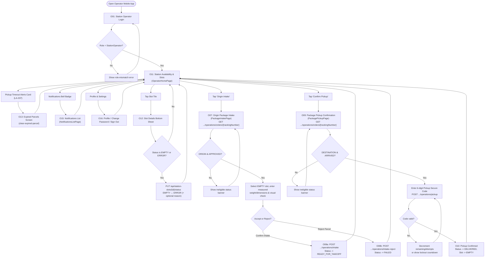

# Station Operator User Flow - SmartDroneDelivery

Updated for **LA-170** (Completed Station Operator Mobile Screens) and aligned with the implemented Flutter routes, widgets, and backend APIs.

---

## User flow

---

## Main screens and decisions

| Screen / Component | Flutter Implementation | Backend API / Behavior |
|---|---|---|
| **O01** Operator Login | `LoginPage` (`AppFlavor.operator`) | `POST /api/auth/login` (requires `StationOperator` / authorized role). |
| **O11** Station Availability | `OperatorHomePage` (`/operator`) | `GET /api/landing-stations`, `GET /api/landing-stations/{id}/availability`, `GET /api/landing-stations/{id}`. Filter slots by `ALL`, `EMPTY`, `OCCUPIED`, `RESERVED`, `ERROR`. |
| **O12** Slot Status Toggle | `_SlotDetailsModalBody` in `OperatorHomePage` | `PUT /api/station-slots/{id}/status` toggles `EMPTY ↔ ERROR` with optional reason; `RESERVED`/`OCCUPIED` return `409 Conflict`. |
| **O07 / O08** Origin Package Intake | `PackageIntakePage` (`/operator/intake`) | `GET /api/landing-stations/{stationId}/operations/orders/{trackingNumber}`, `POST .../intake`, `POST .../intake-reject`. |
| **O09 / O10** Destination Pickup | `PackagePickupPage` (`/operator/pickup`) | `GET /api/landing-stations/{stationId}/operations/orders/{trackingNumber}`, `POST .../pickup` with 6-digit secure code & lockout handling. |
| **O13** Expired Parcels | `PickupTimeoutAlertsCard` & `ExpiredParcelScreen` (`/operator/expired-parcels/:stationId`) | `GET .../expired-parcels` and `POST .../clear-expired-parcel`. |
| **O15** Notifications | `NotificationsListPage` (`/customer/notifications`, shared route) | `GET /api/notifications` and unread badge count on `OperatorHomePage`. |
| **O16** Profile & Session | `ProfilePage`, `EditProfilePage`, `ChangePasswordPage` | Manage operator profile, password, and sign out. |

---

## Flow rules

- **Origin Intake (`UC-16` / `LA-170`):** Only `ORIGIN` orders in `APPROVED` status with a scheduled `PLANNED` mission/assignment enforced by the backend can be accepted into an `EMPTY` slot (`POST .../intake` -> `READY_FOR_TAKEOFF`) or rejected with a mandatory reason (`POST .../intake-reject` -> `FAILED`).
- **Destination Pickup (`UC-17` / `LA-29` / `LA-126`):** Only `DESTINATION` orders in `ARRIVED` status can be released with the customer's 6-digit secure code; repeated invalid attempts trigger temporary lockout feedback.
- **Slot Maintenance (`UC-18` / `LA-170`):** Operators can mark `EMPTY` slots as `ERROR` (maintenance) and restore `ERROR` slots to `EMPTY` from the slot detail bottom sheet; `RESERVED` or `OCCUPIED` slots cannot be toggled manually.
- **Pickup Timeout Clearing (`LA-337`):** `OperatorHomePage` surfaces timed-out `ARRIVED` parcels via `PickupTimeoutAlertsCard` so operators can clear expired parcels and release slots.
- **Notifications (`UC-08` / `LA-170`):** `OperatorHomePage` displays an unread notification badge in the app bar and opens `NotificationsListPage` for operational alerts.
