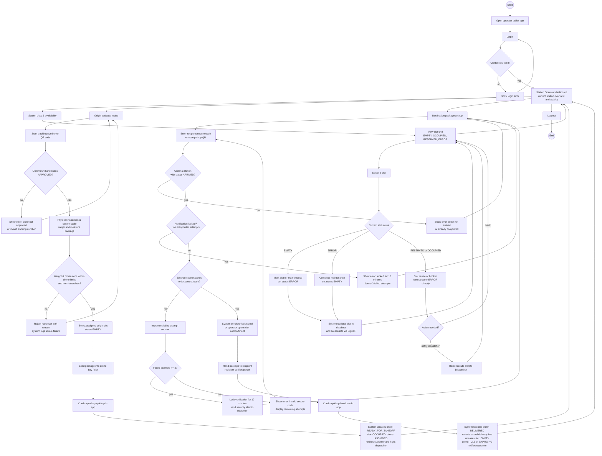

# Station Operator User Flow - SmartDroneDelivery

Screen flow for the Station Operator interface (mobile tablet or station kiosk terminal). It covers landing station availability monitoring, slot status management, origin package intake, and destination package pickup confirmation with secure code verification.

The flow uses the Station Operator use cases in [use-cases.md](../../requirements/use-cases.md) (`UC-16`, `UC-17`, `UC-18`, `UC-08`), the lifecycle and failure rules in [business-processes.md](../business-processes.md), and the landing station and slot models in [erd.md](../../architecture/erd.md).

## User flow

## Main screens and decisions

| Screen or decision | Purpose | Related use case |
|---|---|---|
| Station Operator dashboard | Central hub displaying landing station status, slot occupancy and incoming/outgoing tasks | UC-16, UC-17 |
| Station slots & availability | Grid view displaying all slots with status `EMPTY`, `OCCUPIED`, `RESERVED` or `ERROR` | UC-16, UC-17 |
| Slot maintenance toggle | Switch slot between `EMPTY` and `ERROR` for cleaning, sensor testing or mechanical repair | UC-16 |
| Origin package intake | Search or scan an approved delivery order when a customer drops off a parcel | UC-18 |
| Physical inspection & limits | Verify physical package weight and dimensions against drone limits and hazardous item rules | UC-18 |
| Confirm package pickup | Confirm parcel custody at origin, moving order to `READY_FOR_TAKEOFF` and slot to `OCCUPIED` | UC-18 |
| Destination package pickup | Search parcel and initiate delivery handover when recipient arrives at destination station | UC-08, UC-18 |
| Secure code verification | Validate 6-digit secure code against `order.secure_code` with brute-force lockout defense | UC-08 |
| Confirm delivery handover | Release package to recipient, moving order to `DELIVERED` and freeing slot to `EMPTY` | UC-08, UC-18 |

## Flow rules

- The Station Operator operates the assigned landing station and manages physical package handling at the pads.
- Slot status transitions:
  - An `EMPTY` slot can be put into `ERROR` for maintenance and returned to `EMPTY` once operational.
  - Slots with status `RESERVED` or `OCCUPIED` cannot be placed into maintenance without rerouting the scheduled drone or retrieving the stored parcel.
- Origin intake rules:
  - Only orders in `APPROVED` status can be received at the origin station.
  - Packages exceeding drone weight or size limits, or containing prohibited/hazardous goods, must be rejected with the reason logged.
  - Confirming intake sets order status to `READY_FOR_TAKEOFF`, slot to `OCCUPIED`, drone to `ASSIGNED`, and notifies both the customer and dispatcher.
- Destination pickup rules:
  - Only orders in `ARRIVED` status at the operator's station can be completed.
  - Entering an incorrect secure code increments a failure counter; reaching 3 consecutive failures locks code entry for 10 minutes (`423 Locked`) to protect against unauthorized collection.
  - Successful pickup sets order status to `DELIVERED`, records the timestamp, frees the destination slot to `EMPTY`, and sets the drone to `IDLE` or `CHARGING`.
