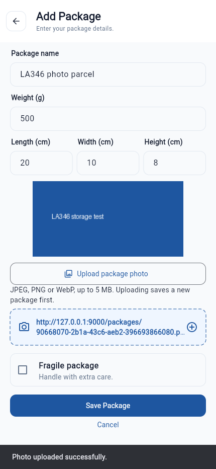
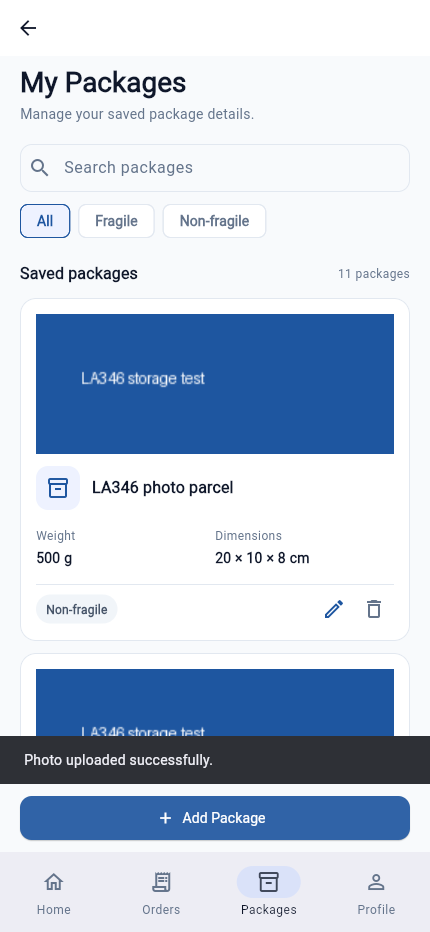
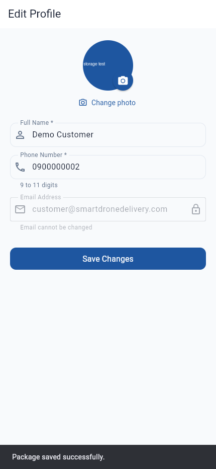

# LA-346 Flutter photo completion

Application source: `0c9b83d5a71a93dcf50acc211d8e90d5dde16f5f`, based on develop `a90668c`. Backend/storage implementation is unchanged from the previously integrated MinIO fixes. The final candidate also contains LA-348 synthetic verification and the corrected LA-351 report.

## Implemented behavior

Flutter now selects package photos from the gallery and sends multipart bytes to the authorized package-image API. A first upload saves a new package once; a failed upload retains that package ID so retry does not duplicate it. A failed replacement retains the previous URL. Success evicts the cached image and rebuilds the preview, including replacements returning the same MinIO URL. Package cards display the persisted photo. Directly opened add/edit routes return to a valid package list after save; pushed order-draft routes retain their pop result.

## Executed checks

- Full combined Flutter suite: **432 passed**; analyzer exits successfully with **30 existing info findings, no warnings/errors**.
- Focused package tests: **34 passed**, including actual multipart shape, invalid size before network, storage failure, retained ID on retry, same-URL image refresh and direct-route recovery.
- Actual Flutter Customer entrypoint in Chrome, 430 x 932 viewport, loopback preview port18761, real ASP.NET API port15064 and real PostgreSQL/MinIO. No HTTP fixtures/interception.
- Package create returned201; photo upload200; save200; the photo rendered in both edit preview and the persisted package list. Reading its returned public object URL returned200 with bytes exactly equal to the selected PNG.
- Actual profile gallery selection/avatar upload returned200; the avatar rendered, and returned object bytes matched the selected PNG.
- Traces include method/path/status only; no tokens or passwords are written. All accounts and uploaded images are synthetic development test data.

Earlier diagnostic runs found a deliberately tiny PNG that the Flutter decoder did not display and a direct-route navigation problem. The final run used a generated valid test PNG and the repaired navigation; failures were investigated rather than presented as successful image rendering.

## Scope

This is supported Flutter browser-runtime acceptance. Native Android/iOS installation and physical-device routing are not inferred. The tested browser could reach the returned MinIO host URL; physical devices still need the documented shared LAN MinIO PublicBaseUrl. Existing Docker photo/restart smoke and ownership/MIME validation evidence remain linked to the original storage integration; this change does not alter storage permissions.

## Evidence

[Actual API trace](evidence/la346-flutter/runtime-events.json), [package object comparison](evidence/la346-flutter/photo-result.json), [avatar object comparison](evidence/la346-flutter/avatar-result.json), [combined tests](evidence/la346-flutter/combined-full.txt), [analyzer](evidence/la346-flutter/combined-analyze.txt).

