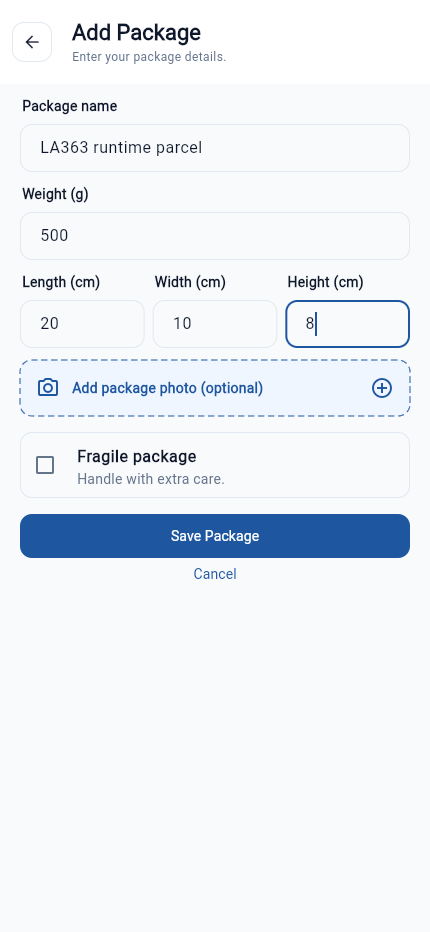
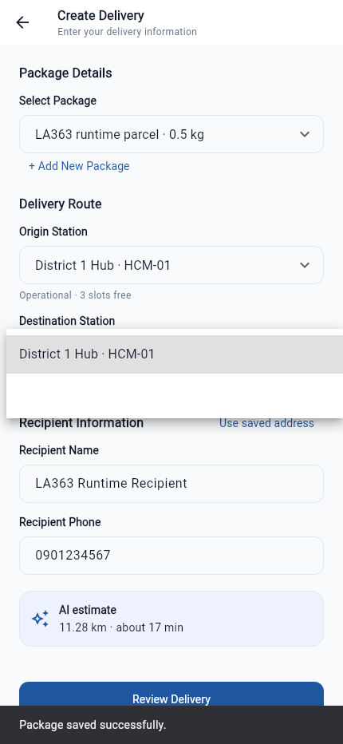
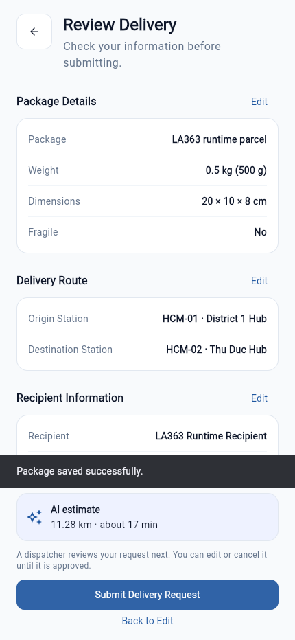
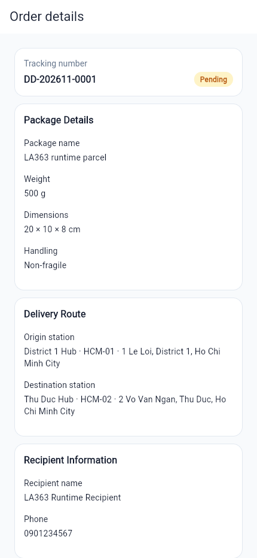
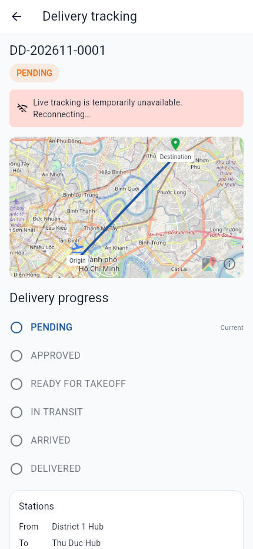
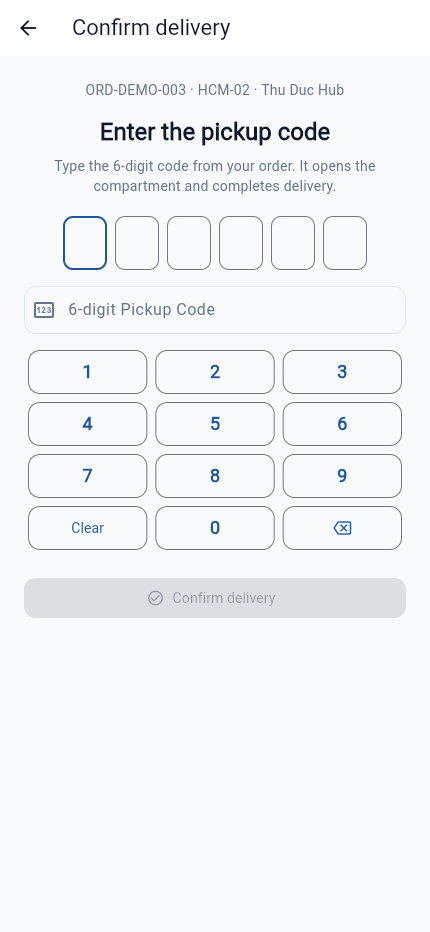

# LA-363 customer journey completion

Application source `c47a90443c063dc6f2557a3dd33207ca61e60851` includes Nhan's original PR277 UI and the completion fixes, with develop `afdd49458b24f1aa0de76cdfe2896461c7d6662a` merged normally. Original authorship is preserved.

## Changes

- Removed unsupported delivery instructions and package description inputs; their values were previously accepted/displayed but omitted from API requests.
- Restored explicit one-time pickup-code save/share guidance; no code in URLs/logs.
- Photo URL dialog now owns its controller until the dialog actually unmounts. Restored package-name limit 200 characters.
- Customer dashboard uses an independent unfiltered recent-100 query, discloses that bound, and invalidates on order mutations. Full-list filters remain independent; READY_FOR_TAKEOFF filtering is restored.
- Updated redesigned UI finders while retaining validation, mutation payload, deletion confirmation, ownership-error and history-order assertions.

## Verification

Flutter 3.47.8 / Dart 3.13.7, Chrome 158.0.8127.36, 430 x 932 viewport. Full combined Customer+Operator suite: **425 passed**. Analyzer: **30 existing info findings, no warnings/errors**. Independent final code review approved all addressed findings.

Real customer entry point used the existing ASP.NET API at loopback port15064 with a dedicated PostgreSQL test database. No HTTP response interception or preview-provider overrides. Runtime created a package (201), returned to order creation with recipient name/phone preserved, selected package/stations, reviewed and created delivery DD-202611-0001 (201/PENDING). The displayed-once warning was verified. View order and tracking both retrieved authorized API data (200). Screenshot of the one-time code screen was deliberately omitted; response traces contain only method/path/status and public order identifiers.

The loopback HTTP gateway does not forward SignalR WebSockets. Tracking displayed the real PENDING snapshot and an honest reconnecting indicator; this proves HTTP fallback/entry, not a healthy real-time flight. Native Android/iOS installation, physical flight, full-team rehearsal and Flutter MinIO photo upload are separate acceptance items.

Receipt navigation was also executed from the real order-detail screen into the code-entry form. Its ARRIVED order/occupied slot were prepared in the dedicated test database; this is a fixture precondition, not a performed flight. No receipt-confirmation POST or pickup code entry was executed in this customer navigation test.

## Evidence

[Tests](evidence/la363-customer/final-test.txt), [analyzer](evidence/la363-customer/final-analyze.txt), [real API response statuses](evidence/la363-customer/runtime-events.json), [created order](evidence/la363-customer/created-order-public.json).

