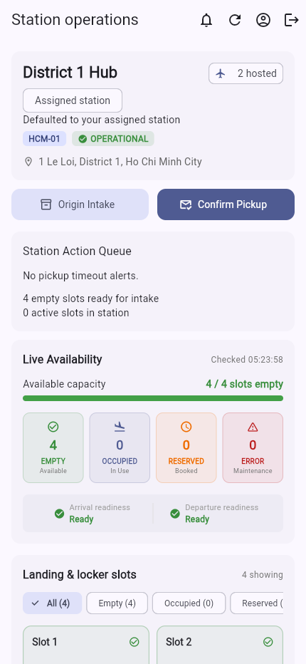
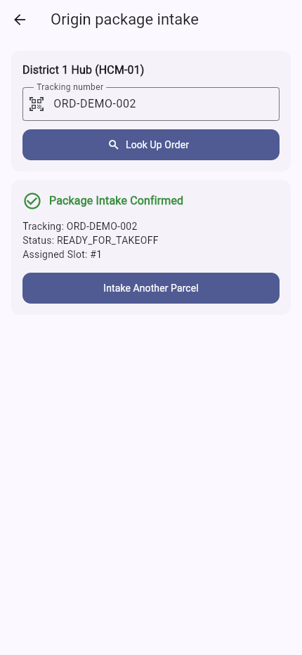
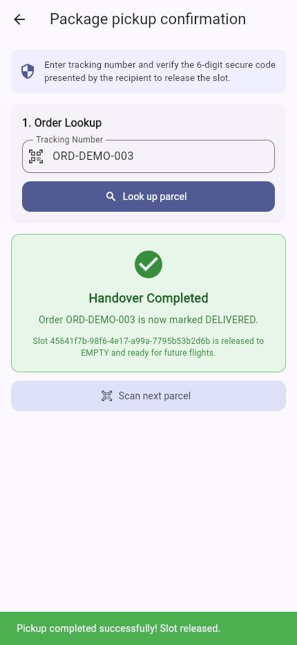

# LA-364 operator completion

PR #278 preserves Nhan's action queue and adds explicit physical inspection, terminal pickup recovery and stale/duplicate-request protection. Primary intake and pickup actions precede the queue. Assigned-station restrictions from LA-367 are retained.

## Verification

- Application source: `6644c6252627329de5bc9034d996e66cd5121caa`, merged develop prerequisite `54d8db94a43bfd59f30cc6e77fa1afc830ca0e72`.
- Flutter 3.47.8 / Dart 3.13.7: **416 tests passed**. Analyzer: 30 pre-existing information-level findings, no warnings/errors; two new braces findings were corrected.
- Chrome 158.0.8127.36, operator entry point, 430 x 932 viewport, real ASP.NET API at loopback port 15064, isolated PostgreSQL database. No HTTP response interception.
- Intake ORD-DEMO-002: declared measurements remained reference-only; actual 2505g / 28x18x12cm and explicit visual acknowledgement were submitted. API returned 200; independent customer read confirmed READY_FOR_TAKEOFF.
- Pickup ORD-DEMO-003: incorrect code returned 400, subsequent correct code returned 200. The secure-code input and obsolete ARRIVED confirmation form disappeared; Scan next parcel was available and executed. Independent customer read confirmed DELIVERED; destination slot 1 was EMPTY with no current order/mission.
- Runtime response traces contain method/path/status only. No entered pickup code or token is stored. No JavaScript page errors. Existing operator unread-notification request returns 403 and is recorded rather than counted as a successful request.
- Controller and widget regressions cover reset/station changes, late responses, duplicate submissions, inspection acknowledgement and code clearing.

## Preconditions and limits

The dedicated database was seeded for this test. Intake scheduling and drone assignment used authorized dispatcher APIs. Pickup ARRIVED state and the linked occupied destination slot were prepared using [the recorded SQL](evidence/la364-operator/arrival-precondition.sql). These are fixture preconditions, not evidence of an executed drone flight or a team rehearsal. Runtime scripts initially needed locator corrections for Flutter's merged accessibility labels; the successful intake POST was not repeated to fabricate another run.

This validates the Flutter operator entry point in a browser, not a native Android/iOS installation. Parent LA-344/customer LA-363, MinIO customer-photo acceptance, AI acceptance and Sprint completion remain separate.

## Evidence

[Full Flutter suite](evidence/la364-operator/flutter-test.txt), [intake requests](evidence/la364-operator/intake-runtime-events.json), [pickup requests](evidence/la364-operator/runtime-events.json), [independent reads](evidence/la364-operator/independent-verification.json).

